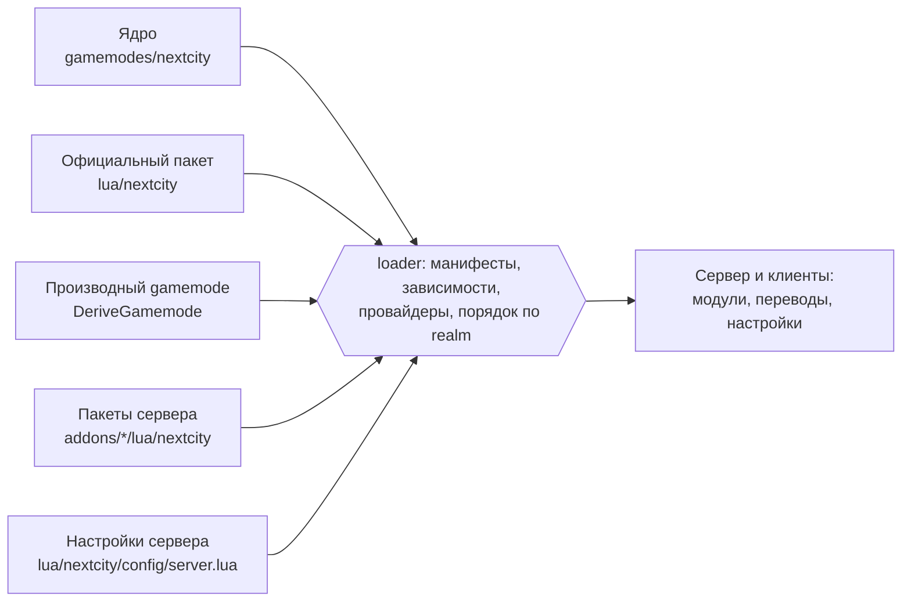
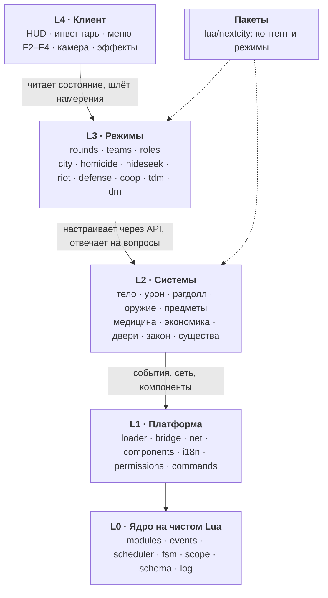
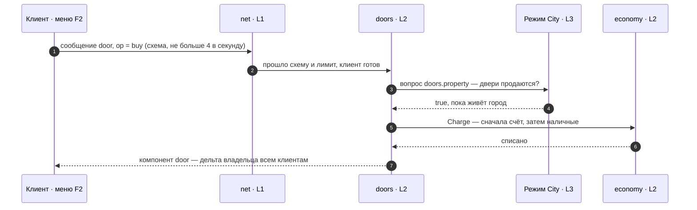
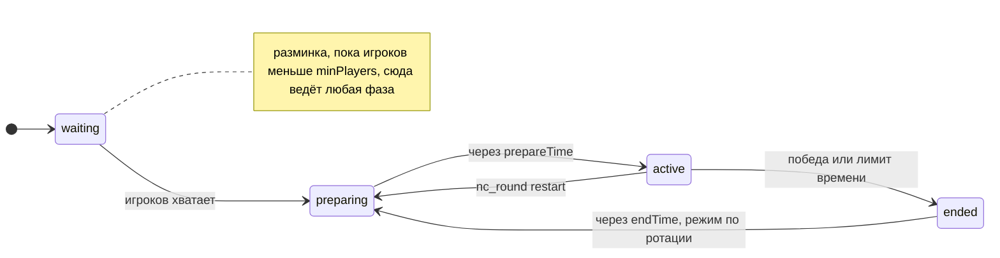

<div align="center">

# Next-City

**Реалистичный модульный gamemode для Garry's Mod — идейный преемник Z-City / Homigrad, написанный с нуля.**

Полная модель тела, физическая баллистика, падение рэгдоллом, инвентарь и медицина, восемь режимов — от Homicide до городского RP — на ядре с бюджетами производительности, сетью по схемам и тестами.

[](docs/ROADMAP.md)
[](https://store.steampowered.com/app/4000/)
[](https://luajit.org/)
[](LICENSE)

[](#разработка)
[](https://github.com/FPtje/GLuaFixer)
[](#модули)
[](#языки)

[](https://github.com/vovawees/Next-City/commits/main)
[](https://github.com/vovawees/Next-City/issues)
[](https://github.com/vovawees/Next-City)

[Быстрый старт](#быстрый-старт) · [Режимы](#режимы) · [Модули](#модули) · [Архитектура](docs/ARCHITECTURE.md) · [Роадмап](docs/ROADMAP.md) · [Как участвовать](CONTRIBUTING.md)

</div>

> [!NOTE]
> **Pre-alpha.** Готовы этапы M0–M7: ядро, сеть, игроки и раунды, организм, рэгдоллы, оружие, инвентарь и медицина, восемь режимов. Всё проверено тестами в эмуляции GMod; впереди замеры на живом сервере и M8 «Сервисы» — права, профили, внешность, чат и голос ([роадмап](docs/ROADMAP.md)).

## Оглавление

- [Почему Next-City](#почему-next-city)
- [Возможности](#возможности)
- [Режимы](#режимы)
- [Быстрый старт](#быстрый-старт)
- [Сборка и настройка сервера](#сборка-и-настройка-сервера)
- [Управление](#управление)
- [Как устроено](#как-устроено)
- [Модули](#модули)
- [Консольные команды](#консольные-команды)
- [Структура репозитория](#структура-репозитория)
- [Языки](#языки)
- [Разработка](#разработка)
- [Документы](#документы)
- [Лицензия](#лицензия)

## Почему Next-City

Z-City и Homigrad задали жанр реалистичного GMod, но выросли в монолиты: логика размазана по глобальным хукам, целые таблицы уходят всем игрокам через `SetNW*`, сотни таймеров живут без контроля. Next-City берёт только игровые идеи и строит их заново — без их кода и ассетов, на ядре с явными контрактами ([раздел 1 архитектуры](docs/ARCHITECTURE.md#1-почему-с-нуля-а-не-форк)).

| | Z-City (грубый подсчёт `grep`) | Next-City |
|---|---|---|
| Логика | ~1 090 `hook.Add`, порядок выполнения не определён | модули с манифестами и зависимостями; одна шина событий с приоритетами; функции `GM:*` — только в мосте |
| Работа по времени | ~620 таймеров, ~87 хуков `Think` / `Tick` | планировщик: своя частота у каждой задачи, профиль `nc_perf`; подписки раунда снимаются вместе с ним |
| Сеть | ~263 сетевые строки, `net.WriteTable`, ~650 `SetNW*` | схемы сообщений с упаковкой в биты, лимиты и проверка всего входящего, репликация компонентов дельтами только своей аудитории |
| Здоровье | ~1 110 прямых правок `*.organism.*` | модель тела за API: системы задают вопросы и шлют события, режимы отвечают |
| Код | ~1 200 мест синтаксиса только GLua (`!=`, `&&`, `continue`) | стандартный Lua 5.1: ядро тестируется вне игры, линтер чистый |
| Контент | зашит в gamemode | ядро без контента: оружие, предметы и режимы — пакеты поверх него |

**Принципы**

| Принцип | Что это значит |
|---|---|
| **Производительность** | бюджеты на тик и кадр для 128 игроков, встроенный профайлер, ноль аллокаций в горячих путях, минимум трафика ([раздел 14](docs/ARCHITECTURE.md#14-производительность)) |
| **Модульность и слои** | каждая механика — модуль с контрактом; модуль, реализация интерфейса или целый слой заменяются без правок остальных |
| **Надёжность** | ошибка модуля не роняет остальные, сервер проверяет всё входящее, загрузка детерминирована, линтер и тесты перед каждым коммитом |
| **Реализм** | смерть решает модель тела, а не HP движка; пули — физические снаряды; упавший — настоящий рэгдолл |
| **Ядро без контента** | сервер собирается из ядра и пакетов: свой контент пишется по тем же правилам, что и официальный |

## Возможности

| Область | Что есть | Модули |
|---|---|---|
| Тело | кровообращение и кровопотеря, дыхание, органы, переломы, боль, шок, сознание; движение по возможностям тела; эффекты на экране | `organism`, `damage`, `movement`, `hud` |
| Броня | классы защиты, покрытие частей тела, заброневая травма, износ | `armor` |
| Падение | серверный рэгдолл в позе момента падения, камера из глаз тела, ползание и хват руками, безопасный подъём, трупы с лимитами | `ragdoll`, `ragdoll_control` |
| Оружие | физические пули одного менеджера (сопротивление, гравитация, пробитие, рикошеты, компенсация задержки); огнестрельное с предсказанием, холодное, метательное с чекой и запалом; кулаки, переноска и бросок тел; взрывы с ударной волной и осколками | `ammo`, `ballistics`, `weapons`, `melee`, `hands`, `throwables`, `explosions` |
| Предметы | вещи как данные, контейнеры и сумки, экран инвентаря, снаряжение по слотам, обыск тел, лут карты и ящики, наборы режимов | `inventory`, `equipment`, `loot` |
| Медицина | повязки, жгуты, шины, дренажи, препараты, реанимация — себе и другим, осмотр раненого | `medical`, `actions` |
| Город | наличные-предмет и банковский счёт, двери как собственность с ключами, отмычки и тараны, розыск, ордера, арест наручниками, тюрьма, обыск | `economy`, `doors`, `law`, `restraints` |
| Раунды | автомат состояний, режимы из блоков правил с типизированными параметрами, команды, скрытые роли, наблюдение, существа для режимов против NPC | `rounds`, `teams`, `roles`, `spectator`, `npcs` |
| Персонаж | профиль между заходами со статистикой, имя и пол персонажа, внешность — модель, скин, бодигруппы и цвет одежды с превью, меню F1 | `profiles`, `identity`, `appearance`, `menu` |
| Платформа | загрузчик модулей и пакетов, мост движка, сеть по схемам, компоненты с репликацией, переводы, права без привязки к админке (ULX и SAM через CAMI), хранилище, уведомления, профайлер | ядро, платформа, `storage`, `notices`, `cami` |

## Режимы

Режим — модуль с типизированными параметрами поверх `rounds`; общие правила (возрождение, команды, тихие смерти) — переиспользуемые блоки ([D9](docs/ARCHITECTURE.md#11-режимы-l3)).

| Режим | `id` | Игроков | Суть | Где |
|---|---|---|---|---|
| [City](lua/nextcity/modules/mode_city/README.md) | `city` | 1+ | бесконечное городское RP: профессии с лимитом мест, снаряжением и зарплатой, магазин профессий, имена и внешность персонажей, форма по полу, двери как собственность, полиция, ордера и тюрьма, меню F4 | пакет |
| [Homicide](lua/nextcity/modules/mode_homicide/README.md) | `homicide` | 3+ | найти убийцу среди мирных: скрытые роли убийцы и шерифа, псевдонимы с их внешностью, варианты `standard`, `gunfree`, `wildwest`, `random` | пакет |
| [Hide and Seek](lua/nextcity/modules/mode_hideseek/README.md) | `hideseek` | 2+ | одни прячутся, пока ищущие ослеплены, потом охота — убить или осалить | пакет |
| [Riot](lua/nextcity/modules/mode_riot/README.md) | `riot` | 2+ | полиция связывает бунтовщиков, бунтовщики отбиваются и освобождают своих | пакет |
| [Defense](lua/nextcity/modules/mode_defense/README.md) | `defense` | 1+ | продержаться против волн существ с передышками; павшие возвращаются после волны | пакет |
| [CO-OP](lua/nextcity/modules/mode_coop/README.md) | `coop` | 1+ | вместе зачистить карту от существ с общими жизнями | пакет |
| [Team Deathmatch](gamemodes/nextcity/gamemode/modules/mode_tdm/README.md) | `tdm` | 2+ | команды набирают очки за убийства, мгновенное возрождение, лимит времени; режим по умолчанию | ядро |
| [Deathmatch](gamemodes/nextcity/gamemode/modules/mode_dm/README.md) | `dm` | 2+ | каждый сам за себя: фраги, мгновенное возрождение, лимиты фрагов и времени | ядро |

Режим выбирается в настройках (`rounds.mode`, ротация — `rounds.rotation`) или из консоли сервера:

```text
nc_round next homicide                    # следующий раунд — Homicide
nc_round restart city                     # перезапустить раунд сейчас, сразу в City
nc_round param homicide variant wildwest  # параметр режима
nc_modes                                  # режимы, их правила и параметры
```

## Быстрый старт

Нужен Garry's Mod с контентом Half-Life 2 — он есть у всех. Нож использует модель Counter-Strike: Source: без неё он работает, но выглядит ошибкой модели.

1. **Установите** репозиторий как аддон — внутри `garrysmod/addons/next-city/` должны оказаться `addon.json`, `gamemodes/` и `lua/`:

   ```sh
   cd garrysmod/addons
   git clone https://github.com/vovawees/Next-City.git next-city
   ```

   Без git — распакуйте [архив ветки `main`](https://github.com/vovawees/Next-City/archive/refs/heads/main.zip) в ту же папку.

2. **Запустите** выделенный сервер (ставится через SteamCMD: `+app_update 4020`):

   ```sh
   ./srcds_run -game garrysmod +gamemode nextcity +map gm_construct +maxplayers 32
   ```

   На Windows — `srcds.exe -console -game garrysmod …`; в своей игре — Next-City в списке gamemode главного меню.

3. **Проверьте** в консоли сервера: `nc_modules` — модули, порядок загрузки и состояние; `nc_perf` — время задач планировщика.

4. **Играйте.** Team Deathmatch начинается с двух игроков — одному поможет бот (`bot` в консоли сервера). Город — `nc_round restart city`.

## Сборка и настройка сервера

Ядро — системы и их API без контента: оружие, патроны, предметы и режимы ставятся пакетами поверх него ([D15](docs/ARCHITECTURE.md#4-модули)). Пакет — обычный аддон с папкой `lua/nextcity/` (`modules/<id>/`, `lang/<язык>/`, `config/`) или производный gamemode (`DeriveGamemode("nextcity")`) с теми же папками в `gamemode/`. Официальный пакет — [`lua/nextcity`](lua/nextcity/README.md) этого репозитория: 16 предметов оружия, 30 предметов медицины и снаряжения, 12 видов врагов и шесть режимов.



Модуль с одним `id` берёт первый пакет по порядку: ядро, производный gamemode, аддоны. Свои настройки сервер кладёт в `garrysmod/lua/nextcity/config/server.lua` — они ложатся последними поверх `config.lua` ядра и настроек пакетов (таблицы сливаются по ключам, списки и значения заменяются), поэтому файлы ядра менять не нужно:

```lua
-- garrysmod/lua/nextcity/config/server.lua
return {
    i18n = { default = "ru" },                          -- язык серверных текстов и запасной
    modules = {
        disabled = { mode_tdm = true },                 -- выключить модуль
        settings = {
            rounds = {
                mode = "homicide",                      -- режим первого раунда
                rotation = { "homicide", "hideseek", "riot" },
                roundsPerMode = 3,
                params = { homicide = { variant = "random", roundTime = 600 } },
            },
            law = { jail = 180 },                       -- настройки любого модуля — из его README
        },
    },
}
```

| Ключ | По умолчанию | Что делает |
|---|---|---|
| `logLevel` | `"info"` | лог в консоли: `trace`, `debug`, `info`, `warn`, `error` или `off` |
| `i18n.default` | `"en"` | язык, если у игрока нет перевода, и язык серверных текстов |
| `i18n.force` | — | один язык для всех, без выбора игрока |
| `net.checkOutgoing` | `false` | сверять исходящие сообщения со схемами (для разработки) |
| `permissions.levels` | `{}` | уровень привилегии вместо объявленного модулем: `[id] = "user" \| "admin" \| "superadmin" \| "nobody"`, например `nc_round = "admin"` |
| `permissions.groups` | `{}` | ранг группы игроков: `[группа] = "user" \| "admin" \| "superadmin"`, например `moderator = "admin"` |
| `permissions.refresh` | `10` | раз в столько секунд права каждого игрока проверяются заново и клиент узнаёт изменения (`0` — не проверять) |
| `modules.disabled` | `{ example = true }` | выключенные модули: `[id] = true` |
| `modules.providers` | `{}` | какая реализация берёт интерфейс, если их несколько: `[интерфейс] = id` |
| `modules.settings` | `{}` | настройки модулей поверх `config` их манифестов: `[id] = { … }` |
| `rounds.mode` | `"tdm"` | режим первого раунда |
| `rounds.rotation`, `rounds.roundsPerMode` | `{}`, `3` | режимы по очереди и раундов на режим |
| `rounds.params` | `{}` | параметры режимов: `{ tdm = { roundTime = 600 } }` |
| `rounds.prepareTime`, `rounds.endTime` | `5`, `8` | секунды подготовки и показа итога |
| `rounds.warmup` | `true` | пока игроков не хватает — свободная разминка |

Права не привязаны к админ-моду: модули объявляют привилегии, а решает тот, кто отвечает на вопрос шины `permissions.can`, — [адаптер CAMI](gamemodes/nextcity/gamemode/modules/cami/README.md) для ULX и SAM или своя админ-панель. Если никто не ответил, уровень привилегии сравнивается с рангом игрока: `user` < `admin` < `superadmin`, а `nobody` — только консоль сервера. Ранг берётся из `permissions.groups` по группе игрока, иначе из `IsSuperAdmin` и `IsAdmin`. Список привилегий и права игрока показывает `nc_privileges`.

Ключи `rounds.*` лежат в `modules.settings`. Настройки каждого модуля описаны в его README, параметры режимов показывает `nc_modes`, а `nc_round param` меняет их на ходу. Файлы настроек уходят клиентам вместе с кодом, поэтому секретов в них не держат.

## Управление

| Клавиша | Действие |
|---|---|
| ЛКМ | выстрел, удар; поднятые кулаки — удар, вещь в руках — бросок; граната — выдернуть чеку и бросить сверху |
| ПКМ | прицеливание; второй удар холодного оружия; опущенные руки — схватить и нести проп или тело; граната — бросок снизу |
| R | перезарядка; кулаки — поднять или опустить; граната с выдернутой чекой — отпустить скобу заранее |
| E + R | режим огня |
| E | поднять вещь, обыскать тело, открыть ящик; с предметом — связать игрока, вскрыть дверь отмычкой или выбить тараном |
| Alt + E | запереть или отпереть дверь, от которой есть ключи |
| C | инвентарь |
| F1 | меню игрока: профиль и статистика, персонаж (имя и пол), внешность (модель, скин, бодигруппы, цвет одежды), настройки (язык), справка по клавишам и командам |
| F2 | меню двери перед глазами |
| F3 | осмотр раненого перед собой или себя |
| F4 | меню города (режим City): профессии, магазин, банк, полиция |
| Shift | бег — оружие опущено |
| Пробел | встать после падения |
| `bind g nc_fall` | упасть или встать по своей клавише |
| Лёжа | мышь — голова, клавиши движения — ползти, ЛКМ и ПКМ — хвататься левой и правой рукой |
| Наблюдение | ЛКМ / ПКМ — следующий / предыдущий игрок, Пробел — сменить камеру |

## Как устроено

Пять слоёв, зависимости только вниз ([D2](docs/ARCHITECTURE.md#3-слои)): системы не знают о режимах, ядро — о GMod. Система задаёт вопрос шины (`doors.property`, `inventory.canMove`), режим на него отвечает — никто не проверяет «какой сейчас режим».



| Слой | Что внутри | Где |
|---|---|---|
| L0 Ядро | `modules` (граф и порядок загрузки), `events` (шина: уведомления и вопросы с приоритетами), `scheduler` (задачи со своей частотой и профилем), `fsm`, `scope` (подписки, которые снимаются разом), `schema` (битовые кодеки), `components` (хранилище и дельты), `params`, `i18n`, `log` | [`gamemode/core/`](gamemodes/nextcity/gamemode/core) |
| L1 Платформа | `loader` и `packages` (модули ядра и пакетов, настройки), `bridge` (единственное место с `GM:*`), `net` (готовность клиента, лимиты, проверка, статистика), `components` (репликация), `i18n` (выбор языка), `permissions` (привилегии и источники прав), `commands`, `devtools`, `boot` | [`gamemode/platform/`](gamemodes/nextcity/gamemode/platform) |
| L2–L4 | модули: системы, режимы и их клиентские части (`cl_*.lua`) | [`gamemode/modules/`](gamemodes/nextcity/gamemode/modules), [`lua/nextcity/modules/`](lua/nextcity/modules) |

**Путь намерения** — например, покупка двери из меню F2:



**Раунд** — автомат состояний `rounds`; режим живёт внутри фаз, его подписки и таймеры снимаются вместе с раундом:



Подробно — в [архитектуре](docs/ARCHITECTURE.md): модули и манифесты, ядро, платформа, сеть и бюджеты, предсказание, игровые системы, режимы, локализация.

## Модули

У каждого модуля — манифест `module.lua` (зависимости, файлы по realm, настройки, сетевые сообщения, компоненты) и README с контрактом. Модуль выключается в `modules.disabled`, реализация интерфейса выбирается в `modules.providers`.

**Ядро** — [`gamemodes/nextcity/gamemode/modules/`](gamemodes/nextcity/gamemode/modules)

| Группа | Модуль | Что делает | Требует |
|---|---|---|---|
| Игроки | [`players`](gamemodes/nextcity/gamemode/modules/players/README.md) | жизненный цикл: подключение, наблюдатель, жив, мёртв; выход в игру и точки появления | — |
| | [`teams`](gamemodes/nextcity/gamemode/modules/teams/README.md) | команды: палитра, баланс, счёт, правила команд для раундов | `players` |
| | [`roles`](gamemodes/nextcity/gamemode/modules/roles/README.md) | роли режимов: знает владелец, союзники или все, раскрытие в конце раунда | `players` |
| | [`spectator`](gamemodes/nextcity/gamemode/modules/spectator/README.md) | наблюдение: камера смерти, слежение за живыми, свободная камера | `players` |
| | [`rounds`](gamemodes/nextcity/gamemode/modules/rounds/README.md) | автомат раунда, реестр режимов и блоков правил с типизированными параметрами | `players` |
| Сервисы | [`storage`](gamemodes/nextcity/gamemode/modules/storage/README.md) | постоянные данные модулей: JSON-файлы папки DATA или SQLite, коллекции с записью на ключ | — |
| | [`profiles`](gamemodes/nextcity/gamemode/modules/profiles/README.md) | профили игроков между заходами: визиты, время в игре, статистика, разделы модулей | — |
| | [`identity`](gamemodes/nextcity/gamemode/modules/identity/README.md) | личность персонажа: имя и пол в профиле, случайные имена новичкам, уникальность, смена с кулдауном, имя вместо ника там, где его включает режим | `players`, `profiles` |
| | [`appearance`](gamemodes/nextcity/gamemode/modules/appearance/README.md) | внешность персонажа: модель из наборов пакетов по полу, скин, бодигруппы и цвет одежды в профиле, вкладка с превью; форма режимов и внешности псевдонимов поверх неё, цвет одежды на телах | `players`, `profiles` |
| | [`menu`](gamemodes/nextcity/gamemode/modules/menu/README.md) | меню игрока на F1: вкладки модулей, настройки (язык), справка по клавишам и командам | — |
| | [`notices`](gamemodes/nextcity/gamemode/modules/notices/README.md) | переведённые сообщения игрокам: всплывающие и в чат | — |
| | [`cami`](gamemodes/nextcity/gamemode/modules/cami/README.md) | права из админок (ULX, SAM) через CAMI: привилегии в админке, решает она; без админки ничего не делает | — |
| | [`actions`](gamemodes/nextcity/gamemode/modules/actions/README.md) | действия со временем: полоса прогресса, отмена движением, уроном, смертью или потерей цели | `players` |
| | [`hud`](gamemodes/nextcity/gamemode/modules/hud/README.md) | минимальный HUD: эффекты тела, состояния, броня, потеря сознания | `organism` |
| | [`example`](gamemodes/nextcity/gamemode/modules/example/README.md) | шаблон нового модуля (по умолчанию выключен) | `organism` |
| Тело | [`organism`](gamemodes/nextcity/gamemode/modules/organism/README.md) | модель тела: травмы, физиология, лечение и смерть | `players` |
| | [`damage`](gamemodes/nextcity/gamemode/modules/damage/README.md) | конвейер урона: урон движка становится попаданиями по телу | `players`, `organism` |
| | [`armor`](gamemodes/nextcity/gamemode/modules/armor/README.md) | бронезащита: классы, покрытие, заброневая травма, износ | `players`, `organism`, `damage` |
| | [`movement`](gamemodes/nextcity/gamemode/modules/movement/README.md) | движение по телу: скорости, бег, прыжки, ползание, без сознания — без управления | `players`, `organism` |
| | [`ragdoll`](gamemodes/nextcity/gamemode/modules/ragdoll/README.md) | упавшие тела: падение, подъём, камера упавшего, трупы | `players`, `organism`, `damage` |
| | [`ragdoll_control`](gamemodes/nextcity/gamemode/modules/ragdoll_control/README.md) | управление упавшим телом: голова за взглядом, ползание, хват руками | `ragdoll`, `organism` |
| | [`medical`](gamemodes/nextcity/gamemode/modules/medical/README.md) | медицина: лечение себя и других предметами и руками, осмотр раненого | `players`, `inventory`, `organism`, `actions` |
| Оружие | [`ammo`](gamemodes/nextcity/gamemode/modules/ammo/README.md) | реестр патронов: калибры, снаряды и типы боеприпасов движка из пакетов | `damage` |
| | [`ballistics`](gamemodes/nextcity/gamemode/modules/ballistics/README.md) | физические снаряды: сопротивление, гравитация, пробитие, рикошеты, попадания | `organism`, `damage`, `ammo` |
| | [`weapons`](gamemodes/nextcity/gamemode/modules/weapons/README.md) | база огнестрельного: спуск, отдача, прицеливание, перезарядка, предсказание | `players`, `organism`, `ammo` |
| | [`melee`](gamemodes/nextcity/gamemode/modules/melee/README.md) | база холодного: замахи и удары по телам и пропам | `players`, `organism`, `damage` |
| | [`hands`](gamemodes/nextcity/gamemode/modules/hands/README.md) | руки каждого игрока: кулаки, переноска пропов и тел | `players`, `organism`, `melee` |
| | [`throwables`](gamemodes/nextcity/gamemode/modules/throwables/README.md) | база метательного: чека, подготовка, бросок, запал, удар | `organism` |
| | [`explosions`](gamemodes/nextcity/gamemode/modules/explosions/README.md) | взрывы: ударная волна по приведённому расстоянию, осколки-снаряды | `players`, `organism`, `damage` |
| Предметы | [`inventory`](gamemodes/nextcity/gamemode/modules/inventory/README.md) | предметы, контейнеры, сумки, вещи на земле, обыск тел, экран инвентаря, наборы | `players` |
| | [`equipment`](gamemodes/nextcity/gamemode/modules/equipment/README.md) | снаряжение: броня, сумки на спине и груди, оружие в руках, патроны и нагрузка | `players`, `inventory` |
| | [`loot`](gamemodes/nextcity/gamemode/modules/loot/README.md) | таблицы лута, ящики и точки карты, где они появляются | `inventory` |
| Город и мир | [`economy`](gamemodes/nextcity/gamemode/modules/economy/README.md) | наличные как предмет, банковские счета, платежи, списания, передача денег | `players`, `inventory` |
| | [`doors`](gamemodes/nextcity/gamemode/modules/doors/README.md) | двери карты: покупка и продажа, замки, совладельцы, таблички, группы карты, отмычки и тараны | `players` |
| | [`law`](gamemodes/nextcity/gamemode/modules/law/README.md) | закон: розыск, ордера, арест наручниками, тюрьма с таймером, обыск | `players` |
| | [`restraints`](gamemodes/nextcity/gamemode/modules/restraints/README.md) | связывание клавишей использования и предметом; связанный беспомощен | `players`, `actions` |
| | [`npcs`](gamemodes/nextcity/gamemode/modules/npcs/README.md) | существа движка: виды и группы, точки карты, появление, охота, убийства | `players` |
| Режимы | [`mode_tdm`](gamemodes/nextcity/gamemode/modules/mode_tdm/README.md) | Team Deathmatch | `rounds`, `teams` |
| | [`mode_dm`](gamemodes/nextcity/gamemode/modules/mode_dm/README.md) | Deathmatch | `rounds`, `players` |

**Официальный пакет** — [`lua/nextcity/modules/`](lua/nextcity/README.md)

| Модуль | Что даёт | Требует |
|---|---|---|
| [`weaponry`](lua/nextcity/modules/weaponry) | 6 видов патронов, 5 стволов, 3 вида холодного и 2 метательного оружия, их предметы и лут | `ammo`, `weapons`, `melee`, `throwables` |
| [`supplies`](lua/nextcity/modules/supplies) | 30 предметов: медицина, броня, сумки, стяжки, наручники, отмычка, таран; таблицы лута, ящики, наборы режимов | `inventory` |
| [`hostiles`](lua/nextcity/modules/hostiles) | 12 видов врагов Half-Life 2 и 6 групп для волн | `npcs` |
| [`wardrobe`](lua/nextcity/README.md#внешность) | 3 набора внешности: горожане, горожанки и беженцы Half-Life 2 | `appearance` |
| [`mode_city`](lua/nextcity/modules/mode_city/README.md), [`mode_homicide`](lua/nextcity/modules/mode_homicide/README.md), [`mode_hideseek`](lua/nextcity/modules/mode_hideseek/README.md), [`mode_riot`](lua/nextcity/modules/mode_riot/README.md), [`mode_defense`](lua/nextcity/modules/mode_defense/README.md), [`mode_coop`](lua/nextcity/modules/mode_coop/README.md) | режимы — см. [таблицу режимов](#режимы) | `rounds`, `players` и др. |

Необязательные зависимости (`optional`) подключают модуль, если он есть: без `loot` нет ящиков, без `weaponry` наборы режимов выдают оружие движка. Новый модуль начинается с копии [`modules/example`](gamemodes/nextcity/gamemode/modules/example/README.md); контент и режимы кладутся в пакет, а не в ядро.

## Консольные команды

Серверные команды, кроме помеченных «все», — привилегии: по умолчанию их могут консоль сервера и суперадмины, а уровень меняется в `permissions.levels` или в админ-моде ([права](#сборка-и-настройка-сервера)). Команды с `_cl` смотрят клиентский realm. Аргументы в `<>` обязательны, в `[]` — нет.

<details>
<summary><b>Платформа и диагностика</b></summary>

| Команда | Что показывает или делает |
|---|---|
| `nc_modules` / `nc_modules_cl` | порядок загрузки, состояние и причина отказа каждого модуля |
| `nc_perf` / `nc_perf_cl` | время каждой задачи планировщика: всего, среднее, максимум, вызовы, ошибки |
| `nc_perf_reset` / `nc_perf_reset_cl` | сброс профиля |
| `nc_net` / `nc_net_cl` | сетевые сообщения: отправлено и принято (штук, байт), отброшено по причинам |
| `nc_net_reset` / `nc_net_reset_cl` | сброс сетевой статистики |
| `nc_components` / `nc_components_cl` | компоненты: аудитория, частота, число записей, трафик |
| `nc_lang [код]` / `nc_lang_cl [код]` | языки и полнота переводов; с кодом — пропуски и ошибки перевода |
| `nc_privileges [игрок]` / `nc_privileges_cl` | привилегии: уровень, модуль, описание; с игроком — его ранг и что ему доступно |
| `nc_cami` | адаптер CAMI: найдена ли CAMI, кто решает (админка или уровни), сколько привилегий отдано |
| `nc_language <код \| auto>` | язык интерфейса (клиент); `auto` — язык игры |
| `nc_storage [flush \| <пространство> [ключ]]` | сохранённые данные модулей |

</details>

<details>
<summary><b>Игроки и раунды</b></summary>

| Команда | Что показывает или делает |
|---|---|
| `nc_players` | игроки и их состояния (наблюдает, жив, мёртв), время возрождения |
| `nc_round` | раунд и параметры; `restart [режим]`, `end`, `next <режим>`, `param <режим> <имя> [значение]` |
| `nc_modes` | режимы, их правила и параметры — все |
| `nc_roles` / `nc_role <игрок> [роль]` | роли игроков / дать роль (`none` — снять) |
| `nc_profile [игрок \| steamid64]` | профиль: визиты, время в игре, статистика — свой все, чужой с правом `profiles.view` |
| `nc_rpname [имя]` / `nc_gender [male \| female]` | имя / пол своего персонажа (раз в кулдаун; первая смена — сразу) |
| `nc_setname <игрок> <имя>` | админ: дать имя персонажу игрока |
| `nc_look [random]` / `nc_looks` | своя внешность (`random` — случайная из своих наборов, раз в кулдаун) / наборы моделей |

</details>

<details>
<summary><b>Тело, медицина и падение</b></summary>

| Команда | Что показывает или делает |
|---|---|
| `nc_organism [игрок]` | тело: кровь, сердце, дыхание, полости, раны, кости, препараты, возможности |
| `nc_hurt <игрок> <вид> [часть] [сила]` / `nc_heal [игрок]` | нанести травму / вернуть здоровое тело |
| `nc_treat <игрок> <вид> [параметр]` | лечение: повязки, жгут, шина, дренажи, препараты, реанимация; без вида — список |
| `nc_damage [число]` | последние попадания: кто, чем, энергия, дистанция, куда, броня, раны |
| `nc_examine` | осмотреть того, кто перед вами, или себя — все, клавиша F3 |
| `nc_ragdoll [игрок] [fall \| up]` | упавшие тела и трупы; уронить игрока или поднять |
| `nc_fall` | упасть или встать (клиент, `bind g nc_fall`) |

</details>

<details>
<summary><b>Оружие и броня</b></summary>

| Команда | Что показывает или делает |
|---|---|
| `nc_ammo [калибр]` | патроны пакетов: масса, скорость, энергия на 0, 100 и 300 м — все |
| `nc_weapons` | оружие пакетов: калибр, магазин, темп, режимы огня, перезарядка — все |
| `nc_melee` | холодное оружие пакетов и его удары: вид, энергия, досягаемость, темп — все |
| `nc_throwables` | метательное пакетов: масса, энергия и скорость броска, запал — все |
| `nc_ballistics` | снаряды в полёте, сколько выпущено, контактов |
| `nc_give <игрок> <класс> [запас]` | выдать оружие: огнестрельное — заряженным и с запасом (по умолчанию два магазина) |
| `nc_explode [заряд кг] [корпус кг] [игрок]` | взрыв там, куда смотришь, или у ног игрока |
| `nc_armor [игрок] [вид \| -слот \| strip]` | броня: показать, надеть, снять слот, снять всё |

</details>

<details>
<summary><b>Предметы, лут и существа</b></summary>

| Команда | Что показывает или делает |
|---|---|
| `nc_inventory` | открыть или закрыть инвентарь (клиент, клавиша C) |
| `nc_items [фильтр]` | предметы пакетов: категория, вес, стопка, размер — все |
| `nc_inv [игрок]` / `nc_item <игрок> <id> [кол-во]` | контейнеры и вещи игрока / выдать предмет |
| `nc_kits` / `nc_kit <игрок> <набор>` | наборы режимов (все) / выдать набор |
| `nc_loot add <ящик \| таблица>`, `remove [радиус]`, `list`, `spawn`, `clear`, `roll <таблица> [раз]`, `tables` | точки лута карты и проверка таблиц |
| `nc_npcs add`, `remove [радиус]`, `list`, `spawn <вид \| группа> [число]`, `clear`, `kinds` | точки и существа карты |

</details>

<details>
<summary><b>Город: профессии, деньги, двери, закон</b></summary>

| Команда | Кто | Что делает |
|---|---|---|
| `nc_job [ключ]` | все | профессии города / сменить профессию |
| `nc_buy [товар [раз]]` | все | магазин своей профессии / покупка |
| `nc_bank [deposit \| withdraw <сумма \| all>]` | все | свой счёт и наличные, внести или снять |
| `nc_givemoney <сумма>` / `nc_dropmoney <сумма>` | все | передать наличные тому, кто перед вами / бросить на землю |
| `nc_door [buy \| sell \| lock \| unlock \| add <игрок> \| remove <игрок> \| title <текст>]` | все | дверь перед глазами |
| `nc_want <игрок> <причина>` / `nc_unwant <игрок>` | полиция, мэр | объявить в розыск / снять розыск |
| `nc_warrant <игрок> <причина>` | мэр (без мэра — полиция) | ордер: можно ломать двери игрока |
| `nc_arrest [игрок]` | полиция | арестовать связанного разыскиваемого |
| `nc_release <игрок>` | полиция, мэр | выпустить из тюрьмы |
| `nc_search [игрок]` | все | обыскать связанного или сидящего |
| `nc_wanted` | все | кто в розыске, на кого ордер, кто сидит |
| `nc_setjob <игрок> <ключ>` | админ | сменить профессию сразу |
| `nc_money [игрок] [set \| add <сумма>]` | админ | счета игроков |
| `nc_doormap [group <имя \| none> \| title <текст \| none> \| closed yes\|no \| release \| list]` | админ | двери карты: группы, таблички, снятие с продажи |
| `nc_jail <игрок> [секунды]` / `nc_jails [add \| clear \| list]` | админ | посадить сразу / точки тюрьмы карты |

</details>

## Структура репозитория

```text
Next-City/
├── addon.json                        # описание аддона для gmad / Workshop
├── gamemodes/nextcity/
│   ├── nextcity.txt                  # метаданные gamemode
│   └── gamemode/
│       ├── init.lua, cl_init.lua, shared.lua   # точки входа
│       ├── config.lua                # настройки ядра по умолчанию
│       ├── core/                     # L0: чистый Lua, тестируется вне игры
│       ├── platform/                 # L1: загрузчик, пакеты, мост GM:*, сеть, компоненты, переводы, команды
│       ├── lang/<код>/               # переводы ядра: _language.lua + файл на модуль
│       └── modules/<id>/             # 39 модулей ядра: module.lua, sh_/sv_/cl_*.lua, README.md
├── lua/nextcity/                     # официальный пакет (D15)
│   ├── modules/<id>/                 # weaponry, supplies, hostiles, wardrobe и шесть режимов
│   └── lang/<код>/                   # их переводы
├── tests/
│   ├── run.lua, bench.lua            # раннер спеков и бенчмарки горячих путей
│   ├── unit/                         # юнит-тесты ядра
│   ├── gmod/                         # эмуляция GMod (env.lua, world.lua) и спеки модулей
│   └── support/                      # строгая замена net (битовый поток) и JSON для эмуляции
├── tools/                            # modmap.lua и apimap.lua: карты модулей и API для .ai/
├── docs/                             # архитектура, стиль кода, роадмап, перевод лицензии
└── .ai/                              # плотные технические заметки для следующих сессий разработки
```

## Языки

Язык выбирается сам по языку игры; вручную — во вкладке «Настройки» меню F1 или `nc_language ru` в консоли клиента (`nc_language auto` — снова язык игры). Сервер может показать всем один язык: `i18n.force` в настройках.

| Код | Язык | Где |
|---|---|---|
| `en` | English — базовый, запасной для остальных | `gamemode/lang/en/`, `lua/nextcity/lang/en/` |
| `ru` | Русский | `gamemode/lang/ru/`, `lua/nextcity/lang/ru/` |

Новый язык — копия папки `lang/en/` под кодом языка (`de`, `pt-br`) в ядре и в пакете: переведите строки и метаданные в `_language.lua` (название, правило множественного числа, запасной язык). `nc_lang <код>` покажет, чего не хватает. Подробности — [раздел 12 архитектуры](docs/ARCHITECTURE.md#12-локализация).

## Разработка

Нужны [LuaJIT 2.1](https://luajit.org/) и [glualint](https://github.com/FPtje/GLuaFixer/releases); сама игра для тестов не нужна. Эмулятор `tests/gmod/env.lua` поднимает сервер и клиентов в отдельных окружениях, как отдельные Lua-состояния: сеть, сущности, кости, трассировки, хуки и таймеры. Клиент видит только файлы, отправленные `AddCSLuaFile`, а `NC` — единственная глобальная переменная проекта.

```sh
luajit tests/run.lua               # все спеки: юнит-тесты ядра и модули в эмуляции GMod
luajit tests/run.lua city          # только спеки, в пути которых есть "city"
luajit tests/bench.lua [nojit]     # бенчмарки горячих путей (nojit — ближе к GMod)
glualint lint gamemodes tests lua  # линтер (настройки в .glualint.json), должен молчать
```

| Что | Сколько |
|---|---|
| Спеки | 63: 11 юнит-тестов ядра, 52 — модули в эмуляции GMod (загрузка обоих realm, сеть, режимы, долгий прогон) |
| Проверки | 556, все проходят; полный прогон ~45 с |
| Код | ~45 тыс. строк Lua в 289 файлах, ~26 тыс. строк тестов |
| Перед коммитом | тесты, линтер и обновлённые документы — [CONTRIBUTING](CONTRIBUTING.md) |

В реальном GMod модули проверяются по чек-листам «Проверить в реальном GMod» в их README; стоимость в игре меряется `nc_perf` и `nc_net`.

## Документы

| Документ | О чём |
|---|---|
| [Архитектура](docs/ARCHITECTURE.md) | ключевые решения D1–D20, слои, модули, ядро, сеть, предсказание, игровые системы, режимы, локализация, бюджеты |
| [Стиль кода](docs/CODESTYLE.md) | правила, производительность, чек-лист ревью |
| [Роадмап](docs/ROADMAP.md) | этапы M0–M9 и их статус |
| [Официальный пакет](lua/nextcity/README.md) | контент и режимы поверх ядра |
| [Как участвовать](CONTRIBUTING.md) | проверки, правила коммитов, вклад |

## Лицензия

[Next-City License 1.0](LICENSE) ([перевод](docs/LICENSE.ru.md)) — исходный код открыт, но это не «open source» в смысле OSI.

- **Можно:** использовать, изменять, бесплатно распространять с указанием авторства, держать серверы — в том числе платные (донат, проходки, привилегии); продавать собственные аддоны, не содержащие кода Next-City.
- **Нельзя:** продавать само ядро и gamemode — исходные или изменённые — и сборки с ними.
- Автор вправе отозвать лицензию у конкретного лица или проекта.
