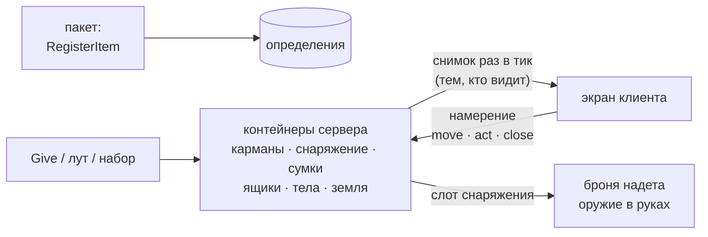

# Архитектура Next-City

> Версия 0.6. Решения D1–D19 приняты; документ обновляется вместе с кодом.

## Ключевые решения

| # | Решение | Статус |
|---|---|---|
| D1 | Пишем с нуля; код и ассеты Z-City/Homigrad не используем | принято |
| D2 | Слои L0–L4, зависимости направлены только вниз | принято |
| D3 | Модули с манифестами, интерфейсами и явным порядком файлов | принято |
| D4 | Ядро — чистый Lua со стандартным синтаксисом, тестируется вне GMod | принято |
| D5 | Сетевые сообщения описываются схемами; частые данные идут пакетной репликацией; без `net.WriteTable` и `SetNW*` | принято (уточнено, раздел 8) |
| D6 | HP движка не используются; смерть определяет модель тела | принято |
| D7 | Наследуемся от `base`, а не от `sandbox` (меньше лишнего кода и хуков) | принято |
| D8 | Совместимости с контентом Z-City/Homigrad нет: свой контент; сторонние аддоны позже портируются на наше ядро | принято |
| D9 | Режимы не зашиты в код: режим — модуль с типизированными параметрами, общие правила — переиспользуемые блоки | принято (раздел 11) |
| D10 | Онлайн сервера — от 32 до 128 игроков; бюджеты считаются для 128 | принято (раздел 14) |
| D11 | Организм — полный реализм с первой версии | принято (раздел 10) |
| D12 | Next-City License 1.0: использовать и изменять может каждый, продавать ядро нельзя, автор может отозвать права у отдельных лиц | принято ([LICENSE](../LICENSE)) |
| D13 | Строки интерфейса — только ключи переводов; переводы лежат в отдельной папке `lang/<язык>/`; язык клиента выбирается автоматически по языку игры или вручную | принято (раздел 12) |
| D14 | Упавшее тело — серверный `prop_ragdoll` в позе момента падения: игрок остаётся живым, скрытым внутри без хитбокса и смотрит глазами тела; модули управляют телом через общий API; труп — тоже серверный рэгдолл | принято (раздел 10) |
| D15 | Ядро без контента: в нём системы и их API, а оружие, патроны, предметы, режимы — модули пакетов поверх ядра (аддоны с `lua/nextcity/` или производный gamemode); сервер собирается из ядра и пакетов | принято (раздел 4) |
| D16 | Пули — физические снаряды одного серверного менеджера (массивы, один цикл за тик, без сущности на пулю) с компенсацией задержки; оружие — данные пакетов на общей базе, его состояние — предсказываемые NetworkVars, огонь предсказывается на клиенте стрелка | принято (раздел 10) |
| D17 | Взаимодействие, чат и голос — вопросы шины: `PlayerUse`, `PlayerCanPickupWeapon` (`false` запрещает), `PlayerSwitchWeapon` (общий, `true` оставляет прежнее оружие), `PlayerSay` (ответ заменяет текст, `""` глушит), `PlayerCanSeePlayersChat`, `PlayerCanHearPlayersVoice` (`true`, `false` или `"3d"`), `HUDDrawTargetID` и `OnPlayerChat` на клиенте (`true` — модуль рисует своё), `PlayerDeathNotice` (`false` — смерть без килфида) | принято (раздел 6) |
| D19 | Роли игроков — общий модуль `roles`: роли регистрируют режимы, владелец знает свою роль всегда, союзники по стороне и все остальные — если роль это разрешает (`visible = self / side / all`), в конце раунда роли раскрываются; клиент получает только то, что ему положено знать | принято (раздел 10) |
| D18 | Предметы — данные: определения регистрируют пакеты, экземпляры `{ uid, id, count, state }` живут только в серверных контейнерах; клиент получает снимки лишь тех контейнеров, которые видит, и отправляет намерения, которые проверяет сервер; надетое и оружие в руках — то, что лежит в слотах снаряжения | принято (раздел 10) |

## 1. Почему с нуля, а не форк

Перед проектированием разобран публичный репозиторий Z-City (`uzelezz123/Z-City`, ветка `main`). Цифры — грубый подсчёт `grep` по Lua-файлам: важен порядок величин, а не точность.

| Что | Сколько | Чем плохо |
|---|---|---|
| Объём Lua | ~219 тыс. строк, ~900 файлов | файлы до 3,5 тыс. строк; режим Homicide — ~1,8 тыс. строк в одном файле |
| `hook.Add` | ~1 090 | логика размазана по глобальным хукам, порядок выполнения не определён |
| хуки `Think` / `Tick` | ~87 | десятки независимых функций каждый кадр/тик, без бюджета |
| покадровые хуки рендера, HUD, `CalcView` | ~76 | конкуренция за кадр и камеру, повторные проходы |
| `util.AddNetworkString` | ~263 | общий лимит 4096 строк на сервер вместе с аддонами; нет схем и валидации |
| `net.WriteTable` | ~73 | медленно, раздуто, опасно для входящих данных |
| `SetNetVar` / `SetNW*` | ~650 | целые таблицы (инвентарь — ~70 мест) уходят **всем** игрокам при каждом изменении |
| `timer.Create` / `timer.Simple` | ~620 | неконтролируемые таймеры, утечки после удаления сущностей |
| прямые обращения `*.organism.*` | ~1 110 | любая подсистема правит внутренности модели здоровья напрямую |
| синтаксис только GLua (`!=`, `&&`, `continue`…) | ~1 200 | несовместим со стандартными Lua-инструментами |

Кроме того: состояние хранится полями на сущностях (`ply.organism`, `ply.FakeRagdoll`, `ply.isTraitor`), realm файла определяется поиском `sv_` по всему пути, порядок загрузки — алфавит `file.Find`, режимы напрямую меняют параметры организма (`ply.organism.stamina.range = 220`).

Вывод: проблемы системные (связность, сеть, планирование работы) — точечной оптимизацией их не исправить.

**Лицензия.** Z-City распространяется под AGPL-3.0. Мы не копируем его код и ассеты, а берём только игровые идеи: механики авторским правом не защищаются, код — защищается.

## 2. Цели и критерии

| Цель | Как проверяем |
|---|---|
| Производительность | бюджеты (раздел 14), профайлер `nc_perf`, нагрузочные прогоны с ботами |
| Модульность | любой модуль отключается в `config.lua`; реализация интерфейса меняется без правок потребителей |
| Слоистость | зависимости только вниз; ядро запускается вне GMod в юнит-тестах |
| Надёжность | линтер, юнит-тесты, тесты модулей в эмуляции GMod, smoke-тест загрузки обоих realm; ошибка модуля не роняет остальные |
| Поддерживаемость | документированные контракты модулей, единый стиль, Conventional Commits |

## 3. Слои

```text
┌────────────────────────────────────────────────────────────────────┐
│ L4 Presentation (client)  HUD, меню, камера, VFX/SFX               │ читает состояние, шлёт намерения
├────────────────────────────────────────────────────────────────────┤
│ L3 Modes                  раунды, режимы, роли, правила            │ настраивает системы через API
├────────────────────────────────────────────────────────────────────┤
│ L2 Systems                organism, damage, ragdoll, weapons,      │ игровые механики
│                           inventory, medical, movement, ...        │
├────────────────────────────────────────────────────────────────────┤
│ L1 Platform               loader, bridge, net, replication,        │ адаптеры к API GMod
│                           storage, permissions, profiler           │
├────────────────────────────────────────────────────────────────────┤
│ L0 Core (pure Lua)        modules, events, scheduler, fsm, log     │ без API GMod
└────────────────────────────────────────────────────────────────────┘
```

Правила:

1. Зависимости направлены только вниз. Системы не знают о режимах, ядро не знает о GMod.
2. Внутри слоя модули общаются через **контракты** — публичный API и события, а не через внутренние поля друг друга.
3. Точки расширения строятся на инверсии управления: система задаёт вопрос (`damage.canHurt`), режим на него отвечает. Система никогда не проверяет «какой сейчас режим».
4. L4 не меняет игровое состояние напрямую — только отправляет намерения (intents) на сервер.
5. Дорогие обращения к API движка проходят через L1, поэтому оптимизируются в одном месте.

## 4. Модули

Модуль — папка `gamemode/modules/<id>/` с манифестом `module.lua`:

```lua
return {
	id = "organism_realistic",  -- уникальный id, snake_case
	provides = "organism",      -- реализуемый интерфейс (по умолчанию = id)
	requires = { "damage" },    -- обязательные интерфейсы
	optional = { "inventory" }, -- необязательные: грузятся раньше, если включены
	files = {                   -- явный порядок загрузки по realm
		sh = { "sh_defs.lua" },
		sv = { "sv_sim.lua" },
		cl = { "cl_view.lua" },
	},
	config = { tickRate = 10 }, -- значения по умолчанию, перекрываются в config.lua
	net = {                     -- сетевые сообщения модуля (раздел 8)
		alarm = { from = "server", fields = { { "kind", "enum", values = { "bleeding", "fracture" } } } },
	},
	components = {              -- данные сущностей с репликацией (раздел 8)
		vitals = { replicate = "owner", fields = { { "pulse", "uint", max = 250 } }, defaults = { pulse = 70 } },
	},
}
```

**Жизненный цикл.** `Init(ctx)` — регистрация определений, сетевых сообщений, конваров (при загрузке, в порядке зависимостей) → `Start(ctx)` — подписки и задачи (в `GM:Initialize`) → `Stop(ctx)` — освобождение (в обратном порядке).

**Состояния:** `resolved` → `initialized` → `started` → `stopped`; а также `disabled` (выключен в конфиге), `inactive` (выбран другой провайдер интерфейса) и `failed` (с причиной).

**Разрешение зависимостей.** Загрузчик собирает манифесты, выбирает провайдера каждого интерфейса, проверяет зависимости и строит детерминированный топологический порядок. Отсутствующая зависимость, цикл или неоднозначный провайдер дают понятную ошибку в отчёте `nc_modules`; проблемный модуль и зависящие от него отключаются, остальные работают.

**Замена реализации.** Потребители зависят от интерфейса (`requires = { "organism" }`), а не от реализации. Реализации `organism_realistic` и `organism_arcade` переключаются одной строкой в `config.lua` (`modules.providers.organism`).

**Контекст `ctx`.** Всё нужное модуль получает через `ctx`, без глобалов:

| Поле | Назначение |
|---|---|
| `ctx.id`, `ctx.config`, `ctx.log` | id, конфиг модуля, логгер с тегом |
| `ctx:Require(iface)` | API другого модуля; ошибка, если интерфейс не объявлен в манифесте |
| `ctx:On(event, fn или "Method", opts)` | подписка; снимается автоматически при `Stop` |
| `ctx:Every(id, interval, fn или "Method", opts)` | периодическая задача; снимается автоматически при `Stop` |
| `ctx:After(delay, fn или "Method")` | одноразовый таймер; отменяется автоматически при `Stop` |
| `ctx:Handler(fn или "Method")` | то же позднее связывание для сервисов (обработчики сети и т.п.) |
| `ctx.net` | сетевые сообщения модуля (раздел 8); обработчики снимаются автоматически при `Stop` |
| `ctx.components` | хранилища компонентов модуля по имени (раздел 8); на клиенте реплицируемые — зеркала только для чтения |
| `ctx.i18n` | переводы (раздел 12) |
| `ctx.commands` | консольные команды модуля: `Add(name, { help, admin }, fn или "Method")`; ответ — строки в консоль вызвавшего; по умолчанию только консоль сервера и суперадмины; снимаются при `Stop` |
| `ctx.events`, `ctx.scheduler` | общие шина событий и планировщик |

Сервисы платформы попадают в `ctx` полями с их именем. Сервис может выдать модулю собственный фасад (`ctx.net` знает id модуля и снимает его обработчики при остановке) и забрать секцию манифеста со своим именем (`net = { ... }`, `components = { ... }`) — она проверяется при регистрации модуля. Сервис, который держит что-то вне ядра (подписки, приёмники сети), освобождает это в `Shutdown`: ядро вызывает его при выключении и при autorefresh, а новый экземпляр забирает состояние старого (например, языки игроков).

Подписка по имени метода (`"OnDamage"`) связывается поздно: после autorefresh файла сразу работает новый обработчик.

**Пакеты (D15).** В ядре — системы и их API, контента в нём нет: оружие, патроны, предметы, режимы — модули пакетов поверх ядра, поэтому разные серверы и режимы собираются из одного ядра. Пакет — папка с `modules/<id>/`, `lang/<код>/` и `config/*.lua`:

| Пакет | Где лежит |
|---|---|
| `core` | сам gamemode: `gamemode/modules`, `gamemode/lang`, `gamemode/config.lua` |
| `<имя>` | активный gamemode, производный от Next-City (`DeriveGamemode("nextcity")`): `gamemodes/<имя>/gamemode/{modules,lang,config}` |
| `addons` | любой аддон и папка `lua/` сервера: `lua/nextcity/{modules,lang,config}` |

Модули и языки ищутся в этом порядке. Модуль с id, который уже есть в предыдущем пакете, не загружается (ошибка в логе): реализацию заменяет модуль с другим id и тем же интерфейсом (`modules.providers`). Переводы пакета добавляются к языкам ядра и могут добавить новый язык; метаданные языка берутся из первого пакета, где они есть. Файлы `config/*.lua` накладываются на `config.lua` ядра в том же порядке, внутри пакета — по имени, `server.lua` — последним: таблицы сливаются по ключам, списки и остальные значения заменяются. Так настройки сервера лежат в `lua/nextcity/config/server.lua`, а файлы ядра не меняются. Файлы настроек уходят клиентам, как и `config.lua`. `nc_modules` показывает пакет каждого модуля не из ядра. Производный gamemode не переопределяет функции `GM:*` (их держит bridge): его логика — тоже модули.

**Изоляция ошибок.** Каждый вызов слушателя, задачи и шага жизненного цикла защищён `xpcall` с трассировкой. Задача, упавшая несколько раз подряд, отключается (circuit breaker) вместо спама в консоль каждый тик.

## 5. Ядро (L0)

Чистый Lua 5.1 / LuaJIT без API GMod; тестируется вне игры (`luajit tests/run.lua`). Синтаксис только стандартный (без `!=`, `&&`, `continue`), чтобы работали обычные Lua-инструменты.

| Компонент | Суть |
|---|---|
| `core/modules.lua` | реестр, выбор провайдеров, топосортировка, жизненный цикл, `ctx` |
| `core/events.lua` | шина: `Emit` — уведомить всех, `Query` — первый не-`nil` ответ (как хуки GMod), `Reduce` — конвейер значения; приоритеты; списки copy-on-write: отписка во время рассылки безопасна, рассылка не аллоцирует |
| `core/scheduler.lua` | периодические задачи с частотой и фазой, одноразовые таймеры (min-heap), профилирование каждой задачи |
| `core/fsm.lua` | конечный автомат: белый список переходов, run-to-completion (переход из колбэка ставится в очередь), защищённые колбэки |
| `core/log.lua` | уровни, теги, ленивое форматирование: строка не собирается, если уровень выключен |
| `core/i18n.lua` | каталоги переводов: цепочки fallback, правила множественного числа CLDR, плейсхолдеры, проверка полноты |
| `core/schema.lua` | типизированные схемы сообщений: кодеки компилируются в замыкания, запись приводит значения к схеме, чтение валидирует, известны границы размера |
| `core/components.lua` | хранилища компонентов: таблица полей на индекс сущности, значения по умолчанию, dirty-маски полей и удалённые ключи для репликации, зеркала только для чтения со слушателями изменений |
| `core/params.lua` | типизированные параметры режимов и правил: значения по умолчанию, границы, перечисления, списки; проверка с исправлением и предупреждением, разбор текста консоли, слияние наборов |
| `core/scope.lua` | области жизни: подписки, задачи, таймеры и колбэки очистки освобождаются вместе; вложенные области (раунд → правила) |

## 6. Платформа (L1)

| Компонент | Суть | Этап |
|---|---|---|
| loader | обнаружение манифестов, `AddCSLuaFile` / `include` по realm, порядок по зависимостям | M0 |
| packages | пакеты поверх ядра (D15): модули, переводы и файлы настроек аддонов (`lua/nextcity/`) и производного gamemode | M5 |
| bridge | единственное место с функциями `GM:*`; хуки движка превращаются в события шины `gm.<Hook>`: уведомления (сначала `base`, потом событие), вопросы (`Query`: первый не-`nil` ответ, иначе решает `base`), замены (`base` не вызывается: `PlayerLoadout`, `PlayerRequestTeam`, клавиши F1–F4 `ShowHelp`, `ShowTeam`, `ShowSpare1`, `ShowSpare2`) и конвейер камеры (`CalcView`: вид `base` по очереди меняют слушатели `gm.CalcView`); объявление смерти (`PlayerDeathNotice`) и строка чата (`OnPlayerChat`) — тоже вопросы | M0, M2, M4, M6, M7 |
| devtools | `nc_modules`, `nc_perf`, `nc_perf_reset`, `nc_lang`, `nc_net`, `nc_net_reset`, `nc_components` | M0 |
| i18n | загрузка `lang/`, выбор языка клиента, язык каждого игрока на сервере | M1 |
| net | сообщения по схемам из манифестов, бит-упаковка, готовность клиента, лимиты, валидация, статистика | M1 |
| components | данные компонентов вне entity-таблиц, автоочистка при удалении сущности; репликация: аудитория, частота, дельты по dirty-маскам, батчинг, полный снимок готовому игроку | M1 |
| commands | консольные команды модулей: проверка прав, ответ в консоль вызвавшего, перехват ошибок, снятие при остановке модуля | M2 |
| persistence | репозитории (профили, статистика): SQLite по умолчанию, MySQL опционально, асинхронный API | M8 |
| permissions | права через CAMI — совместимость с ULX, SAM и др. без жёсткой привязки | M8 |

## 7. Поток данных

```text
клиент: ввод → intent ──net──► сервер: валидация (права, дистанция, кулдаун, rate limit)
                                         │
                                         ▼
                              система меняет состояние ──► события шины ──► режимы и другие системы
                                         │
                                         ▼
                              replication: dirty → батч → только нужной аудитории
                                         │
клиент: read-only зеркало ◄──────────────┘ ──► view-model ──► HUD, камера, эффекты
```

Сервер — единственный источник истины. Клиент хранит read-only зеркало и предсказание.

## 8. Сеть

**Сообщения.** Каждое сообщение — своя сетевая строка `nc.<модуль>.<имя>`. GMod и так находит обработчик по 16-битному id сообщения, поэтому общий канал с вложенным id только добавил бы биты и второй поиск; кроме того, имена видны стандартным инструментам (логгеры net, анти-эксплойт аддоны). Лимит в 4096 строк не мешает: бюджет всего проекта — не больше 256 строк (сверх бюджета — предупреждение в логе). Служебные сообщения платформы — `nc.hello` и `nc.info`: в их именах два сегмента, поэтому они не пересекаются с сообщениями модулей.

Сообщения объявляются данными в манифесте модуля, поэтому оба realm гарантированно используют одинаковые схемы:

```lua
net = {
	state = { from = "server", fields = {
		{ "phase", "enum", values = { "waiting", "preparing", "active", "ended" } },
		{ "endsAt", "float" },
		{ "scores", "array", max = 4, of = { "uint", bits = 16 } },
	} },
	vote = { from = "client", rate = 1, burst = 3, fields = { { "mode", "string", max = 32 } } },
},
```

Ключи сообщения: `from` (`server` или `client`), `fields` (схема), для клиентских — `rate` (сообщений в секунду, по умолчанию 10) и `burst` (сколько подряд, по умолчанию 20), а также `unreliable` и `desc`. Секция проверяется при регистрации модуля: ошибка в схеме отключает модуль с понятной причиной в `nc_modules`.

**Схемы** (`core/schema.lua`, чистый Lua). Типы: `bool`, `uint` и `int` (`bits` или диапазон `min`/`max` → минимум бит), `float`, `double`, `quant` (число в диапазоне, упакованное в N бит), `string` (`max` байт), `enum`, `array` (`of`, `max`), `struct`, `entity` (13 бит), `player` (8 бит), `vector`, `angle`, `normal`, `color`; у любого поля — `optional` (бит присутствия). Кодеки компилируются один раз в замыкания; у схемы известны `minBits` и `maxBits`.

**Отправка:** `ctx.net:Send(имя, игрок или список, данные)`, `Broadcast`, `SendOmit`, `SendPVS`, `SendPAS`, `SendToServer`; **приём** — `ctx.net:Receive(имя, fn или "Method")`, обработчик получает `(data, ply)` и снимается при остановке модуля. При записи значения приводятся к схеме (ограничение диапазона, обрезка строк и массивов, неверная сущность — индекс 0), поэтому ошибка в одном модуле не ломает поток; сверка данных со схемой с предупреждением в лог включается `net.checkOutgoing` в `config.lua`. Клиент не отправляет свои сообщения до hello, а сообщение, которого сервер не знает (модуль упал на сервере), не уходит и пишется в лог.

**Приём на сервере** — данные недоверенные, проверки идут от дешёвых к дорогим:

1. игрок готов (см. ниже), иначе сообщение отбрасывается;
2. token bucket на игрока и сообщение (`rate` в секунду, `burst`);
3. размер сообщения в границах `minBits`/`maxBits` схемы — до разбора;
4. разбор с валидацией: NaN и бесконечность, диапазоны, длины строк и массивов, значения `enum`, существование сущностей;
5. только потом — обработчик модуля, защищённый `xpcall`.

Сообщение неготового игрока — не нарушение: оно отбрасывается и считается. Нарушения (`rate`, `size`, `invalid`) считаются, пишутся в лог не чаще раза в секунду на игрока и публикуются событием `net.violation(ply, сообщение, причина, подробности)`; политику (кик, бан) решает отдельный модуль. Ошибка обработчика пишется в лог и не мешает следующим сообщениям.

**Готовность клиента.** Клиент отправляет `nc.hello` после `InitPostEntity` (и после autorefresh) вместе с клиентской информацией — короткими строками, которые серверу нужны сразу, например язык (`SetInfo` на клиенте, `OnInfo` на сервере; изменения уходят сообщением `nc.info`). Сервер применяет её, помечает игрока готовым и публикует `net.ready(ply)` — модули отправляют ему полное состояние, уже на его языке; клиент после hello публикует `net.ready`. `Send` и `Broadcast` доставляют только готовым игрокам, поэтому сообщения не теряются во время загрузки. `SendPVS` и `SendPAS` — для мгновенных эффектов, без такой проверки. При autorefresh сервера готовые игроки и их информация переходят в новое ядро, и новые модули получают `net.ready` для каждого.

**Компоненты** (`platform/components.lua`, хранилища — `core/components.lua`). Данные сущностей — показатели организма, инвентарь, профиль — объявляются в секции `components` манифеста и живут в хранилищах платформы, а не в таблицах сущностей: чтение — обычная таблица по индексу сущности без медленного `__index` сущности, а при удалении сущности (`EntityRemoved`) её данные удаляются сами.

```lua
components = {
	vitals = { replicate = "owner", rate = 10, fields = {
		{ "blood", "quant", min = 0, max = 5000, bits = 12 },
		{ "pulse", "uint", max = 250 },
	}, defaults = { blood = 5000, pulse = 70 } },
},
```

```lua
local vitals = ctx.components.vitals  -- ключи: сущности или их индексы
vitals:Add(ply)                       -- значения по умолчанию, затем переданные
vitals:Set(ply, "pulse", 120)         -- true, если значение изменилось; поле помечается
vitals:Get(ply).blood                 -- чтение; в горячем цикле можно писать в таблицу и вызвать Touch
vitals:OnChange("OnVitals")           -- клиент: M:OnVitals(index, data, mask)
```

Поля записываются в синтаксисе схем: до 31 поля, без `optional` — у поля всегда есть значение. Без значения по умолчанию поле начинается с нулевого: `false`, `0` (или ближайшая к нулю граница диапазона), `""`, первое значение `enum`, пустой массив, `NULL`, нулевые вектор и угол; для `struct` и `color` значение по умолчанию обязательно.

**Репликация.** Без `replicate` у каждого realm своё локальное хранилище. `all` — данные получают все готовые игроки; `owner` — только игрок, чья это сущность (ключи — игроки): чужие показатели организма не уходят тем, кому их видеть не положено, — меньше трафика и нечего читать читерам. Аудитории `team` и `pvs` добавятся, когда их потребуют режимы со скрытой информацией. Изменение поля помечает его в dirty-маске; `rate` раз в секунду (по умолчанию 10) сервер отправляет удалённые ключи и по каждому изменённому ключу только изменённые поля — бит присутствия на поле, значения квантуются по схеме. Для `all` это одно сообщение всем готовым игрокам, для `owner` — по сообщению каждому владельцу; ничего не изменилось — ничего не отправляется. Готовый игрок (`net.ready`) сначала получает полный снимок — раньше сообщений, которые модули отправляют ему по `net.ready`. Каждый реплицируемый компонент — одно сетевое сообщение `nc.<модуль>:<компонент>` со схемой из его полей; большие пакеты делятся на сообщения не больше 16 КиБ, а компонент, одна запись которого в них не помещается, отклоняется при регистрации. На клиенте реплицируемый компонент — зеркало только для чтения: `OnChange` сообщает, какие поля пришли (`data = nil` — ключ удалён), ошибка слушателя пишется в лог и не мешает остальным. При autorefresh данные сохраняются, если поля компонента не изменились. `nc_components` показывает хранилища: аудиторию, частоту, число записей и трафик.

**Статистика:** `nc_net` — по каждому сообщению отправлено и принято (штук и байт), отброшено по причинам (`notReady`, `rate`, `size`, `invalid`, `noHandler`, `unpooled`) и ошибки обработчиков; `nc_net_reset` — сброс.

## 9. Предсказание

- Всё, что влияет на движение (выносливость, переломы ног, сознание, позже перегруз), клиент знает из реплицированных данных своего тела (`vitals`), а ограничения команд считает тот же shared-код, что и на сервере (`movement`): предсказание совпадает с сервером, нет rubber-banding. Скорости ставит сервер, движок передаёт их клиенту сам.
- Стрельба shared и predicted: состояние оружия (режим, очередь, перезарядка, прицеливание, разогрев) — предсказываемые NetworkVars, случайность — `util.SharedRandom` от номера команды, эффекты и подъём взгляда — при `IsFirstTimePredicted`, патроны запаса движка клиент предсказывает сам. Снаряд выпускает сервер: часть полёта, которую скрывает пинг стрелка, пролетает под `LagCompensation`.

## 10. Игровые системы (L2)

### players — жизненный цикл игрока

Состояния `connecting → spectator → alive ⇄ dead` в реплицируемом компоненте: клиенты видят состояние и время возрождения каждого игрока. В игру попадают только через `Deploy`; любое другое появление (первое появление движка, автовозрождение базового режима) делает игрока наблюдателем. Точка появления — свободная и подальше от противников (при равенстве по кругу), при занятых точках — свободное место рядом; режимы влияют на выбор через вопрос `players.spawnPoint`. Раунды и режимы работают поверх этого API, а не через `ply:Spawn()`.

### teams — команды

Палитра до четырёх команд, распределение в самую маленькую, счёт с объединением изменений за тик в одно сообщение. Режимам команды достаются блоками правил: `teams` (число команд, огонь по своим, стороны появления), `team_elimination`, `team_score`. Названия команд на раунд задаёт режим (`teamNames`: «Полиция» и «Бунтующие» вместо палитры). Подробности — в [README модуля](../gamemodes/nextcity/gamemode/modules/teams/README.md).

### roles — роли

Роли регистрируют режимы: скрытые (убийца, шериф) и публичные (профессии города). Сервер хранит, у кого какая роль, и каждому клиенту отправляет только то, что тот знает: свою роль, роли союзников (`visible = "side"`) и публичные (`"all"`), а после конца раунда — все. Раздача по количествам (`Deal`), правило `roles` (раскрытие в конце, снятие при очистке), HUD своей роли и баннер «Вы — Убийца». Подробности — в [README модуля](../gamemodes/nextcity/gamemode/modules/roles/README.md).

### spectator — наблюдение

Камера смерти, затем наблюдение за живыми (глазами, со стороны) или свободная камера. Цели выбирает и проверяет сервер: с `teamOnly` — только живые товарищи, пока они есть; режимы запрещают цели вопросом `spectator.canObserve`. Камеры перепроверяются после изменений и дважды в секунду. Подробности — в [README модуля](../gamemodes/nextcity/gamemode/modules/spectator/README.md).

### organism — модель тела

- Тело задаётся данными: сегменты (голова, шея, торс, руки, ноги) на костях модели игрока, в них капсулы структур — кожа и мягкие ткани, органы, кости скелета, крупные сосуды, спинной мозг. Попадание — луч сквозь структуры: снаряд теряет энергию в каждой, ранит по виду (пуля, осколок, клинок, удар, падение, взрыв, ожог, яд).
- Полный реализм с первой версии (D11). Состояние: объём крови и кровотечения (артериальные, венозные, внутренние, в полости), давление, пульс и ритм сердца (вплоть до фибрилляции и остановки), дыхание и насыщение кислородом (в том числе напряжённый пневмоторакс), органы (мозг, сердце, лёгкие, печень, почки, селезёнка, желудок, кишечник), переломы и вывихи, спинной мозг, боль, шок, сознание, адреналин, выносливость, температура, токсины и препараты. Смерть — гибель мозга (прямой урон или гипоксия); убийцей считается тот, кто нанёс большую часть травм.
- Симуляция с фиксированной частотой (по умолчанию 10 Гц); тела распределены по тикам, поэтому нагрузка равномерна.
- Шаги симуляции — упорядоченный конвейер (препараты → кровотечение → кровообращение → дыхание → мозг → нервы → сознание → выносливость → температура); каждый шаг заменяем.
- **Выход — производные возможности, а не сырые поля:** `moveSpeedMul`, `canStand`, `canJump`, `canSprint`, `canUseArmL/R`, `aimSway`, `recoilMul`, `visionBlur`, `unconscious` — и компонент `vitals` (только владельцу, 10 Гц) с флагами состояний для HUD. Движение, оружие и HUD читают только их, поэтому внутренности модели можно менять, не ломая потребителей.
- Лечение (повязки, жгут, шина, препараты, растворы, реанимация) идёт через API организма (`ApplyTreatment`), без прямых правок полей. Подробности — в [README модуля](../gamemodes/nextcity/gamemode/modules/organism/README.md).

### damage — конвейер урона

Урон движка становится попаданиями по телу, здоровье движка у игроков не меняется никогда (D6). Пуля — попадание на каждую дробину со снарядом своего боеприпаса (масса, скорость с учётом дистанции, диаметр, проникание, бронебойность). Попадание проходит стадии по порядку: `localize` (куда входит луч) → `armor` → `wound` (API организма) → `impulse` (тряска камеры, толчок) → `notify` (`damage.hit`, история `nc_damage`). Стадии добавляются и заменяются модулями; модули оружия и взрывов наносят попадания напрямую (`damage:Inflict`). Подробности — в [README модуля](../gamemodes/nextcity/gamemode/modules/damage/README.md).

### armor — бронезащита

Слои в слотах (шлем, жилет, пластины) с классом защиты, материалом и зоной покрытия. Пуля против слоя: угроза (энергия, диаметр, бронебойность) против защиты класса, ниже у изношенного слоя; остановленная бьёт запреградной травмой, пробившая летит дальше с остатком энергии. Клинки и удары встречает материал, осколки взрыва — каждый по отдельности. Режимы надевают броню при появлении (параметр `armor` у TDM). Подробности — в [README модуля](../gamemodes/nextcity/gamemode/modules/armor/README.md).

### movement — движение по телу

Скорости движка и ограничения команд игрока — из возможностей организма: медленнее с ранами, без бега и прыжка, ползком, когда не держат ноги, без ввода без сознания. Ограничения считает общий код: сервер и предсказание клиента обрезают команды одинаково. Подробности — в [README модуля](../gamemodes/nextcity/gamemode/modules/movement/README.md).

### hud — минимальный HUD

Без чисел здоровья: экран теряет цвет, темнеет по краям и плывёт по `vitals`, без сознания — чёрный с подсказкой, когда можно сдаться; строки состояний тела и надетая броня. Тексты пересобираются по событиям, не каждый кадр. Подробности — в [README модуля](../gamemodes/nextcity/gamemode/modules/hud/README.md).

### ragdoll — «фейк»

Упавший игрок — серверный `prop_ragdoll` в позе момента падения (D14): игрок жив, скрыт внутри без хитбокса и смотрит глазами тела; организм читает попадания и дыхание с рэгдолла. Подробности — в README модулей [`ragdoll`](../gamemodes/nextcity/gamemode/modules/ragdoll/README.md) и [`ragdoll_control`](../gamemodes/nextcity/gamemode/modules/ragdoll_control/README.md).

- Состояния тела: `standing → fallen | unconscious → getting_up → standing`, из любого — `dead` (труп). Падают, потеряв сознание или когда не держат ноги, от сильного удара, взрыва или жёсткого приземления, по желанию (`nc_fall`) и по команде админа — на следующем такте, вне вызова движка, который уронил.
- Управление телом — отдельные модули поверх общего API тела (`ragdoll:Body(ply)`: физобъекты по костям, клавиши игрока, которые не доходят до движка). `ragdoll_control`: голова поворачивается за взглядом в пределах шеи, тело ползёт на руках, руки хватаются за мир и предметы. Стрелять и пользоваться предметами лёжа — вместе с инвентарём (M6).
- Производительность: физобъекты костей кэшируются при падении; скрытый игрок догоняет тело 20 раз в секунду, управление — 30; тел и трупов вместе не больше 64, трупов — 24 (новый вытесняет старейший), очистка — не больше бюджета за проход, труп в покое засыпает и перестаёт сталкиваться с игроками и телами.
- Безопасный подъём: пол под тазом и хитбокс игрока на нём так, как мир видит движение игрока, иначе — точки на кольцах вокруг таза в прямой видимости; место перепроверяется в конце подъёма, без места игрок остаётся лежать; движущееся тело не встаёт.

### Оружие: ammo, ballistics, weapons, melee, hands, explosions, throwables

- **ammo** — реестр патронов пакетов: калибр, масса, скорость, диаметр, проникание, дальность (сопротивление воздуха), бронебойность, дробь. Каждый тип — тип боеприпаса движка (`game.AddAmmoType`) и снаряд конвейера урона, поэтому и чужие пули движка этого типа ранят как он. Подробности — в [README модуля](../gamemodes/nextcity/gamemode/modules/ammo/README.md).
- **ballistics** — физические снаряды (D16): один серверный менеджер, снаряды в массивах, один цикл за тик. Сопротивление воздуха в замкнутом виде, гравитация, вода; пробитие материалов по энергии и толщине, рикошеты; попадания по телам через `damage:Inflict`, остаток энергии летит дальше. Выстрел в команде стрелка догоняет его пинг под компенсацией задержки. Подробности — в [README модуля](../gamemodes/nextcity/gamemode/modules/ballistics/README.md).
- **weapons** — база огнестрельного оружия `nc_firearm`. Определение оружия — данные пакета (калибр, магазин, темп, режимы огня, точность, отдача, прицел, перезарядка, анимации и звуки); база исполняет их как скриптовое оружие с состоянием в предсказываемых NetworkVars (`idle`, `draw`, `reload`, перезарядка по патрону). Разброс, раскачка и отдача — от ствола, движения, разогрева и возможностей организма (`aimSway`, `recoilMul`, руки, сознание). Патроны перезарядки — из подключаемого источника: по умолчанию запас движка, с модулем `equipment` — патроны-предметы из карманов, разгрузки и сумок. Представление (viewmodel в прицеле, поле зрения, опускание на бегу) — только на клиенте. Подробности — в [README модуля](../gamemodes/nextcity/gamemode/modules/weapons/README.md).
- **melee** — база холодного оружия `nc_melee`: удары — данные пакета (вид раны, энергия, досягаемость, замах, восстановление, выносливость). Удар ищет цель лучом, затем объёмом; по телу бьёт через `damage:Inflict` с глубиной клинка, пропам наносит урон движка. Состояние удара — в предсказываемых NetworkVars, силы тратит `organism:Exert`. Подробности — в [README модуля](../gamemodes/nextcity/gamemode/modules/melee/README.md).
- **hands** — руки каждого игрока на базе `melee`: поднятые — кулаки, опущенные переносят и бросают пропы и тела (тяга не сильнее рук и не чаще раза за тик физики, тяжёлое тратит выносливость). Модуль можно выключить. Подробности — в [README модуля](../gamemodes/nextcity/gamemode/modules/hands/README.md).
- **explosions** — один API для зарядов пакетов (`Explode`): ударная волна по приведённому расстоянию бьёт по телам через `damage:Inflict`, корпус разлетается осколками `ballistics` (скорость по Гёрни), взрыв движка толкает и ломает остальное. Подробности — в [README модуля](../gamemodes/nextcity/gamemode/modules/explosions/README.md).
- **throwables** — база метательного `nc_throwable`: чека, бросок сверху и снизу по энергии и массе, подготовка с запалом в руке, ударный взрыватель. Брошенный предмет — физический проп под присмотром сервера; что делает срабатывание, решает функция пакета (например, `explosions:Explode`). Подробности — в [README модуля](../gamemodes/nextcity/gamemode/modules/throwables/README.md).
- Базы и API — в ядре, конкретное оружие, патроны и заряды — в пакетах (D15).

### Предметы: inventory, equipment, medical, loot

Предметы — данные (D18). Пакет регистрирует определение (`inventory:RegisterItem`: вес, стопка, размер, категория, черты других модулей — `weapon`, `ammo`, `armor`, `medical`, `container`, `wear`), экземпляр `{ uid, id, count, state }` живёт только в серверном контейнере: карманах, снаряжении, сумке, ящике, на теле или на земле. Клиент получает снимок контейнера, только пока видит его (свой — всегда, чужой — пока открыт и в досягаемости), и отправляет намерения: переложить, взять, глагол предмета; сервер проверяет досягаемость, размер, вес и вложенность.



- **inventory** — предметы, контейнеры, сумки, вещи на земле, места для обыска (ящики, тела погибших), глаголы предметов, наборы для режимов (`RegisterKit`, `GiveKit`) и экран инвентаря. Подробности — в [README модуля](../gamemodes/nextcity/gamemode/modules/inventory/README.md).
- **equipment** — снаряжение: слоты шлема, жилета, пластин, рюкзака, разгрузки и оружия. Броня надета, пока её предмет в слоте; оружие в руках, пока предмет в слоте; перезарядка берёт патроны-предметы; вес несомого замедляет. Подробности — в [README модуля](../gamemodes/nextcity/gamemode/modules/equipment/README.md).
- **medical** — лечение предметами и руками себя и других (стоящих, упавших, тел): осмотр с отчётом и вариантами помощи, время лечения через `actions`, расход предмета. Подробности — в [README модуля](../gamemodes/nextcity/gamemode/modules/medical/README.md).
- **loot** — таблицы лута (взвешенные выпадения, вложенные таблицы), виды ящиков и точки карты в `storage`; правило раунда `loot` расставляет ящики и россыпь. Подробности — в [README модуля](../gamemodes/nextcity/gamemode/modules/loot/README.md).
- Опоры: **actions** (действие со временем и полосой прогресса, прерывается раной, уходом, смертью), **notices** (короткие сообщения на языке игрока), **storage** (данные, которые переживают перезапуск: JSON на пространство имён).
- **restraints** — связывание: клавиша `E` на игроке (или его теле) с предметом черты `restraint` связывает за время через `actions`, на связанном — развязывает; связанный без оружия, атак, бега и инвентаря; кто кого вправе связать — вопросы `restraints.canTie` / `canUntie` к режимам. Подробности — в [README модуля](../gamemodes/nextcity/gamemode/modules/restraints/README.md).
- **npcs** — существа для режимов: виды (класс `npc_*`, оружие, здоровье, меткость) и группы видов с весами регистрируют пакеты; точки появления на карте ставит админ (`nc_npcs`, `storage`); режим создаёт волны под своей меткой (`SpawnGroup`) подальше от игроков, забирает существ карты (`Adopt`), узнаёт об убийствах (`npcs.killed`); существа без врага бегут к ближайшему игроку, живых не больше `maxAlive`. Подробности — в [README модуля](../gamemodes/nextcity/gamemode/modules/npcs/README.md).
- **economy** — деньги: наличные — предмет инвентаря (карманы, земля, тело погибшего, кража), банковский счёт игрока в `storage`; режимы платят на счёт (`Pay`) и списывают (`Charge`: сначала счёт, затем наличные), игроки вносят, снимают, передают из рук в руки и бросают наличные. Подробности — в [README модуля](../gamemodes/nextcity/gamemode/modules/economy/README.md).
- Конкретные предметы, таблицы, ящики и наборы — в [официальном пакете](../lua/nextcity/README.md) (D15).

### Позже

позы и движения тела (наклоны), identity и appearance (одежда, аксессуары), chat и voice (proximity с кэшем матрицы слышимости), killfeed и karma, admin (CAMI), интеграции (транспорт и т.п.) через адаптеры.

## 11. Режимы (L3)

Режимы не зашиты в код (D9). Системный модуль `rounds` ведёт автомат раунда, реестр режимов и блоков правил и их параметры; режим — обычный модуль (`mode_tdm`, `mode_dm`, `mode_homicide`, …), который регистрирует описание через API `rounds`. В гейммоде — эталонные режимы из одних правил: командный `mode_tdm` и «каждый сам за себя» `mode_dm`; остальные — в официальном пакете. Новый режим — новая папка в `modules/`, без правок ядра и других режимов. Подробности API — в [README модуля](../gamemodes/nextcity/gamemode/modules/rounds/README.md).

**Автомат раунда** (`core/fsm.lua`): `waiting` (мало игроков, разминка) → `preparing` (очистка карты, участники, спавн, заморозка) → `active` → `ended` (итоги) → `preparing`…; из любой фазы — `waiting` (игроки ушли, режим пропал). Тайминги — настройки модуля. Урон есть только в разминке и в `active`, где его решают режим и правила.

```lua
-- modules/mode_tdm/sv_tdm.lua
local M = NC.Module("mode_tdm")

function M:Init(ctx)
	ctx:Require("rounds"):RegisterMode({
		id = "tdm",
		name = "mode_tdm.name",                   -- ключ перевода
		minPlayers = 2,
		rules = { "time_limit", "teams", "team_score", "respawn", "team_elimination" },
		params = {
			roundTime = { type = "number", default = 600, min = 60, max = 3600, desc = "длительность раунда, с" },
			scoreLimit = { type = "integer", default = 50, min = 1, max = 1000 },
		},
		Loadout = function(round, ply) end,       -- снаряжение
		CheckWin = function(round) end,           -- итог или nil
	}, ctx)                                       -- режим уходит вместе с модулем
end
```

```lua
-- config.lua
settings = {
	rounds = {
		mode = "tdm",                      -- режим по умолчанию
		rotation = { "tdm", "homicide" },  -- ротация
		params = { tdm = { roundTime = 900, friendlyFire = true } },
	},
},
```

**Параметры типизированы** (`core/params.lua`): тип, значение по умолчанию, границы, описание. Значения раунда: по умолчанию → `params` из `config.lua` → `nc_round param` из консоли. Неверный тип заменяется значением по умолчанию, выход за границы ограничивается — оба случая с предупреждением в логе.

**Блоки правил.** Общие куски логики — переиспользуемые правила с теми же колбэками, что у режима, и собственными параметрами; режим собирается из правил и добавляет только своё (и может поменять значение по умолчанию параметра правила, объявив его у себя). Встроенные: `time_limit`, `respawn` (мгновенно, волнами или без возрождения), `last_standing`, `silent_deaths` (смерти без килфида), `dead_mute` (живые не слышат мёртвых и наблюдателей); модуль `teams` добавляет `teams`, `team_elimination`, `team_score`, модуль `roles` — `roles`, модуль `loot` — `loot`.

**Колбэки.** Уведомления идут сначала правилам по порядку, затем режиму: `Setup`, `PlayerAdded`, `Start`, `Think` (с частотой режима, а не каждый тик), `PlayerSpawned`, `Loadout`, `PlayerDied`, `PlayerLeft`, `End`, `Cleanup`. Вопросы задаются сначала режиму, затем правилам, побеждает первый ответ: `Participants`, `LateJoin`, `SpawnPoint`, `CheckWin`, `Timeout`, `ShouldTakeDamage`. Неизвестный ключ в описании — ошибка регистрации; ошибка в колбэке пишется в лог, раунд продолжается.

**Объект раунда** передаётся во все колбэки: `round.params` (проверенные значения), `round.data` и `round:RuleData(id)` (данные режима и правил), участники, возрождения, лимит времени, строка состояния под таймером (`round:SetStatus`: ключ перевода с параметрами и обратным отсчётом — «Волна 2 из 5 через 0:20» — у всех клиентов, опоздавших тоже), `round:CheckWin()`, `round:End(result)`. Подписки раунда (`round:On`, `Every`, `After`, `Defer`) живут в его области (`core/scope.lua`) и снимаются вместе с раундом — нет глобальных хуков, которые на каждый вызов выясняют текущий режим. Вопросы других систем (`players.spawnPoint`, `gm.PlayerShouldTakeDamage`, позже `damage.*`, `inventory.*`) `rounds` переводит в вопросы режима, не меняя внутренности систем.

**Итог раунда** — таблица `{ reason, key, team, winner }`: `key` — победитель для баннера (`win.team`, `win.innocents`…), `reason` — причина; если в `reason` есть точка, это ключ перевода режима (`mode_homicide.reason.fled`), иначе встроенная причина `rounds`.

**Режимы пакета.** Режим не обязан жить в гейммоде: официальный пакет `lua/nextcity` (D18) несёт свои режимы (`mode_homicide`, `mode_hideseek`, `mode_riot`, `mode_defense`, `mode_coop`) как обычные модули с манифестом. Режим собирается из платформы: роли (`roles`) со сторонами и видимостью, имена игроков (вопрос `players.name` — позывные Homicide), наборы снаряжения (`inventory:GiveKit`), фильтр лута (`loot.allow` в `Setup`), тихие смерти и немота мёртвых (правила `silent_deaths`, `dead_mute`). Вариант режима (`standard`, `gunfree`, `wildwest`, `random`) — обычный параметр, его значение раунд разрешает в `Setup`. Фазы внутри раунда (прятки перед охотой) режим ведёт сам таймерами раунда (`round:After`) и своим сетевым сообщением; команды с именами режима — параметр `teamNames` правила `teams`, а счёт команд режим может занять своим смыслом (в прятках — число живых, в бунте — стоящих на ногах). Режим отвечает на вопросы модулей ядра в своих подписках раунда: бунт через `restraints.canTie` и `restraints.canUntie` даёт связывать только чужих и развязывать только своих, а связанного считает выбывшим. Режимы против существ (оборона, кооператив) берут виды и группы врагов из пакета (`hostiles`) и ведут их через модуль `npcs`: метка режима, `SpawnGroup` подальше от игроков, NPC карты под меткой (`Adopt`), событие `npcs.killed`; отсчёт передышки и число оставшихся врагов — строка состояния раунда, итог с параметрами (`params` в `round:End`) — «Все пали на волне 3 из 5».

## 12. Локализация

В Z-City и большинстве режимов переводов нет: строки зашиты в код на одном языке. У нас каждая строка интерфейса — ключ перевода (D13).

**Файлы** лежат в отдельной папке `gamemode/lang/`: подпапка на язык, файл на пространство имён — id модуля или `common`:

```text
lang/
├── en/
│   ├── _language.lua   # метаданные языка
│   ├── common.lua
│   └── rounds.lua
└── ru/
    ├── _language.lua
    ├── common.lua
    └── rounds.lua
```

```lua
-- lang/ru/_language.lua
return { name = "Русский", english = "Russian", plural = "east_slavic", fallback = "en" }

-- lang/ru/rounds.lua: ключи становятся "rounds.<ключ>"
return {
	win = "Победила команда {team}",
	["hud.time"] = "Осталось: {time}",
	players = { one = "{count} игрок", few = "{count} игрока", many = "{count} игроков" },
}
```

Новый язык — копия папки `lang/en/` под своим кодом; перевод модуля — файл с его id в папке каждого языка. Переводчику не нужно читать код.

**Выбор языка на клиенте:** консольная переменная `nc_language` (сохраняется у игрока): `auto` — язык игры (`gmod_language`), или явный код (`ru`, `en`, …). Порядок поиска строки: выбранный язык → родительский (`pt-br` → `pt`) → fallback из метаданных → язык сервера по умолчанию → сам ключ (так видно, чего не хватает; пропуск пишется в лог один раз). Смена языка применяется сразу, без переподключения: событие `i18n.changed` перерисовывает интерфейс. Сервер может задать язык для всех (`i18n.force` в `config.lua`).

**Сервер** загружает все языки, клиент — только языки своей цепочки и подгружает новые при смене. Клиент сообщает серверу свой язык, поэтому сервер может собрать текст для конкретного игрока (`ctx.i18n:TFor(ply, key, params)`) — для кика, чата, консоли; пока сообщения нет, используется язык сервера (`i18n.force` или `i18n.default`). В остальных случаях сервер отправляет ключ и параметры, а текст собирает клиент на своём языке.

Битый файл перевода (ошибка, не таблица, неверный ключ или форма) пишется в лог и пропускается — остальные строки и языки работают. Папка с именем не в формате кода языка (`Ru`, `english`) пропускается с предупреждением.

**Возможности** (`core/i18n.lua`): плейсхолдеры `{name}`; множественное число по правилам CLDR (русский one/few/many, польский, чешский, арабский и др.) — форма выбирается по `params.count` правилом того языка, из которого пришла строка; вложенные ключи в параметрах (`{ team = { key = "teams.red" } }`); кэш — строка без параметров стоит одно чтение из таблицы.

**Контроль качества:** тест сверяет все языки с эталонным `en`. В `en` и `ru` не должно быть пропусков; во всех языках запрещены лишние ключи, несовпадающие плейсхолдеры и неполные формы множественного числа. `nc_lang` показывает языки и полноту переводов, `nc_lang <код>` — чего не хватает.

**Правило:** строки интерфейса не пишутся в коде — только ключи. Логи и консольные команды разработчика остаются на английском.

## 13. Клиент (L4)

- HUD — виджеты поверх view-model; view-model обновляется по событиям или с заданной частотой, а не пересчитывается каждый кадр. Статичное рисуется в render target.
- Камера — **один** `CalcView`: мост берёт вид `base` и пропускает его через слушателей `gm.CalcView` по приоритету — сначала камеры, которые переносят вид (тело, приоритет 100), потом покачивание, отдача и эффекты боли.
- Пост-эффекты — один `RenderScreenspaceEffects`, интенсивность берётся из view-model организма.
- Материалы и шрифты создаются только при загрузке.

## 14. Производительность

**Принципы:** сначала замер (профайлер), троттлинг (своя частота у каждой системы), распределение работы по фазам тиков, данные в массивах, ноль аллокаций в горячих путях, минимум вызовов C-API движка, дельты вместо снимков.

**Целевые бюджеты** — для 128 игроков (D10), уточним замерами:

| Где | Бюджет |
|---|---|
| сервер, весь Lua за тик (66 тиков/с) | ≤ 3 мс при 128 игроках, ≤ 1,5 мс при 64 |
| организм, амортизировано за тик | ≤ 0,5 мс при 128 игроках |
| упавшие тела (`ragdoll`, `ragdoll_control`), амортизировано за тик | ≤ 0,3 мс при 64 телах |
| клиент, весь Lua за кадр | ≤ 1 мс |
| клиент, мусор в установившемся режиме | ≈ 0 |
| сеть, постоянный поток на игрока | ≤ 4 КБ/с (≈ 4 Мбит/с исходящего трафика сервера на 128 игроков) |

Работа, которая растёт с онлайном, не делается каждый тик для всех: организм — 10 Гц с распределением игроков по фазам, данные дальних и невидимых игроков — реже или не отправляются вовсе, клиентские циклы по игрокам ограничены дистанцией и PVS.

Правила в виде шпаргалки — в [CODESTYLE.md](CODESTYLE.md#производительность).

## 15. Качество

- **Линтер** glualint (`glualint lint gamemodes tests lua`) перед каждым коммитом.
- **Юнит-тесты ядра** на LuaJIT без внешних зависимостей (`tests/run.lua`).
- **Smoke-тест загрузки:** эмуляция окружения GMod поднимает gamemode в обоих realm и проверяет `AddCSLuaFile`, порядок загрузки и жизненный цикл.
- Позже: интеграционные тесты на реальном сервере (GLuaTest), нагрузочные прогоны с ботами.
- Ошибки изолированы; `nc_modules` показывает состояние каждого модуля.

## 16. Структура репозитория

```text
Next-City/
├── addon.json                 # описание для gmad / Workshop
├── gamemodes/nextcity/
│   ├── nextcity.txt           # метаданные gamemode
│   └── gamemode/
│       ├── init.lua, cl_init.lua, shared.lua
│       ├── config.lua         # включение модулей, провайдеры, настройки
│       ├── lang/<язык>/       # переводы: _language.lua + файл на пространство имён
│       ├── core/              # L0: чистый Lua
│       ├── platform/          # L1: адаптеры GMod
│       └── modules/<id>/      # L2–L4: модули с манифестами
├── lua/nextcity/              # официальный пакет контента (D15): modules/, lang/
├── tests/                     # раннер, юнит-тесты, эмуляция GMod
├── tools/                     # modmap.lua: карта модулей для заметок
└── docs/                      # архитектура, стиль, роадмап
```

Пакет-аддон (D15) лежит отдельно от ядра:

```text
garrysmod/addons/<пакет>/lua/nextcity/
├── modules/<id>/              # модули пакета: контент, режимы
├── lang/<язык>/<id>.lua       # их переводы
└── config/<пакет>.lua         # настройки поверх config.lua ядра (сервер — config/server.lua)
```
