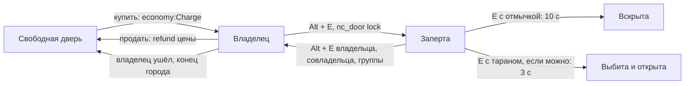

# Модуль `doors` — двери и собственность

Двери карты как собственность. Пока режим разрешает владеть дверями (город), игрок покупает свободную дверь за деньги, запирает и отпирает её, даёт ключи совладельцам, вешает табличку и продаёт обратно за часть цены. Администратор отдаёт двери карты группам (участок полиции), подписывает их и снимает с продажи — это хранится по картам. Отмычка вскрывает запертую дверь за время, таран выбивает её, если режим разрешает.

| | |
|---|---|
| Интерфейс | `doors` |
| Зависимости | `players`; необязательно `economy`, `storage`, `inventory`, `actions`, `notices` |
| Компоненты | `door` (видят все; только у дверей, на которых что-то есть): владелец, совладельцы, табличка, группа, заперта, снята с продажи |
| Сеть | `door` (клиент → сервер): меню двери — `buy`, `sell`, `lock`, `unlock`, `add`, `remove`, `title` |
| Спрашивает | `doors.property (ply, door) -> true` — двери продаются (режим; на клиенте без аргументов — для подсказки); `doors.canBuy (ply, door) -> false`; `doors.price (price, ply, door) -> price` (свёртка); `doors.canPick (ply, door) -> false`; `doors.canRam (ply, door) -> false`; `doors.member (ply, group) -> true` — игрок из группы двери (обе стороны); `doors.groupName (group) -> текст` — как назвать группу в подсказке (клиент) |
| Слушает | `gm.InitPostEntity`, `gm.PostCleanupMap` (настройки карты), `gm.KeyPress`, `players.left`; клиент: `gm.HUDPaint` (подсказка), `gm.PlayerBindPress` (`gm_showteam`, F2 — меню), `i18n.changed` |
| Испускает | `doors.bought (ply, door, price)`, `doors.sold (ply, door, refund)`, `doors.locked (ply, door, locked)`, `doors.picked (ply, door)`, `doors.rammed (ply, door)` |
| Хранит | `storage`, пространство `doors`: ключ — карта, в нём двери по `MapCreationID` → `{ group, title, closed }` |
| Переводы | `lang/<код>/doors.lua` |

## Настройки

| Ключ | По умолчанию | Что задаёт |
|---|---|---|
| `classes` | `prop_door_rotating`, `func_door`, `func_door_rotating` | классы сущностей-дверей |
| `price` | 100 | цена двери (без `economy` двери бесплатны) |
| `refund` | 0,5 | доля уплаченного, которая возвращается при продаже |
| `limit` | 8 | дверей у одного игрока (0 — без лимита) |
| `coowners` | 4 | совладельцев у одной двери |
| `range` | 96 | дотянуться до двери ключами, отмычкой, тараном, юнитов от глаз |
| `pick`, `ram` | 12, 3 | секунд вскрывать и выбивать, если предмет не говорит |

## Ключи и собственность



- **Ключи** у владельца, совладельцев и членов группы двери (`doors:HasKeys`). `Alt + E` (клавиши ходьбы и использования) на двери запирает или отпирает её.
- **Купить** можно дверь без владельца, без группы и не снятую с продажи, пока режим отвечает `true` на `doors.property`; деньги — `economy:Charge` (счёт, затем наличные).
- **Продать** может только владелец: возвращается `refund` уплаченного, дверь отпирается, совладельцы и табличка снимаются.
- **Совладельцы** — до `coowners` игроков: запирают и отпирают, но не продают и не добавляют других; совладелец может сам вернуть ключи.
- **Табличка** — до 48 байт без управляющих символов и `<>"\`; пустая возвращает табличку карты.
- **Вышел с сервера** — его двери свободны, ключи от чужих дверей у него забраны. Режим возвращает все двери на рынок в конце (`doors:ReleaseAll`).
- **Отмычка и таран** — клавиша `E` на запертой двери без ключей: с предметом черты `lockpick` начинается вскрытие, без неё с предметом черты `ram` — выбивание (действие [`actions`](../actions/README.md): отойти — прервать). Вскрытая дверь отпирается, выбитая ещё и распахивается.

```lua
inventory:RegisterItem("lockpick", { weight = 0.1, traits = { lockpick = { time = 10 } } })
inventory:RegisterItem("ram", { weight = 6, traits = { ram = { time = 3 } } })
```

## Подсказка и меню (F2)

Игрок смотрит на дверь в пределах `range` — под прицелом появляется подсказка, а F2 (`gm_showteam`) открывает меню двери. Клавиши в подсказке — те, что назначены у игрока (`input.LookupBinding`).

| Дверь | Подсказка | Меню F2 |
|---|---|---|
| свободная, пока двери продаются | «Продаётся: $100 · F2» | купить за цену |
| снятая с продажи | «Не продаётся» | — |
| группы карты | имя группы (город: название профессии, «Полицейский») | запереть / отпереть — у членов группы |
| своя | «Ваша дверь», «Заперто», «ALT + E: отпереть» | запереть / отпереть, дать ключи (подменю игроков), забрать ключи, табличка…, продать |
| чужая | «Владелец: Gordon», «У вас есть ключи» у совладельца | совладельцу: запереть / отпереть, вернуть ключи |

Табличка двери — первая крупная строка подсказки. Пункт «Табличка…» открывает окно с полем ввода; всё меню — запросы `door` на сервер, который всё проверяет сам и отвечает уведомлением. Без двери перед глазами F2 свободна для других модулей.

## Двери карты

Администратор смотрит на дверь и пишет:

| Команда | Что делает |
|---|---|
| `nc_doormap group police` | ключи у группы `police` (кто в ней — отвечает режим на `doors.member`), дверь не продаётся; `none` — снять |
| `nc_doormap title Полицейский участок` | табличка карты; `none` — снять |
| `nc_doormap closed yes` | снять с продажи (`no` — вернуть) |
| `nc_doormap release` | отобрать дверь у владельца |
| `nc_doormap list` | все двери карты с настройками или владельцами |

Настройки хранятся по `MapCreationID` — номеру, который карта даёт двери и который не меняется ни после очистки карты, ни после перезапуска сервера; после `game.CleanUpMap` они возвращаются на новые сущности дверей.

## Игроку

| Команда | Что делает (дверь перед игроком) |
|---|---|
| `nc_door` | кто владелец, совладельцы, табличка, группа, заперта ли |
| `nc_door buy` / `sell` | купить / продать |
| `nc_door lock` / `unlock` | запереть / отпереть |
| `nc_door add <игрок>` / `remove <игрок>` | дать / забрать ключи |
| `nc_door title <текст>` | табличка |

## API

```lua
local doors = NC.Modules:Instance("doors")
doors:Buy(ply, door)                 -- true, цена или false, причина
doors:Sell(ply, door)                -- true, возврат или false, причина
doors:Lock(ply, door, true)          -- ply = nil — сервер сам
doors:AddCoowner(owner, door, target), doors:RemoveCoowner(owner, door, target)
doors:SetTitle(owner, door, "Дом")
doors:Owned(ply), doors:Release(door), doors:ReleaseAll()
doors:SetMap(door, "group", "police") -- настройки карты: group, title, closed
doors:BeginPick(ply, door), doors:BeginRam(ply, door)
-- обе стороны
doors:IsDoor(ent), doors:Info(ent), doors:Owner(ent), doors:Coowners(ent)
doors:HasKeys(ply, ent), doors:ForSale(ent), doors:Title(ent), doors:Group(ent)
-- клиент
doors:Aimed()                        -- дверь перед глазами
doors:Ask("buy", door)               -- меню двери: buy, sell, lock, unlock, add/remove (игрок), title (текст)
doors:HintLines(door)                -- { { text, color, title } } — строки подсказки
doors:OpenMenu(door), doors:OpenTitle(door)
doors:IsLocked(door), doors:IsProperty(), doors:GroupName(group)
```

Причины отказа: `door` (не дверь), `closed` (двери сейчас не продаются), `yours`, `owned`, `sale` (не продаётся), `limit`, `denied`, `funds`, `owner` (только владелец), `keys`, `target`, `already`, `full`, `long`, `chars`, `tool` (нечем), `unlocked`, `map` (дверь не из карты). Игрок видит уведомление `doors.fail.<причина>`.

## Проверить в реальном GMod

- `Fire("Lock")` и `Fire("Open")` у `prop_door_rotating` и `func_door` разных карт, двойные двери (`slavename`): запирается ли вторая створка.
- `MapCreationID` дверей после `game.CleanUpMap` и смены карты.
- Звуки `doors/door_latch3.wav`, `doors/door_latch1.wav`, `physics/wood/wood_crate_break3.wav`.
