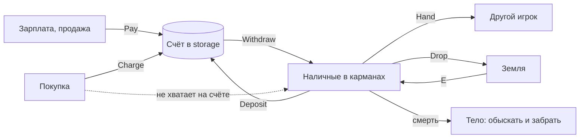

# Модуль `economy` — деньги

Наличные — предмет инвентаря: лежат в карманах, падают на землю, остаются на теле погибшего и крадутся. Банковский счёт игрока хранится в `storage` и переживает смену карты и перезапуск сервера. Режимы платят на счёт (зарплата, возврат) и списывают деньги (покупки: сначала со счёта, недостающее — наличными); игроки вносят и снимают наличные, передают их из рук в руки и бросают на землю.

| | |
|---|---|
| Интерфейс | `economy` |
| Зависимости | `players`, `inventory`; необязательно `storage` (без него счета живут до перезапуска), `notices` |
| Слушает | `players.ready` (компонент счёта), `players.left` (первым: наличные уходящего — на его счёт), сеть `cash` |
| Испускает | `economy.paid (ply, amount, reason)`, `economy.charged (ply, amount, reason)`, `economy.handed (ply, target, amount)`, `economy.balance (ply, balance, old)` |
| Компоненты | `account` (только владелец): баланс счёта |
| Сеть | `cash` (клиент → сервер, до 4 в секунду): внести, снять, передать игроку перед собой, бросить |
| Команды | `nc_bank [deposit \| withdraw <сумма \| all>]`, `nc_givemoney <сумма>`, `nc_dropmoney <сумма>` — все игроки; `nc_money [игрок] [set \| add <сумма>]` — админ |
| Настройки | `item` = `"money"`, `model`, `stack` = 1 000 000, `weight` = 0,00001 кг, `currency` = `"$"`, `group` = `" "`, `start` = 500, `maxBalance` = 10⁹, `range` = 96, `depositOnLeave` = `true` |
| Переводы | `lang/<код>/economy.lua` |

## Наличные и счёт



- Наличные — предмет `money` (модуль регистрирует его сам): мелкий, почти невесомый, до `stack` в одном слоте. Сколько их у игрока — `inventory:Count(ply, "money")`.
- Счёт создаётся при первом обращении с балансом `start`; ключ — `storage:PlayerKey` (SteamID64, у ботов `bot_<имя>`), пространство `economy`.
- Уходящий с сервера игрок не теряет наличные: они зачисляются на счёт (`depositOnLeave`). Погибший теряет — они остаются на теле.

## API (сервер)

```lua
local economy = ctx:Require("economy")
economy:Balance(ply); economy:Cash(ply); economy:Wealth(ply); economy:CanAfford(ply, 300)
economy:Pay(ply, 80, "salary")          -- на счёт: true или false, причина
economy:Charge(ply, 300, "shop")        -- со счёта, остаток наличными: true или false, "funds"
economy:Deposit(ply, 100)               -- наличные -> счёт: сумма или false, причина
economy:Withdraw(ply, 100)              -- счёт -> карманы, сколько влезет: сумма или false, причина
economy:Hand(ply, target, 50)           -- из рук в руки, не дальше range: сумма или false, причина
economy:Drop(ply, 40)                   -- на землю перед собой: сущность, сумма или false, причина
economy:SetBalance(ply, 1000); economy:GiveCash(ply, 20, { drop = true }); economy:TakeCash(ply, 20)
economy:Aimed(ply)                      -- живой игрок перед ним в пределах range
economy:Format(1250)                    -- "$1 250" (оба реалма)
```

Причины отказа: `amount` (не целая положительная сумма), `cash` (нет столько наличных), `funds` (не хватает денег), `full` (некуда положить, счёт полон), `target` (перед ним нет живого игрока), `range`, `dead`. Игрок видит уведомление `economy.fail.<причина>`.

## Клиент

```lua
local economy = NC.Module("economy")    -- на клиенте
economy:Balance()                       -- баланс счёта (компонент account)
economy:Cash()                          -- наличные в своих контейнерах
economy:Request("withdraw", 100)        -- deposit | withdraw | give | drop
```

Экран банка и показ денег на HUD — у режима (город, `mode_city`).

## Проверить в реальном GMod

- Модель `models/props/cs_assault/money.mdl` есть только с контентом Counter-Strike: Source; без него — `model` в настройках.
