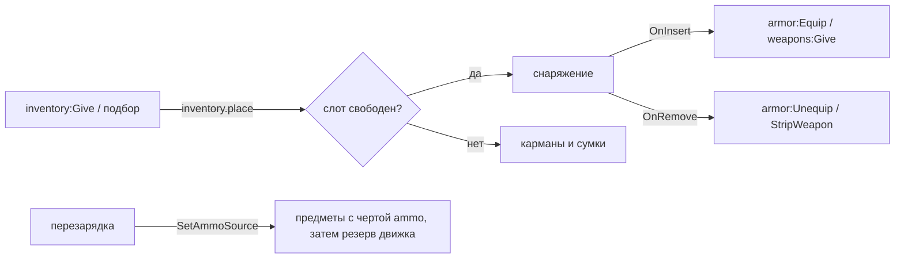

# Модуль `equipment` — снаряжение

Что надето и что в руках — это то, что лежит в снаряжении игрока: контейнере инвентаря со слотом под шлем, жилет, пластины, рюкзак, разгрузку и оружие. Броня надета, пока её предмет в слоте; оружие в руках, пока предмет в слоте; перезарядка берёт патроны из всех контейнеров игрока; всё, что он несёт, замедляет его.

| | |
|---|---|
| Интерфейс | `equipment` |
| Зависимости | `players`, `inventory`; необязательно `armor`, `weapons`, `throwables`, `movement`, `notices` |
| Слушает | `inventory.place`, `inventory.changed`, `players.left`, `gm.DoPlayerDeath` (первым: копирует патроны в предметы), `throwables.thrown`, `armor.hit` |
| Отвечает | `inventory.place` — полученное ложится в свой слот, если он свободен; `movement.speed` — доля скоростей, которую оставляет груз |
| Глаголы | `equip` «Экипировать» (из своих контейнеров в слот, то, что там было, — на место предмета), `unequip` «Снять» (в карманы и сумки) |
| Настройки | `freeLoad` = 15 кг без замедления, `fullLoad` = 45 кг — медленнее всего, `minSpeed` = 0,6 — доля скоростей при `fullLoad`, `sync` = 1 с между копиями патронов в руках в предметы |
| Переводы | `lang/<код>/equipment.lua`; названия слотов — `inventory.slot.<слот>` |

## Слоты

| Слот | Что туда кладётся | Пока предмет в слоте |
|---|---|---|
| `helmet`, `vest`, `plates` | черта `armor = "<вид>"` — вид модуля `armor`, слот вида | слой брони надет с износом `state.cond`; попадания изнашивают предмет |
| `back`, `rig` | сумка (черта `container`) с чертой `wear = "back"` или `"rig"` | её содержимое несёт игрок, вес идёт в груз |
| `primary`, `secondary`, `melee` | черта `weapon = { class = "nc_glock17", slot = "secondary" }` (`slot` по умолчанию `primary`) | оружие в руках: в магазине `state.charge` патронов типа `state.ammo` (без них — полный магазин по умолчанию) |
| `throwable` | черта `weapon = { class = "nc_frag", slot = "throwable" }` | стопка — боезапас метательного оружия; бросок отнимает одну, последняя уходит вместе с оружием |

```lua
local inventory = ctx:Require("inventory")
inventory:RegisterItem("glock17", { model = "models/weapons/w_pistol.mdl", weight = 0.9, size = 2,
	category = "weapon", traits = { weapon = { class = "nc_glock17", slot = "secondary" } } })
inventory:RegisterItem("ammo_9x19", { model = "models/items/boxsrounds.mdl", weight = 0.012, stack = 60,
	category = "ammo", traits = { ammo = "9x19_fmj" } })   -- патроны для перезарядки
inventory:RegisterItem("vest_police", { model = "models/...", weight = 3.5, size = 3,
	category = "armor", traits = { armor = "vest" } })
inventory:RegisterItem("backpack", { model = "models/...", weight = 1.2, size = 3, category = "gear",
	traits = { wear = "back", container = { slots = 10, maxWeight = 25, maxSize = 2 } } })
```

## Как это работает



- Патроны в руках копируются в предмет раз в `sync` с и при смерти, поэтому оружие, снятое с тела, заряжено ровно тем, что было в магазине.
- Перезарядка (`weapons:SetAmmoSource`) считает и забирает патроны сначала из предметов с чертой `ammo` (малые стопки первыми), затем из резерва движка — режимы без инвентаря работают как раньше. Клиент предсказывает перезарядку по своим снимкам контейнеров.
- Груз — вес всех контейнеров игрока (`inventory:Load`). До `freeLoad` скорость полная, к `fullLoad` падает линейно до `minSpeed`; прыжок слабеет меньше. Скорости пересчитываются, когда груз меняется на 0,05 кг и больше.
- При каждом появлении инвентарь опустошает снаряжение (режимы выдают своё), при смерти всё остаётся на теле: чужое снаряжение обыскивают как обычный контейнер.

## API (сервер)

```lua
local equipment = ctx:Require("equipment")
equipment:Of(ply)            -- контейнер снаряжения (создаётся при первом обращении)
equipment:Item(ply, "primary") -- предмет в слоте или nil
equipment:Equip(ply, item)   -- переложить предмет игрока в его слот; ok, причина
equipment:SpeedFactor(ply)   -- доля скоростей, которую оставляет груз
equipment:SlotFor(def)       -- слот для определения предмета или nil (оба realm)
equipment:CountAmmo(ply, ammoId); equipment:TakeAmmo(ply, ammoId, count) -- оба realm
```

## Проверить в реальном GMod

- Выдача оружия через `Give` в `OnInsert` во время `PlayerLoadout` и после него (оружие не должно дублироваться при быстром переключении слотов).
- Предсказание перезарядки на клиенте при высоком пинге: снимок контейнера приходит раз в тик.
