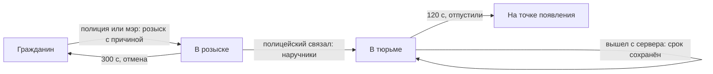

# Модуль `law` — закон: розыск, ордера, арест, тюрьма

Закон города. Пока режим держит закон (город), полиция объявляет игроков в розыск с причиной и арестовывает разыскиваемых, связав их наручниками ([`restraints`](../restraints/README.md)): арестованный сидит в тюрьме карты с таймером и пустыми руками — даже после смерти и переподключения. Мэр выдаёт ордера, с которыми полиция выбивает двери ([`doors`](../doors/README.md)) подозреваемого; связанного или сидящего в тюрьме можно обыскать.

| | |
|---|---|
| Интерфейс | `law` |
| Зависимости | `players`; необязательно `restraints`, `inventory`, `doors`, `hands`, `actions`, `movement`, `notices`, `storage` |
| Компоненты | `wanted` и `warrant` (видят все): до какого времени и за что; `jailed` (видят все): до какого времени в тюрьме |
| Сеть | `law` (клиент → сервер): меню полиции — `want`, `unwant`, `warrant`, `arrest`, `release`, `search` |
| Спрашивает | `law.enabled () -> true` — закон действует (режим); `law.officer (ply) -> true` — полицейский; `law.authority (ply) -> true` — глава города (обе стороны); `law.canSearch (ply, target) -> false` |
| Отвечает | `inventory.canMove`, `inventory.canAct`, `restraints.canTie`, `restraints.canUntie`, `doors.canBuy`, `doors.canPick`, `doors.canRam`, `movement.speed`, `gm.StartCommand`, `gm.PlayerSwitchWeapon` |
| Слушает | `restraints.tied`, `players.spawned`, `players.left` |
| Испускает | `law.wanted (ply, by, reason)`, `law.unwanted (ply, by)`, `law.warrant (ply, by, reason)`, `law.jailed (ply, by, seconds)`, `law.released (ply, by)`, `law.searched (ply, by)` |
| Хранит | `storage`: пространство `jails` — точки тюрьмы по картам; `law` — остаток срока ушедших с сервера |
| Переводы | `lang/<код>/law.lua` |

## Настройки

| Ключ | По умолчанию | Что задаёт |
|---|---|---|
| `wanted` | 300 | секунд в розыске |
| `warrant` | 300 | секунд действует ордер |
| `jail` | 120 | секунд в тюрьме после ареста |
| `reach` | 110 | юнитов от глаз полицейского до арестуемого |
| `speed` | 0,05 | доля скорости арестованного, если у карты нет тюрьмы |

## Как работает



- **Розыск** объявляют полицейский или мэр, причина обязательна (до 96 байт, без управляющих символов и `<>"\`). Узнают все — в чате; над головой разыскиваемого — «В розыске», у него самого на экране — причина. Через `wanted` секунд розыск снимается сам; отменить можно раньше.
- **Ордер** выдаёт мэр; пока мэра нет в игре — полицейский. С ордером на владельца или совладельца двери (или с розыском) полиция выбивает её тараном; дверь без владельца и группы — тоже, остальные — нет.
- **Арест**: полицейский связывает разыскиваемого (наручники, стяжки — `restraints`) — арест сразу. Если связал кто-то другой, полицейский рядом арестует командой `nc_arrest` или из меню. Розыск снимается, все узнают срок.
- **Тюрьма** — точки, которые администратор ставит на карте (`nc_jails add`); арестованные встают на них по очереди, развязанными. Без точек арестованный остаётся на месте связанным и почти не двигается. В тюрьме: пустые руки, без атаки, `E` и перезарядки, без инвентаря, без связывания, покупки дверей, отмычки и тарана; развязать его никто не может. После смерти он появляется снова в тюрьме, ушедший с сервера досиживает остаток при возвращении. Когда срок вышел — или его отпустили полицейский или мэр — он выходит на точку появления.
- **Обыск**: любой рядом может обыскать связанного или сидящего в тюрьме (`nc_search` или меню) — у обыскивающего открываются контейнеры обыскиваемого, тот узнаёт, кто его обыскивает. Режим может запретить (`law.canSearch`).
- Конец режима — амнистия (`law:Amnesty`): розыск, ордера и сроки снимаются, сидящие выходят.

## Команды

| Команда | Кто | Что делает |
|---|---|---|
| `nc_want <игрок> <причина>` | полиция, мэр | объявить в розыск |
| `nc_unwant <игрок>` | полиция, мэр | снять розыск |
| `nc_warrant <игрок> <причина>` | мэр (без мэра — полиция) | ордер |
| `nc_arrest [игрок]` | полиция | арестовать связанного разыскиваемого (без игрока — того, кто перед глазами) |
| `nc_search [игрок]` | все | обыскать связанного или сидящего |
| `nc_release <игрок>` | полиция, мэр | выпустить из тюрьмы |
| `nc_wanted` | все | кто в розыске, на кого ордер, кто сидит и сколько осталось |
| `nc_jail <игрок> [секунды]` | администратор | посадить сразу |
| `nc_jails [add \| clear \| list]` | администратор | точки тюрьмы этой карты: добавить место, где стоишь, убрать все, список |

## API

```lua
local law = NC.Modules:Instance("law")
law:Want(by, ply, "Кража")           -- true или false, причина; by = nil — сервер без проверок, кто приказал
law:Unwant(by, ply), law:IssueWarrant(by, ply, "Краденое")
law:Arrest(by, ply)                  -- связанного разыскиваемого рядом
law:Jail(by, ply, 60), law:Release(by, ply)
law:Search(by, ply)
law:Amnesty()
law:AddJailPoint(pos, yaw), law:JailPoints(), law:ClearJailPoints()
law:Do(by, "want", ply, "Кража")     -- операция меню; law:Request(ply, ...) — то же с уведомлением об отказе
-- обе стороны
law:IsOfficer(ply), law:IsAuthority(ply)
law:Wanted(ply), law:IsWanted(ply)   -- { ends, reason } или nil
law:WarrantOf(ply), law:HasWarrant(ply)
law:IsJailed(ply), law:JailLeft(ply) -- секунд до выхода
-- клиент
law:Ask("want", ply, "Кража")        -- want, unwant, warrant (с причиной), arrest, release, search
```

Причины отказа: `closed` (закон сейчас не действует), `officer` (только полиция), `authority` (ордера выдаёт мэр), `target`, `reason` (нет причины), `long`, `chars`, `wanted` (уже в розыске), `warrant` (ордер уже есть), `none` (не в розыске), `jailed` (уже в тюрьме), `loose` (сначала связать), `far` (далеко), `free` (не в тюрьме), `denied`, `op`. Игрок видит уведомление `law.fail.<причина>`.

## Проверить в реальном GMod

- `SetPos` в тюрьму и обратно: не застревает ли игрок в стенах (точки ставит администратор там, где стоит сам).
- Предсказание блокировки кнопок и смены оружия на клиенте у сидящего.
