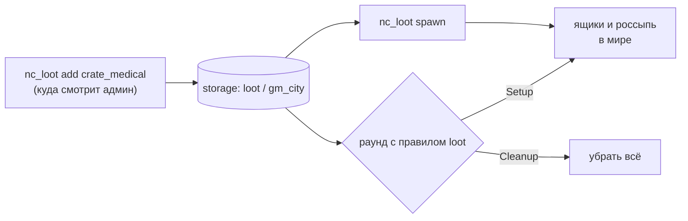

# Модуль `loot` — лут

Что и где находят. Пакеты регистрируют **таблицы лута** (взвешенные выпадения предметов, таблицы внутри таблиц) и **виды ящиков**; администратор ставит на карте **точки** (`nc_loot`, хранятся в `storage` отдельно для каждой карты), где появляются ящики или вещи россыпью — на каждый раунд (правило `loot`) или разово (`nc_loot spawn`). Опустевший ящик может наполниться снова.

| | |
|---|---|
| Интерфейс | `loot` (только сервер) |
| Зависимости | `inventory`; необязательно `storage` (без него точки живут до перезапуска), `rounds` (правило `loot`) |
| Правило раундов | `loot` — параметры `loot` (вкл., `true`) и `lootShare` (доля точек, `1`) |
| Команды | `nc_loot add <ящик \| таблица>`, `remove [радиус]`, `list`, `spawn`, `clear`, `roll <таблица> [раз]`, `tables` (администратор) |
| Хранилище | пространство `loot`, ключ — имя карты: список `{ kind, id, x, y, z, yaw }` |
| Настройки | `maxDraws` = 32 выпадения за бросок, `maxDepth` = 4 уровня вложенности, `scatter` = 20 единиц разброса россыпи, `refill` = 5 с между проверками ящиков |

Готовые таблицы и ящики (`medical_small`, `military`, `crate_wood`, …) даёт [официальный пакет](../../../../../lua/nextcity/README.md#лут).

## Таблицы

```lua
local loot = ctx:Require("loot")
loot:RegisterTable("medical_small", {
	draws = { 1, 3 },                                    -- сколько раз тянуть: число или { мин, макс }
	entries = {
		{ item = "bandage", weight = 10, count = { 1, 3 } }, -- предмет и количество
		{ item = "ifak", weight = 2, state = { charge = 2 } }, -- с состоянием (копия на каждый)
		{ table = "ammo_pistol", weight = 4 },           -- бросок другой таблицы
		{ weight = 5 },                                  -- ничего
	},
})
```

| Поле записи | По умолчанию | Смысл |
|---|---|---|
| `item` | — | id предмета `inventory` |
| `table` | — | id другой таблицы (вложенность до `maxDepth`) |
| `weight` | 1 | вес: шанс записи = `weight / сумма весов` |
| `count` | 1 | число или `{ мин, макс }` |
| `state` | — | состояние предмета (`state.charge` и т. п.) |

Одинаковые предметы без состояния складываются в одну запись. Неизвестные предметы и таблицы пропускаются с одним предупреждением в журнале. Проверить таблицу можно командой `nc_loot roll medical_small 100` — суммы за сто бросков.

## Ящики

```lua
loot:RegisterCrate("crate_medical", {
	model = "models/items/item_item_crate.mdl",
	title = "loot.crate.medical",      -- ключ перевода заголовка
	size = 12, maxWeight = 40, maxSize = 3, -- контейнер inventory
	table = "medical_small",           -- чем наполняется
	respawn = 300,                     -- через сколько секунд после опустошения наполнить снова (0 — никогда)
	frozen = true,                     -- не двигается
})
```

Ящик — это место `inventory` (`kind = "crate"`, `data.loot = id`): его обыскивают клавишей E. Пустой ящик с `respawn > 0` ждёт `respawn` секунд и наполняется, когда в него никто не смотрит.

## Точки карты



| API | Что делает |
|---|---|
| `Roll(table)` | `{ { id, count, state }, ... }` — один бросок |
| `Fill(container, table)` | бросок в контейнер; сколько поместилось |
| `SpawnCrate(crate, pos, ang)` | ящик в мире → `ent, container` |
| `SpawnLoose(table, pos)` | бросок россыпью вокруг `pos` (стопки делятся по `stack`) |
| `AddPoint(kind, id, pos, yaw)` | точка `crate` (ящик) или `items` (таблица россыпью) |
| `RemovePoint(i)`, `Points()`, `Nearest(pos, r)` | точки текущей карты |
| `SpawnAll(share)`, `ClearAll()` | заполнить точки (доля `share` наугад) / убрать созданное |

Режим включает лут, добавляя правило `loot` в свой список правил, когда модуль работает (без модуля режим с этим правилом недоступен):

```lua
-- module.lua режима: optional = { "loot" }
local rules = { "time_limit", "respawn" }
if ctx:Require("loot") ~= nil then
	rules[#rules + 1] = "loot"
end
```
