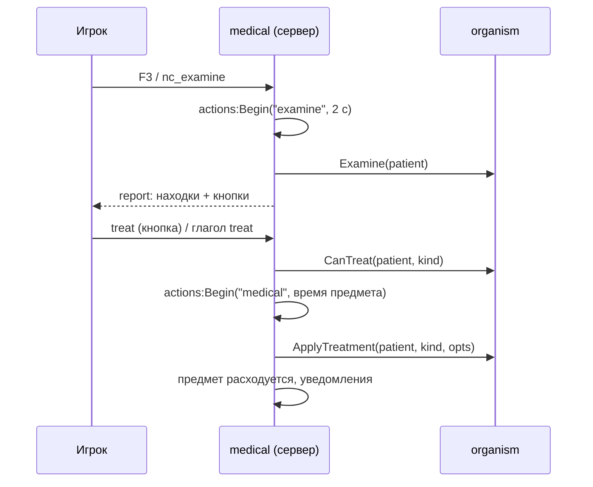

# Модуль `medical` — медицина

Первая помощь и лечение предметами и руками. Игрок лечит себя или раненого перед собой — стоящего или лежащего (регдолл упавшего, тело погибшего) — тем, что несёт; лечение занимает время (действие `actions`) и расходует предмет. Осмотр говорит, что с пострадавшим, и предлагает, чем можно помочь прямо сейчас.

| | |
|---|---|
| Интерфейс | `medical` |
| Зависимости | `players`, `inventory`, `organism`, `actions`; необязательно `notices`, `menu` (клавиша в справке F1) |
| Слушает | `gm.ShowSpare1` (F3 — осмотр), `players.left`; на клиенте `i18n.changed` |
| Спрашивает | `medical.canTreat (ply, patient, kind, itemId) -> false` — запретить лечение (например, режиму) |
| Испускает | `medical.treated (ply, patient, kind, itemId)`, `medical.examined (ply, patient)`; на клиенте `medical.report (data)` |
| Сеть | `report` (сервер → клиент: находки и варианты), `treat`, `examine` (клиент → сервер, с лимитами частоты) |
| Глаголы | `use` «Применить на себе», `treat` «Применить к раненому» |
| Команды | `nc_examine` — осмотреть того, кто перед вами, или себя (доступна всем) |
| Настройки | `reach` = 96 единиц до тела, `examineTime` = 2 с (себя — вдвое быстрее), `oneArm` = 1,6 — время с одной рабочей рукой, `reportTime` = 20 с, `cprTime` = 30 с — один цикл СЛР |
| Переводы | `lang/<код>/medical.lua`: `find.*`, `part.*`, `flag.*`, `action.*`, `hands.*`, `fail.*`, `done.*` |

## Как лечат



- **Пациент** — тот, на ком прицел (игрок или сущность, которая несёт его тело), иначе пациент последнего осмотра (пока свеж отчёт и он в досягаемости), иначе сам игрок (`use`).
- **Время** — `time` предмета на себе, `othersTime` на другом; с одной рабочей рукой × `oneArm`, без рук — нельзя (`arms`).
- **Прерывание** — сдвинулся, ранен, потерял сознание, пациент умер (`patient`), предмет пропал (`item`), тело сменилось (поднялся с земли).
- **Конечность и сторона** выбираются сами: повязка — на самую сильную рану, жгут — на конечность, которая кровит сильнее всех, шина — на первую сломанную, иглой — сторона с худшим пневмотораксом.
- **Расход** — `uses` = 1: одна штука из стопки; больше: `state.charge` считает остаток (из стопки отделяется начатая); 0 — не расходуется (дефибриллятор).

## Предметы

```lua
inventory:RegisterItem("tourniquet", { weight = 0.1, stack = 3, category = "medical",
	traits = { medical = { treatment = "tourniquet", time = 4, othersTime = 3 } } })
inventory:RegisterItem("ifak", { weight = 0.4, category = "medical",
	traits = { medical = { treatment = "bandage", time = 3, uses = 4 } } })
inventory:RegisterItem("morphine", { weight = 0.02, stack = 5, category = "medical",
	traits = { medical = { treatment = "morphine", opts = { dose = 1 }, time = 2 } } })
inventory:RegisterItem("defibrillator", { weight = 2, size = 2, category = "medical",
	traits = { medical = { treatment = "defib", time = 3, uses = 0, self = false } } })
inventory:RegisterItem("pulse_oximeter", { weight = 0.05, category = "medical",
	traits = { diagnostic = { spo2 = true, rhythm = true } } })
```

| Поле черты `medical` | По умолчанию | Смысл |
|---|---|---|
| `treatment` | — | вид `organism:ApplyTreatment` |
| `opts` | `{}` | параметры лечения (`dose`, `ml`, `seconds`) |
| `time` / `othersTime` | 3 / `time` | секунд на себе / на другом |
| `uses` | 1 | сколько раз лечит один предмет (0 — бесконечно) |
| `self` / `others` | `true` | можно на себе / на другом |
| `label` | `medical.action.<treatment>` | подпись полосы действия |

Черта `diagnostic = { spo2, pressure, rhythm, temperature }` — прибор: его владелец видит в отчётах SpO₂, среднее давление, ритм сердца и температуру.

## Руками

| Id | Что делает | На себе |
|---|---|---|
| `cpr` | непрямой массаж сердца `cprTime` с, вдохи каждые 6 с; заканчивается сам, когда сердце заработало | нет |
| `ventilate` | искусственное дыхание 20 с (есть пульс, нет дыхания) | нет |
| `reduce` | вправить вывих конечности (5 с, себе — 9 с) | да |
| `tourniquet_off` | снять жгут с конечности (3 с, себе — 4 с) | да |

## Осмотр

F3 (`gm_showspare1`), `nc_examine` или кнопка «Осмотреть снова». Через `examineTime` секунд игрок получает отчёт: панель с находками — красное угрожает жизни, жёлтое требует помощи, зелёное в порядке — и кнопками всего, что он может сделать сейчас (предметы из его контейнеров и помощь руками). Кнопка начинает лечение и закрывает панель; сама панель закрывается через `reportTime` секунд.

| Находки | Ключи `medical.find.*` |
|---|---|
| сознание | `dead`, `unconscious`, `confused`, `awake` |
| пульс и дыхание | `pulse.none/weak/fast/slow/normal` (≈ уд/мин), `breath.none/agonal/fast/slow/normal`, `airway` |
| кровь | `pale`, `pale.severe`, `bleed.arterial/heavy/light/stopped` + часть тела и флаг (`tourniquet`, `soaked`, `dressed`), `internal` |
| грудь и голова | `chest.open/tension/quiet/tube` по сторонам, `tamponade`, `pupils` |
| кости и нервы | `fracture`, `fracture.open` (флаг `splinted`), `dislocation`, `tourniquet` (минуты), `paralysis.legs/full` |
| прочее | `pain`, `cold`, `ok` |
| приборы | `spo2`, `pressure`, `rhythm.sinus/vf/pea/asystole`, `temperature` |

## API (сервер)

```lua
local medical = ctx:Require("medical")
medical:UseItem(ply, patient, item)          -- лечить предметом игрока; true или false, причина
medical:UseHands(ply, patient, "cpr")        -- руками; part — конечность для reduce и tourniquet_off
medical:Examine(ply, patient); medical:ExamineAimed(ply)
medical:Report(ply, patient)                 -- findings, options — то, что покажет отчёт
medical:Aimed(ply)                           -- пациент перед глазами и сущность его тела
medical:CanTreat(ply, patient, kind, opts, itemId)
```

Причины отказа: `patient`, `dead`, `reach`, `self`, `others`, `nothing`, `already`, `pulse`, `not_shockable`, `target`, `arms`, `busy`, `item`, `denied`, `breathing`, `unconscious` — игрок видит `medical.fail.<причина>`.

## Проверить в реальном GMod

- Трассировка `MASK_SHOT` по регдоллу лежащего и по телу погибшего с разных углов.
- Панель отчёта с курсором (`MakePopup`) во время движения и при открытом инвентаре.
