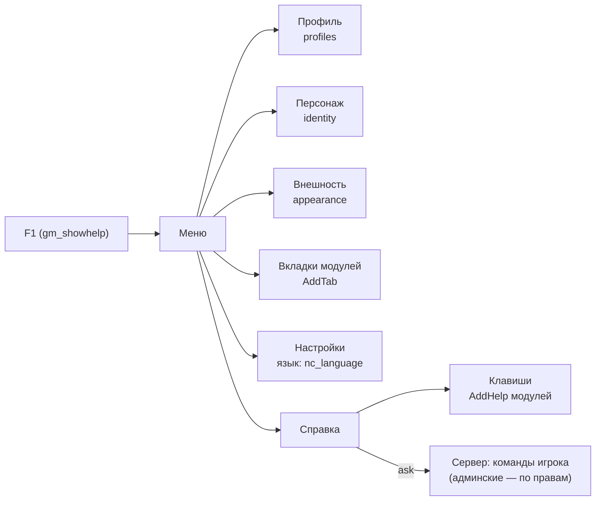

# Модуль `menu` — меню игрока на F1

Меню по клавише F1 (`gm_showhelp`): вкладки модулей, настройки и справка. Первая вкладка — «Профиль» модуля `profiles`, вторая — «Персонаж» модуля [`identity`](../identity/README.md), третья — «Внешность» модуля [`appearance`](../appearance/README.md), дальше вкладки других модулей по порядку, в конце «Настройки» (язык) и «Справка» (клавиши модулей и консольные команды, доступные игроку). F1 в открытом меню закрывает его; меню открывается на последней вкладке.

| | |
|---|---|
| Интерфейс | `menu` (вкладки, справка и блоки оформления — клиент; список команд — сервер) |
| Зависимости | нет; модули подключают его как необязательный: `optional = { "menu" }` |
| Слушает | клиент: `gm.PlayerBindPress` (`gm_showhelp`), `i18n.changed`, `permissions.changed` |
| Сеть | `ask` (клиент, 1/с, запас 3) → `commands` (сервер: до 128 команд игрока) |
| Настройки | `tab` = `""` — вкладка при первом открытии (`""` — первая по порядку) |



## Вкладки

Вкладка — функция, которая наполняет панель (прокручиваемую). Меню дважды в секунду смотрит, изменились ли видимые вкладки или «штамп» открытой, и тогда пересобирает её — но не пока игрок печатает в поле; введённое в поля `Entry` переживает пересборку. Ошибка вкладки не ломает меню: вместо содержимого — строка «Вкладка не открылась», ошибка — один раз в лог.

| Поле | Что это | По умолчанию |
|---|---|---|
| `title` | ключ перевода или функция → текст | обязательно |
| `build` | `function(panel, menu)` — наполняет вкладку | обязательно |
| `order` | порядок: профиль 10, персонаж 20, внешность 30, настройки 900, справка 1000 | 100 |
| `visible` | `function()` → видна ли вкладка этому игроку | всегда |
| `stamp` | `function()` → строка или число; другое значение — пересобрать | никогда |

## Справка

- **Клавиши** — записи модулей (`AddHelp`): клавиша так, как её назначил игрок (`input.LookupBinding`), иначе запасная; сочетания через « + » («ALT + E»); без привязки и запасной — «не назначена». Сейчас: F1 меню, F2 дверь, F3 осмотр, F4 меню города (пока идёт город), C инвентарь, E подобрать / обыскать, ALT + E запереть дверь, E связать, ПКМ прицел, R перезарядка, E + R режим огня, R кулаки, ПКМ нести, Пробел встать, `nc_fall`, R сдаться без сознания, ЛКМ / ПКМ и Пробел в наблюдении.
- **Команды** — список приходит с сервера, когда вкладка открывается: команды для всех и админские, на которые у игрока есть право (отдельным списком); клиентские команды (`nc_fall`, `nc_inventory`) добавляются на месте. Описание — перевод `<модуль>.command.<имя>`, если модуль его дал, иначе `help` из `ctx.commands:Add`. Когда права игрока меняются, список запрашивается заново.

## API (клиент)

```lua
local menu = ctx:Require("menu")              -- в манифесте: optional = { "menu" }
if menu ~= nil then
	menu:AddTab("mytab", { title = "mymod.tab", order = 50,
		visible = function() return self:IsRunning() end,
		stamp = function() return self.version end,
		build = function(panel, kit)
			kit:Heading(panel, "Заголовок")
			local row = kit:Row(panel)
			kit:Caption(row, "Имя")
			kit:Entry(row, "name", "Alyx")      -- введённое остаётся при пересборке
			kit:Button(row, "Сохранить", function() self:Save(kit:Text("name")) end, 120, RIGHT)
		end })
	menu:AddHelp("mymod.key", { bind = { "+walk", "+use" }, fallback = { "alt", "e" },
		text = "mymod.help.key", order = 65 })
end
menu:Open("help"); menu:Close(); menu:Toggle(); menu:IsOpen(); menu:Tab()
menu:ShowTab("settings"); menu:Refresh(true)  -- пересобрать открытую вкладку сразу
menu:Tabs()                                   -- id видимых вкладок по порядку
menu:Keys()                                   -- { { id, key = "ALT + E", text } } справки
menu:Commands()                               -- { { name, module, help, admin } } или nil до ответа
menu:SetLanguage("ru")                        -- "auto" — язык игры; сохраняется в nc_language
```

- Поле модуля для меню называйте не `self.menu` (оно занято у дверей и города): например, `self.playerMenu`.
- Блоки оформления: `Heading`, `Label(parent, text, color, font)`, `Row(parent, tall)`, `Caption(row, text, wide)`, `Value(row, text, color)`, `Button(parent, text, fn, wide, dock)`, `Entry(parent, id, default)`, `Text(id)`, `Typing()`; цвета `menu.COLORS`, шрифты `menu.FONTS`.
- Сервер: `menu:CommandsFor(ply)` — команды, которые игрок может выполнить; платформа дала `ctx.commands:List()`.
- Язык: `ctx.i18n:Choice()` (выбор игрока: `"auto"` или код) и `ctx.i18n:Forced()` (язык, который сервер показывает всем, — тогда выбора нет).

## Проверить в реальном GMod

- F1 открывает и закрывает меню, F2–F4 и C работают как раньше; меню не мешает чату и консоли.
- Вкладки: вид, прокрутка длинной справки, перетаскивание окна, закрытие крестиком; переключение языка меняет тексты сразу.
- Клавиши в справке — те, что назначены у игрока (переназначьте F2 или E и откройте снова).
- Команды: у игрока — только общие; у админа — отдельный список админских; после смены группы список обновляется.
