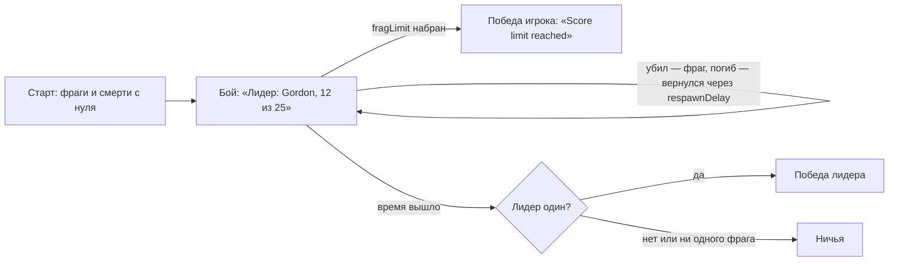

# Модуль `mode_dm` — Deathmatch

Каждый сам за себя: убийство — фраг, самоубийство — минус фраг, погибшие сразу возвращаются на точках подальше от остальных. Побеждает первый набравший `fragLimit` фрагов, а когда время вышло — единственный лидер; несколько лидеров или ни одного фрага — ничья. Как [`mode_tdm`](../mode_tdm/README.md), собран из блоков правил ([ARCHITECTURE §11](../../../../../docs/ARCHITECTURE.md#11-режимы-l3)).

| | |
|---|---|
| Режим | `dm` — «Каждый сам за себя» (`lang/<код>/mode_dm.lua`) |
| Зависимости | `rounds`, `players`; необязательно `inventory` (набор предметов), `loot` (лут на карте), `armor` |
| Игроков | от 2 |
| Правила | `time_limit`, `respawn`; `loot`, когда работает модуль лута |

## Правила игры

- Фраги и смерти обнуляются в начале каждого раунда — счёт разминки не переходит в бой.
- **Строка состояния** под таймером: «Фрагов до победы: 25», затем «Лидер: Gordon, 12 из 25» или «Делят лидерство: 12 из 25»; при `fragLimit = 0` — без предела.
- Опоздавшие входят в идущий раунд (правило `respawn`).
- Точки появления выбираются подальше от других игроков (модуль `players`): все друг другу враги.

## Параметры

| Параметр | По умолчанию | |
|---|---|---|
| `roundTime` | 600 | длина раунда, с |
| `respawnDelay` | 3 | задержка возрождения, с |
| `fragLimit` | 25 | фрагов для победы (0 — без лимита, решает время) |
| `kit` | `dm` | набор предметов при появлении (`inventory:RegisterKit`); пустая строка — без набора |
| `loadout` | `weapon_crowbar`, `weapon_pistol`, `weapon_smg1` | оружие без набора; в руках — последнее |
| `spareMags` | 3 | запасных магазинов к каждому оружию без набора |
| `armor` | — | броня без набора: виды `armor`, если модуль включён |

Меняются в `config.lua` (`settings.rounds.params.dm`) или из консоли: `nc_round param dm fragLimit 40`.

## Снаряжение

С инвентарём и набором из параметра `kit` — вещи набора, в руках основное оружие (иначе пистолет, иначе холодное). Набор `dm` официального пакета — лёгкий бронежилет, MP7 с 80 патронами 4,6×30, USP с 30 патронами 9×19, нож и бинт ([состав](../../../../../lua/nextcity/README.md#наборы)). Без инвентаря, без пакета или с `kit = ""` — оружие движка из `loadout` со `spareMags` магазинами и броня `armor`; неизвестный набор — одно предупреждение в журнале.
