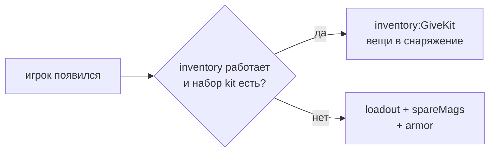

# Модуль `mode_tdm` — Team Deathmatch

Эталонный режим: собран из блоков правил, своё — только выдача снаряжения. Показывает, как добавить режим отдельным модулем ([ARCHITECTURE §11](../../../../../docs/ARCHITECTURE.md#11-режимы-l3)).

| | |
|---|---|
| Режим | `tdm` — «Командный бой» (`lang/<код>/mode_tdm.lua`) |
| Зависимости | `rounds`, `teams`; необязательно `inventory` (набор предметов), `loot` (лут на карте), `armor` |
| Игроков | от 2 |
| Правила | `time_limit`, `teams`, `team_score`, `respawn`, `team_elimination`; `loot`, когда работает модуль лута |

## Правила игры

Две–четыре команды (`teams`), убийство противника — очко команде. Побеждает команда, набравшая `scoreLimit`, по истечении `roundTime` — лидер по счёту (равенство — ничья). Погибшие возвращаются через `respawnDelay` секунд на стороне своей команды; опоздавшие входят в идущий раунд. Команда, которой не осталось (все вышли), выбывает.

## Параметры

| Параметр | По умолчанию | |
|---|---|---|
| `roundTime` | 600 | длина раунда, с |
| `respawnDelay` | 5 | задержка возрождения, с |
| `scoreLimit` | 50 | очков для победы (0 — без лимита) |
| `teams` | 2 | число команд (2..4) |
| `friendlyFire` | `false` | урон по своим |
| `kit` | `tdm` | набор предметов при появлении (`inventory:RegisterKit`); пустая строка — без набора |
| `loadout` | `weapon_crowbar`, `weapon_pistol`, `weapon_smg1` | оружие без набора; в руках — последнее |
| `spareMags` | 3 | запасных магазинов к каждому оружию без набора |
| `armor` | — | броня без набора: виды `armor` (`vest`, `helmet`, …), если модуль включён |

Меняются в `config.lua` (`settings.rounds.params.tdm`) или из консоли: `nc_round param tdm scoreLimit 30`.

## Снаряжение

С инвентарём и зарегистрированным набором из параметра `kit` игрок появляется с вещами набора: оружие, броня и сумки сразу надеты, патроны и медицина лежат в карманах (и сумках, если они есть в наборе), в руках — основное оружие (иначе пистолет, иначе холодное). Набор `tdm` официального пакета — шлем, бронежилет, MP7 со 120 патронами, USP с 30 патронами, нож, граната, два бинта и жгут ([состав](../../../../../lua/nextcity/README.md#наборы)).

Без инвентаря, без пакета или с `kit = ""` — запасной путь: оружие движка из `loadout` с `spareMags` магазинами в запасе и броня `armor`. Неизвестный набор — одно предупреждение в журнале и тот же запасной путь.

