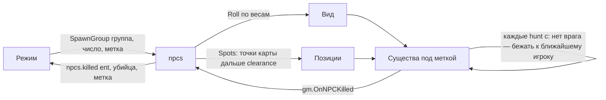

# Модуль `npcs` — существа для режимов

Движковые NPC (`npc_*`) для режимов против существ: оборона волнами, кооператив по карте. Пакеты регистрируют **виды** существ (класс, оружие, здоровье, меткость) и **группы** видов с весами; админ ставит на карте **точки появления** (`nc_npcs add`, хранятся в `storage` по карте); режимы создают существ, считают их по **меткам**, забирают существ самой карты и узнают, кто кого убил. Конкретные виды и группы — в официальном пакете (модуль `hostiles`).

| | |
|---|---|
| Интерфейс | `npcs` (только сервер) |
| Зависимости | `players`; необязательно `storage` (без него точки живут до перезапуска) |
| Слушает | `gm.OnNPCKilled`, `gm.EntityRemoved` |
| Испускает | `npcs.spawned (ent, kind, tag)`, `npcs.killed (ent, attacker, inflictor, tag, kind)`, `npcs.removed (ent, tag)` — исчез, не умерев (очистка, админ) |
| Команды | `nc_npcs` (админ) |
| Настройки | `hunt` = 5 — секунд между приказами охоты; `maxAlive` = 40 — живых существ модуля одновременно не больше; `clearance` = 768 — юнитов от каждого живого игрока до точки появления; `frags` = `true` — убийце фраг; `ignore` — классы, которые `Adopt` не забирает |

## Виды и группы

```lua
local npcs = ctx:Require("npcs")
npcs:RegisterKind("combine", {
	class = "npc_combine_s",                    -- движковый класс npc_*
	weapons = { "weapon_smg1", "weapon_ar2" },  -- одно из них наугад (нет — что у класса своё)
	health = 80,                                -- иначе здоровье класса
	proficiency = "good",                       -- poor, average, good, very_good, perfect
	model = "models/combine_super_soldier.mdl", skin = 1,
	keyvalues = { tacticalvariant = 1 }, spawnflags = 256,
	hostile = true,                             -- ненавидит игроков, какой бы ни был класс (по умолчанию)
})
npcs:RegisterGroup("combine", { { kind = "combine", weight = 3 }, { kind = "manhack", weight = 1 } })
```

| Поле вида | По умолчанию | Что задаёт |
|---|---|---|
| `class` | — | движковый класс `npc_*` (обязателен) |
| `weapons` | `{}` | оружие на выбор: движок выдаёт его при появлении (`additionalequipment`), как меню спавна |
| `health` | здоровье класса | здоровье и максимум |
| `proficiency` | меткость класса | `poor` … `perfect` |
| `model`, `skin`, `keyvalues`, `spawnflags` | — | модель, раскраска, ключи сущности |
| `hostile` | `true` | отношение к игрокам `D_HT` — враждебен даже класс, по умолчанию дружелюбный к игрокам |

Группа — взвешенный список видов: `Roll(group)` выбирает вид пропорционально весу. Ошибки описания (класс не `npc_*`, неизвестная меткость, вес не больше нуля) — ошибка регистрации. Виды группы проверяются при появлении (неизвестный — предупреждение в логе один раз), поэтому порядок регистрации видов и групп не важен.

## Как режим ими пользуется

```lua
-- волна: сколько поместится под maxAlive, в точках подальше от игроков
local spawned = npcs:SpawnGroup("zombies", 12, { tag = "defense" })
round:On("npcs.killed", function(ent, attacker, inflictor, tag)
	if tag == "defense" and npcs:Count("defense") == 0 then
		-- волна отбита
	end
end)
-- кооператив: существа самой карты (кроме config ignore) — тоже под меткой
npcs:Adopt("coop", { hunt = true })
-- конец раунда
npcs:Clear("defense")
```



- **Метки.** Существа одной метки не дерутся друг с другом (разные классы получают `D_LI`); `Count(tag)`, `List(tag)`, `Clear(tag)` работают по метке, `nil` — по всем существам модуля. `TagOf(ent)`, `IsTracked(ent)` — чьё существо.
- **Охота.** Существо без врага каждые `hunt` секунд получает приказ бежать (`SCHED_FORCED_GO_RUN`) к ближайшему живому игроку и запоминает его врагом — волна не стоит в углу карты. `hunt = false` в `Spawn` / без `hunt` в `Adopt` — стоит на месте, пока не увидит.
- **Где появляются.** `Spots(count)`: точки карты, а без них — точки появления стороны `b` (`players:SpawnPoints("b")`); сначала самые далёкие от живых игроков, ближе `clearance` — нет (если подходят все); по кругу по дальней половине; несколько существ у одной точки — по кольцам через 48 юнитов, проверенным `util.TraceHull`.
- **Убийства.** `gm.OnNPCKilled` по существу модуля: убийце-игроку фраг (`frags`), событие `npcs.killed` с меткой и видом. Удалённое без смерти — `npcs.removed`.
- **Лимит.** `SpawnGroup` не создаёт больше `maxAlive − Count()` — сервер не утонет в NPC при большом онлайне.

## Точки карты

```text
nc_npcs add                     точка там, куда смотрит админ (лицом к нему)
nc_npcs remove [радиус]         ближайшая к взгляду точка в радиусе (128)
nc_npcs list                    точки карты и число существ
nc_npcs spawn <вид | группа> [число]   существа с меткой admin: вид — куда смотрит админ, группа — в Spots
nc_npcs clear                   убрать всех существ модуля
nc_npcs kinds                   виды и группы
```

API: `AddPoint(pos, yaw)`, `RemovePoint(index)`, `Points()`, `Nearest(pos, radius)` — точки текущей карты в пространстве `npcs` хранилища.

## API

```lua
npcs:Kind(id) / Group(id) / Kinds() / Groups() / Roll(groupId)
npcs:Spawn(kindId, pos, { tag, yaw, hunt })    -- сущность или nil и причина
npcs:SpawnGroup(groupId, count, { tag, hunt }) -- сколько появилось
npcs:Adopt(tag, { hunt })                      -- сколько существ карты теперь под меткой
npcs:Count(tag) / List(tag) / TagOf(ent) / IsTracked(ent) / Clear(tag)
npcs:Spots(count)                              -- позиции для count существ
```

## Проверить в реальном GMod

- Отношения `AddRelationship("player D_HT 99")` у дружелюбных классов и `D_LI` между разными классами одной метки.
- `SCHED_FORCED_GO_RUN` к игроку на карте без navmesh-а NPC (`ai_nodes`): существа без узлов стоят — нужны карты с узлами.
- Выдача оружия через `additionalequipment` до `Spawn`.
