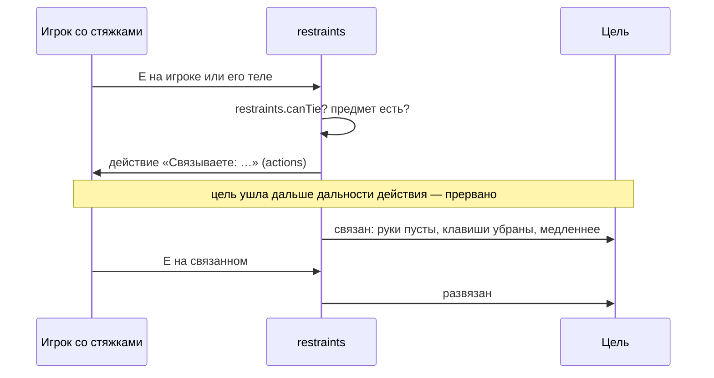

# Модуль `restraints` — связывание

Стяжки, наручники. Клавиша использования (`E`) на игроке — или на его теле, если он упал, — со связывающим предметом в инвентаре через несколько секунд связывает ему руки; на связанном — развязывает. Связанный беспомощен: пустые руки, без атак, использования, бега и прыжка, медленнее шаг, инвентарь не трогает. Кто кого может связать, решают режимы и город.

| | |
|---|---|
| Интерфейс | `restraints` |
| Зависимости | `players`, `actions`; необязательно `inventory`, `organism`, `movement`, `hands`, `notices`, `menu` (клавиша в справке F1) |
| Компоненты | `tied` (видят все): с какого момента связан |
| Спрашивает | `restraints.canTie (ply, target) -> false`, `restraints.canUntie (ply, target) -> false` — запретить; `restraints.tool (ply) -> restraint` — связывать без предмета (например, полиции) |
| Отвечает | `movement.speed` (доля `speed`), `inventory.canMove` и `inventory.canAct` (`false`, пока связан), `gm.PlayerSwitchWeapon` (только руки), `gm.StartCommand` (убирает клавиши); на клиенте `players.targetLines` («Связан» под именем) |
| Слушает | `gm.KeyPress`, `players.died`, `players.spawned`, `players.left`; на клиенте `gm.HUDPaint` |
| Испускает | `restraints.tied (ply, by)`, `restraints.untied (ply, by)` (`by = nil` — смерть, новая жизнь, уход) |
| Настройки | `range` = 72 — дотянуться клавишей, юнитов; `time` = 3, `untie` = 3 — секунды по умолчанию; `speed` = 0,55 — доля скоростей связанного |
| Переводы | `lang/<код>/restraints.lua` |

## Предмет

```lua
inventory:RegisterItem("zipties", { weight = 0.02, stack = 10,
	traits = { restraint = { time = 3, untie = 4, consume = true } } })
```

| Поле | По умолчанию | Что задаёт |
|---|---|---|
| `time` | настройка `time` | секунд связывать |
| `untie` | настройка `untie` | секунд развязывать того, кого связали этим предметом |
| `consume` | `true` | одна штука уходит на каждого связанного (стяжки); `false` — многоразовый (наручники) |

## Как это идёт



- Сопротивляющегося не связать: достаточно отойти, и действие прерывается. Сначала его надо остановить — оглушить, уронить, ранить — или он сдаётся сам.
- Связанный не берёт оружие (`gm.PlayerSwitchWeapon`), не атакует, не пользуется (`E`), не бегает, не прыгает (`gm.StartCommand`, предсказывается на клиенте), не перекладывает и не использует предметы.
- Смерть, новое появление и уход освобождают.

## API

```lua
local restraints = ctx:Require("restraints")
restraints:IsTied(ply)                     -- оба реалма
restraints:Tie(ply, by, restraint)         -- сразу, без действия: true или false, причина
restraints:Untie(ply, by, quiet)           -- quiet: без уведомления «Вы свободны» (тюрьма law)
restraints:BeginTie(ply, target)           -- действие: true или false, причина
restraints:BeginUntie(ply, target)
restraints:Restraint(ply)                  -- черта restraint предмета, что у него есть, и id предмета
restraints:Aimed(ply)                      -- живой игрок под клавишей использования, сущность
```

Причины отказа: `none` (нечем), `tied`, `free`, `denied`, причины `actions` (`busy`, `range`, `target`, …). Игрок видит уведомление `restraints.fail.<причина>`.

## Проверить в реальном GMod

- Клавиша `E` на игроке и на регдолле упавшего; прерывание, когда цель уходит.
- Переключение оружия колесом и цифрами у связанного; предсказание клавиш на клиенте.
