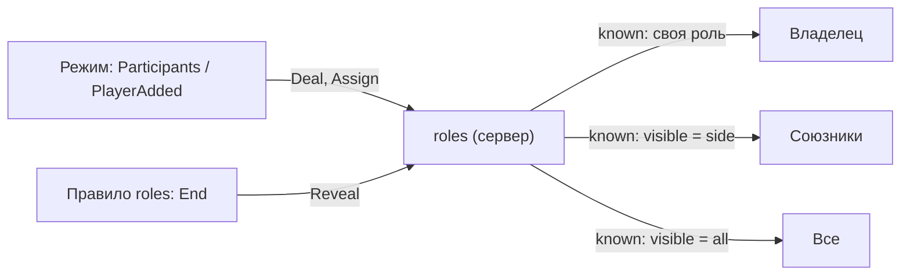

# Модуль `roles` — роли игроков

Роли регистрируют режимы: скрытые (убийца и шериф в Homicide) и публичные (профессии города). Владелец всегда знает свою роль, союзники по стороне и остальные — только если роль это разрешает, а в конце раунда роли раскрываются всем.

| | |
|---|---|
| Интерфейс | `roles` |
| Зависимости | `players`; необязательно `rounds` (без него нет правила `roles`) |
| Слушает | `players.left`, `net.ready`, `i18n.changed`, `gm.HUDPaint` |
| Испускает | `roles.assigned (ply, id, old)` — на сервере; `roles.changed (mine, old)` — на клиенте |
| Сеть | `known` — роли, которые знает этот клиент, и раскрыты ли они |
| Настройки | `intro` = 6 — сколько секунд держится баннер новой роли |
| Переводы | `lang/<код>/roles.lua` |
| Команды | `nc_roles`, `nc_role <игрок> [роль]` (админ) |

## Регистрация

Режим регистрирует роли в `Init` на обоих концах в одном порядке — по сети уходит номер роли.

```lua
local roles = ctx:Require("roles")
roles:Register("murderer", {
	name = "mode_homicide.role.murderer",        -- ключ перевода (по умолчанию roles.<id>)
	description = "mode_homicide.goal.murderer", -- цель, показывается вместе с ролью
	color = Color(200, 40, 40),
	side = "murderer",                           -- союзники делят сторону (по умолчанию id)
	visible = "side",                            -- кто знает: self | side | all
	intro = true,                                -- баннер, когда игрок получает роль
})
```

| `visible` | Кто знает роль | Пример |
|---|---|---|
| `self` | только владелец | мирный, шериф |
| `side` | владелец и все игроки той же стороны | убийцы знают друг друга |
| `all` | все | профессия в городе |

## API

- Оба конца: `M:Def(id)`, `M:Index(id)`, `M:All()` — id в порядке регистрации, `M:SideOfRole(id)`.
- Сервер: `M:Assign(ply, id)` (`nil` — снять), `M:Of(ply)`, `M:Side(ply)`, `M:Members(id)`, `M:OnSide(side)` — игроки по номеру сущности, `M:Clear()`, `M:Reveal(on)`, `M:IsRevealed()`, `M:Knows(viewer, target)`.
- `M:Deal(players, { { "murderer", 1 }, { "sheriff", 1 } }, "innocent")` → `{ [ply] = id }`: случайные игроки на каждое количество по порядку, остальным — `rest` (или ничего).
- Клиент: `M:Of(ply)` — роль, если она здесь известна, `M:Mine()`, `M:Allies()`, `M:IsRevealed()`.

Изменения за тик уходят одним сообщением и только тем клиентам, чьё знание изменилось.



## Правило `roles`

| Правило | Параметры | Что делает |
|---|---|---|
| `roles` | — | в конце раунда раскрывает все роли, при очистке снимает их |

Режимы с ролями подключают правило и раздают роли сами — обычно в `Participants` (`Deal`) и `PlayerAdded` (`Assign`).

## Клиент

- Слева сверху — название своей роли её цветом, цель и союзники («Свои: …») для ролей `visible = side`.
- При получении роли с `intro` — баннер по центру «Вы — Убийца» с целью на `intro` секунд.
- Тексты пересобираются только при изменении ролей или языка.

## Команды

| Команда | Что делает |
|---|---|
| `nc_roles` | роли всех игроков и сторона, раскрыты ли роли |
| `nc_role <игрок> [роль]` | выдать роль (без роли — снять) |

## Позже

- Роли со способностями (предметы, действия по клавише) — через наборы `inventory` и `actions`.
