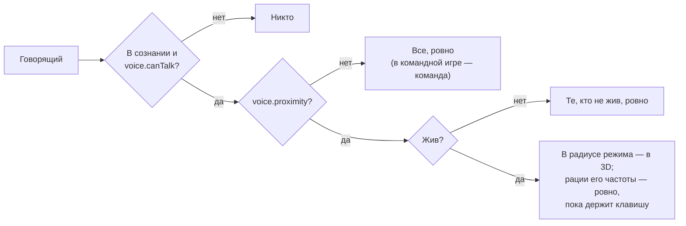

# Модуль `voice` — голос

Что игрок говорит в микрофон, слышно оттуда, где он стоит (3D), и так далеко, как несёт режим голоса — шёпот, обычный голос или крик, — там, где режим делает голос местным (город); где нет — всем (в командной игре — своей команде). Рация в инвентаре, настроенная на частоту, несёт голос на все рации этой частоты, пока держишь её клавишу. Без сознания не говорят и не слышат, мёртвые говорят с мёртвыми, правила раунда (`dead_mute`) сохраняются. HUD показывает, кто говорит.

| | |
|---|---|
| Интерфейс | `voice` (оба realm) |
| Зависимости | `players`; необязательные: `inventory` (рации), `organism` (без сознания), `teams` (голос команды), `notices` (что с рацией), `menu` (клавиши голоса в справке F1) |
| Слушает | `players.ready`, `players.left`, `inventory.changed`; отвечает на `gm.PlayerCanHearPlayersVoice` (приоритет -10: `"3d"`, `true` или `false` из матрицы); клиент — на `gm.PlayerStartVoice` и `gm.PlayerEndVoice` (`true`: без базовой панели с ником и аватаром) |
| Спрашивает | `voice.proximity (ply)` → `true`: голос по расстоянию, `false`: общий (без ответа — настройка `proximity`); `voice.canTalk (ply)` → `false`: его не слышит никто |
| Испускает | `voice.mode (ply, mode, old)`; `voice.radio (ply, frequency, on)` — рацию настроили, включили или выключили |
| Сеть | `ptt` (клиент → сервер, 4/с, запас 8): клавиша рации нажата или отпущена; компоненты `voice` (всем: `mode`, `radio` — говорит в рацию) и `radio` (владельцу: `frequency`, `on`) |
| Команды | `nc_voice [whisper \| normal \| yell \| cycle]`, `nc_radio [частота \| on \| off]` (всем); клиент: `+nc_radio` — клавиша рации |
| Настройки | `proximity` = `false`, `whisperRange` = 120, `normalRange` = 600, `yellRange` = 1400 (юниты: 100 ≈ 2 м), `mode` = `"normal"` (голос новичка), `refresh` = 0,25 с (пересборка матрицы), `teamOnly` = `true`, `frequency` = 1 (новой рации), `maxFrequency` = 999, `radioRange` = 0 (юниты рации, 0 — везде; черта предмета может задать свои) |

## Режимы голоса

| Режим | Где голос местный, слышно | Как включить |
|---|---|---|
| шёпот (`whisper`) | вплотную: `whisperRange`, ~2 м | `nc_voice whisper`, `/voice whisper` |
| обычный (`normal`) | вокруг: `normalRange`, ~11 м | `nc_voice normal` |
| крик (`yell`) | далеко: `yellRange`, ~27 м | `nc_voice yell` |

`nc_voice cycle` — по очереди: шёпот → обычный → крик → шёпот (своя клавиша: `bind n "nc_voice cycle"`); `nc_voice` без слов — как слышен голос сейчас. Режим — компонент `voice`, его видят все: HUD помечает крик и шёпот. Где голос общий, режим на дальность не влияет.

## Кто кого слышит



- **Без сознания** (`organism`) не говорят и не слышат; кого `voice.canTalk` не пускает, не слышит никто.
- **Голос по расстоянию** (`voice.proximity` говорящего: город) — живых слышат живые в радиусе режима, в 3D: звук идёт оттуда, где стоит говорящий, без учёта стен. **Мёртвые** (и наблюдатели) слышны тем, кто не жив, на любом расстоянии.
- **Рация** — пока говорящий держит её клавишу, его ровно слышат все, у кого рация включена на той же частоте, в её радиусе (0 — везде); только живые и в сознании.
- **Голос общий** — все слышат всех, ровно; в командной игре только свою команду (`teamOnly`), а при `sv_alltalk` 1 и больше — всех.
- Правила раундов отвечают на `gm.PlayerCanHearPlayersVoice` раньше (`dead_mute`: живые не слышат мёртвых), режимы тоже могут — с приоритетом выше -10.
- Движок спрашивает об этом много раз за тик: ответы — из матрицы «слушатель → говорящий», которая пересобирается каждые `refresh` с; строка и столбец игрока — сразу, когда он нажимает или отпускает клавишу рации, настраивает, включает или выключает её.

## Рации

Рация — предмет с чертой `radio` (`{ range = юниты }`) модуля [`inventory`](../inventory/README.md). Официальный пакет даёт `radio`: в магазине города, в луте (снаряжение), в наборах полиции (частота 102) и медиков (103). Состояние вещи: `frequency` (по умолчанию настройка `frequency`), `off` (выключена) и `label` — частота на экране инвентаря, в скобках, когда рация выключена. Считается первая рация, которую игрок несёт.

| Что | Как |
|---|---|
| Настроить | `nc_radio 7`, `/radio 7` (1–`maxFrequency`) |
| Включить, выключить | `nc_radio on`, `nc_radio off`; «Рация: вкл. / выкл.» в меню вещи на экране инвентаря |
| Говорить в рацию | держать `+nc_radio` (`bind b +nc_radio`): микрофон включается сам, отпустил — выключается |
| Узнать | `nc_radio` — `radio: 7, on` |

Уведомления: «Рация включена: 7», «Рация выключена (7)», «У вас нет рации», «Рация выключена: /radio on», «Частоты — от 1 до 999: /radio <частота>».

## HUD

Справа посередине экрана — кто говорит из тех, кого слышит этот клиент: имя, которое видят другие (`players:Name`), с пометкой «крик», «шёпот» или «рация» (зелёным), до шести строк, дальше «и ещё N». Свои строки: «Ваш голос: крик», пока игрок говорит и 3 с после смены режима; «Вы говорите в рацию: 7»; «Рация: 7» или «Рация выключена (7)» после смены рации. Базовые панели движка (ник и аватар) не показываются.

## API

```lua
local voice = ctx:Require("voice")             -- в манифесте: optional = { "voice" }
voice:Hears(listener, talker)                   -- false, true (ровно: рация, мёртвые, общий голос) или "3d"
voice:Mode(ply); voice:SetMode(ply, "yell")     -- режим голоса; true или false, "mode"
voice:Range(ply)                                -- сколько юнитов несёт его голос сейчас, nil — везде
voice:Proximity(ply)                            -- слышен ли его голос по расстоянию
voice:Radio(ply); voice:Frequency(ply)          -- его рация (вещь) или nil; её частота, если включена
voice:Tune(ply, 102)                            -- true или false, причина: none, frequency
voice:Switch(ply, false)                        -- выключить рацию (true — включить, nil — наоборот)
voice:Transmit(ply, true)                       -- клавиша рации: true или false, причина: none, off
voice:IsTransmitting(ply); voice:Rebuild()      -- говорит ли в рацию; пересобрать матрицу сейчас
voice:Talkers(); voice:Lines()                  -- клиент: кто говорит (кого слышит клиент); строки HUD
```

```lua
-- режим делает голос местным (в Setup; раунд снимает ответ сам)
round:On("voice.proximity", function(ply)
	return true
end)

-- модуль заглушает игрока
ctx:On("voice.canTalk", function(ply)
	if gagged[ply] then
		return false
	end
end)

-- своя рация пакета: дальность 3000 юнитов
inventory:RegisterItem("field_radio", { model = "models/props_lab/reciever01b.mdl", weight = 1,
	category = "gear", traits = { radio = { range = 3000 } } })
```

## Справка F1

Раздел клавиш вкладки «Справка» меню F1 ([`menu`](../menu/README.md)): «Говорить (ваш голос: обычный)» — клавиша `+voicerecord`, «Говорить в рацию, пока держите» — `+nc_radio`, «Шёпот, обычный голос или крик по очереди» — `nc_voice cycle`; у каждой — клавиша игрока или «не назначена».

## Проверить в реальном GMod

- Затухание 3D-голоса движком на радиусах режимов: шёпот вплотную, крик через улицу; голос по рации и мёртвых — ровный.
- `+nc_radio`: микрофон включается сам (`permissions.EnableVoiceChat`) и выключается, когда клавишу отпустили; иконка над головой говорящего.
- Базовые панели голоса скрыты, HUD справа: имена персонажей, пометки, «и ещё N» при толпе.
- `sv_alltalk` 0, 1 и 2 в командных режимах; `dead_mute` в Homicide; без сознания — тишина.
- ULX `ulx gag`: хук аддона `PlayerCanHearPlayersVoice` отвечает раньше режима — заглушённого не слышит никто.
- Нагрузка: пересборка матрицы на 64 игроках (`nc_perf`), трафик компонентов `voice` и `radio` (`nc_net`).
