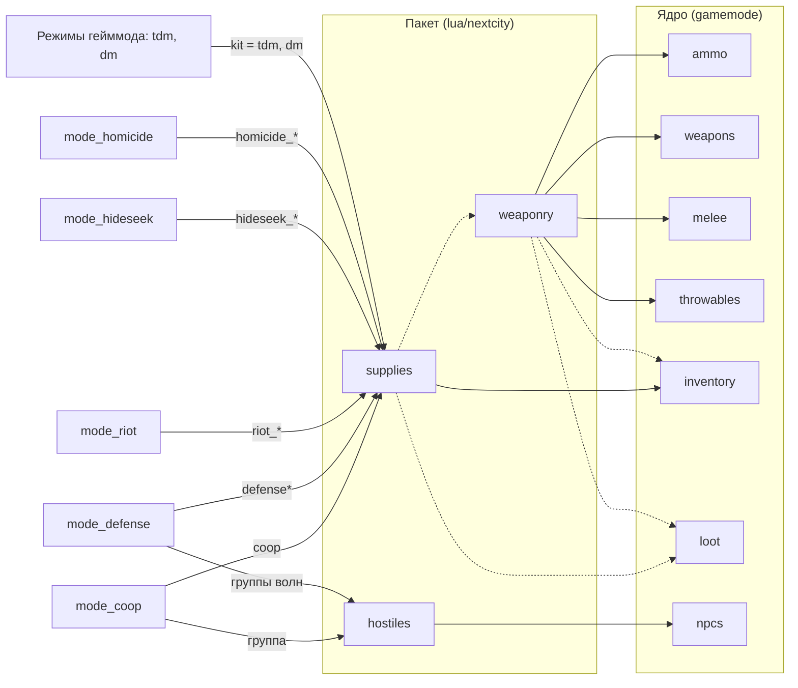

# Официальный пакет контента

Ядро Next-City — это системы и их API без контента ([D15](../../docs/ARCHITECTURE.md#4-модули)). Всё, что игрок держит в руках, носит и находит, лежит здесь: в пакете поверх ядра, по тем же правилам, по которым свой контент пишет любой сервер.

| Модуль | Что даёт | Зависимости |
|---|---|---|
| [`weaponry`](modules/weaponry/) | 6 видов патронов, 5 стволов, 3 вида холодного и 2 метательного оружия, их 16 предметов, таблицы лута оружия и патронов | `ammo`, `weapons`, `melee`, `throwables`; необязательно `inventory`, `loot`, `explosions` |
| [`supplies`](modules/supplies/) | 27 предметов: медицина, броня, сумки, стяжки; таблицы лута, 3 вида ящиков, наборы режимов `tdm`, `dm`, `homicide`, `hideseek`, `riot`, `defense`, `coop` | `inventory`; необязательно `loot`, `weaponry` |
| [`hostiles`](modules/hostiles/) | 12 видов врагов Half-Life 2 (зомби, хедкрабы, муравьиные львы, Гражданская оборона, солдаты Альянса, мэнхаки) и 6 групп для волн | `npcs` |
| [`mode_homicide`](modules/mode_homicide/README.md) | режим «Хомисайд»: скрытые роли убийцы, шерифа и мирных, псевдонимы, варианты `standard`, `gunfree`, `wildwest` | `rounds`, `roles`, `players`; необязательно `inventory`, `loot`, `notices`, `hands` |
| [`mode_hideseek`](modules/mode_hideseek/README.md) | режим «Прятки»: фаза пряток с ослеплёнными ищущими, охота с убийством или осаливанием | `rounds`, `teams`, `players`; необязательно `inventory`, `loot`, `notices`, `hands` |
| [`mode_riot`](modules/mode_riot/README.md) | режим «Бунт»: полиция связывает бунтовщиков, бунтовщики отбиваются и освобождают своих | `rounds`, `teams`, `players`; необязательно `inventory`, `loot`, `notices`, `restraints` |
| [`mode_defense`](modules/mode_defense/README.md) | режим «Оборона»: волны существ с передышками, павшие возвращаются после волны | `rounds`, `players`, `npcs`; необязательно `inventory`, `loot`, `notices` |
| [`mode_coop`](modules/mode_coop/README.md) | режим «Кооператив»: зачистка карты от NPC с общими жизнями команды | `rounds`, `players`, `npcs`; необязательно `inventory`, `loot`, `notices` |

```text
lua/nextcity/
├── modules/
│   ├── weaponry/      # module.lua, sh_weaponry.lua (данные), sv_weaponry.lua (взрывы, лут)
│   ├── supplies/      # module.lua, sh_supplies.lua (предметы), sv_supplies.lua (лут, ящики, наборы)
│   ├── hostiles/      # module.lua, sv_hostiles.lua (виды и группы существ)
│   ├── mode_homicide/ # module.lua, sh_homicide.lua (роли, псевдонимы), sv_homicide.lua (режим)
│   ├── mode_hideseek/ # module.lua, sh_hideseek.lua (команды), sv_hideseek.lua (режим), cl_hideseek.lua (повязка)
│   ├── mode_riot/     # module.lua, sh_riot.lua (команды), sv_riot.lua (режим)
│   ├── mode_defense/  # module.lua, sv_defense.lua (режим)
│   └── mode_coop/     # module.lua, sv_coop.lua (режим)
└── lang/<код>/        # ammo, weapons, melee, throwables, items, loot, mode_homicide, mode_hideseek, mode_riot,
                       # mode_defense, mode_coop
```



Сплошные стрелки — обязательные зависимости, пунктир — необязательные: без `loot` нет таблиц и ящиков, без `weaponry` в таблицах `supplies` нет оружия и не регистрируются наборы режимов (режимы тогда выдают оружие движка).

## Модели

Только модели Half-Life 2, которые есть у каждого: `c_`-модели с руками игрока (`useHands`). Исключение — нож: модели Counter-Strike: Source (`c_knife_t`, `w_knife_t`), смонтированного на большинстве серверов; без CS:S нож выглядит ошибкой модели, но работает.

## Огнестрельное оружие

| Предмет | Класс | Название | Патрон | Магазин | Темп | Режимы | Слот | Вес, кг | Размер |
|---|---|---|---|---|---|---|---|---|---|
| `usp` | `nc_usp` | USP Match | 9×19 мм | 15 + 1 | 450 | одиночный | `secondary` | 0,75 | 1 |
| `python` | `nc_python` | Кольт Питон | .357 Magnum | 6 | 120 | одиночный | `secondary` | 1,2 | 1 |
| `mp7` | `nc_mp7` | MP7 | 4,6×30 мм | 40 + 1 | 950 | авто, одиночный | `primary` | 1,9 | 2 |
| `ar2` | `nc_ar2` | AR2 | 5,56×45 мм | 30 + 1 | 700 | авто, одиночный | `primary` | 3,4 | 3 |
| `spas12` | `nc_spas12` | SPAS-12 | 12/70 | 6 + 1 | 70 | помпа, по патрону | `primary` | 4,4 | 3 |

Темп — выстрелов в минуту. Размер 1 помещается в карман, 2 — в сумку, 3 — только в слот снаряжения или баул. `nc_weapons` показывает всё оружие пакетов с перезарядкой и разбросом.

## Патроны

| Патрон | Название | Масса, г | Скорость, м/с | Особенности | Предмет | Стопка |
|---|---|---|---|---|---|---|
| `9x19_fmj` | 9×19 мм, оболочечная | 8 | 360 | — | `ammo_9x19` | 60 |
| `357_jhp` | .357 Magnum, экспансивная | 10,2 | 440 | раскрывается (0,6) | `ammo_357` | 30 |
| `46x30_ap` | 4,6×30 мм, бронебойная | 2 | 720 | бронебойность 1,6 | `ammo_46x30` | 80 |
| `556_m855` | 5,56×45 мм M855 | 4 | 940 | бронебойность 1,3, фрагментация | `ammo_556` | 60 |
| `12g_buck` | 12/70, картечь | 3,5 × 9 | 400 | 9 картечин, разлёт 1,5° | `ammo_12g_buck` | 24 |
| `12g_slug` | 12/70, пуля | 28 | 430 | раскрывается (0,3) | `ammo_12g_slug` | 24 |

Патроны — предметы: перезарядка берёт их из карманов, разгрузки и сумок. `nc_ammo [калибр]` — энергия на 0, 100 и 300 м.

## Холодное оружие

| Предмет | Класс | Название | Первая атака | Вторая атака | Досягаемость | Вес, кг |
|---|---|---|---|---|---|---|
| `crowbar` | `nc_crowbar` | Монтировка | тупой удар, 110 Дж | — | 52 | 1,5 |
| `stunstick` | `nc_stunstick` | Дубинка | тупой удар, 70 Дж | — | 48 | 0,7 |
| `knife` | `nc_knife` | Нож | режет, 40 Дж | колет, 60 Дж на 12 см | 40 / 36 | 0,2 |

## Метательное

| Предмет | Класс | Название | Действие | В слоте | Вес, кг |
|---|---|---|---|---|---|
| `frag` | `nc_frag` | Осколочная граната | запал 4 с; 0,18 кг ВВ и 0,21 кг осколков корпуса; бросок — первой атакой, катнуть — второй | до 3 | 0,4 |
| `bottle` | `nc_bottle` | Бутылка | разбивается там, куда упала | до 3 | 0,5 |

## Медицина

| Предмет | Название | Лечение | Время: себе / другому, с | Стопка | |
|---|---|---|---|---|---|
| `bandage` | Бинт | `bandage` | 3 / 2,5 | 5 | |
| `gauze` | Гемостатическая марля | `hemostatic` | 5 / 4 | 3 | артериальное кровотечение, где не наложить жгут |
| `tourniquet` | Жгут | `tourniquet` | 4 / 3 | 2 | |
| `splint` | Шина | `splint` | 8 / 6 | 2 | |
| `chest_seal` | Окклюзионная повязка | `chest_seal` | 4 / 3 | 2 | открытая рана груди |
| `needle` | Игла для декомпрессии | `needle` | 6 / 5 | 2 | напряжённый пневмоторакс |
| `morphine` | Шприц-тюбик морфина | `morphine` | 2 / 2 | 3 | 1 доза |
| `naloxone` | Налоксон | `naloxone` | 2 / 2 | 3 | 1 доза |
| `epinephrine` | Автоинъектор адреналина | `epinephrine` | 2 / 2 | 3 | 1 доза |
| `txa` | Транексамовая кислота | `txa` | 3 / 3 | 3 | 1 доза |
| `saline` | Физраствор, 500 мл | `saline` | 10 / 8 | 1 | 500 мл за 5 мин |
| `blood` | Кровь, 450 мл | `blood` | 12 / 10 | 1 | 450 мл за 5 мин |
| `ifak` | Индивидуальная аптечка | `bandage` | 3 / 2,5 | 1 | 4 повязки |
| `defibrillator` | Дефибриллятор | `defib` | — / 3 | 1 | только на другом, не расходуется |
| `pulse_oximeter` | Пульсоксиметр | осмотр | | 1 | SpO₂ и ритм сердца |
| `bp_cuff` | Тонометр | осмотр | | 1 | давление |
| `thermometer` | Термометр | осмотр | | 1 | температура |

Как лечение действует на тело — в README модулей [`medical`](../../gamemodes/nextcity/gamemode/modules/medical/README.md) и [`organism`](../../gamemodes/nextcity/gamemode/modules/organism/README.md).

## Броня и сумки

| Предмет | Название | Слот | Класс | Вес, кг | Размер | |
|---|---|---|---|---|---|---|
| `helmet` | Баллистический шлем | `helmet` | 4, жёсткая | 1,4 | 2 | голова |
| `vest_light` | Лёгкий бронежилет | `vest` | 2, мягкая | 2 | 2 | грудь и живот |
| `vest` | Бронежилет | `vest` | 4, мягкая | 3,5 | 3 | грудь и живот |
| `plates` | Бронепластины | `plates` | 5, жёсткая | 6 | 3 | спереди и сзади, поверх жилета |
| `plates_heavy` | Тяжёлые бронепластины | `plates` | 6, жёсткая | 8 | 3 | спереди и сзади, поверх жилета |
| `backpack` | Рюкзак | `back` | 12 мест, до 25 кг, до размера 2 | 1,2 | 3 | |
| `duffel_bag` | Баул | `back` | 16 мест, до 35 кг, до размера 3 | 1,6 | 3 | длинное оружие |
| `chest_rig` | Разгрузка | `rig` | 6 мест, до 10 кг, мелочь | 0,9 | 2 | |
| `pouch` | Подсумок | — | 3 места, до 3 кг, мелочь | 0,15 | 1 | кладётся в карман |

## Инструменты

| Предмет | Название | Черта | Вес, кг | В слоте | |
|---|---|---|---|---|---|
| `zipties` | Стяжки | `restraint`: 3 с связать, 4 с развязать, расходуются | 0,02 | 10 | `E` на игроке ([`restraints`](../../gamemodes/nextcity/gamemode/modules/restraints/README.md)) |

## Лут

Таблицы регистрируются, когда работает модуль [`loot`](../../gamemodes/nextcity/gamemode/modules/loot/README.md); проверить — `nc_loot roll <таблица> 100`.

| Таблица | Бросков | Что выпадает |
|---|---|---|
| `ammo_pistol`, `ammo_smg`, `ammo_rifle`, `ammo_shotgun` | 1 | патроны одного вида |
| `ammo` | 1 | любая из таблиц патронов |
| `weapons_melee` | 1 | монтировка, нож, дубинка, бутылки |
| `weapons_civil` | 1 | пистолет, револьвер, дробовик или холодное |
| `weapons_military` | 1 | MP7, AR2, SPAS-12, USP, гранаты |
| `medical_small` | 1–2 | бинты, жгут, марля, шина, морфин (или ничего) |
| `medical_large` | 2–4 | всё из медицины, дефибриллятор — редко |
| `armor` | 1 | шлем, жилеты, пластины |
| `gear` | 1 | рюкзак, баул, разгрузка, подсумок |
| `civilian` | 1–3 | малая медицина, сумки, гражданское оружие и патроны к пистолетам |
| `military` | 2–4 | броня, малая медицина, сумки, военное оружие и патроны |

| Ящик | Заголовок | Мест | До, кг | Наполняется |
|---|---|---|---|---|
| `crate_wood` | Деревянный ящик | 12 | 60 | `civilian` |
| `crate_military` | Военный ящик | 16 | 80 | `military` |
| `crate_medical` | Медикаменты | 10 | 30 | `medical_large` (вещи до размера 2) |

Точки ставит администратор, глядя туда, где должен стоять ящик: `nc_loot add crate_military`, россыпь — `nc_loot add medical_small`.

## Наборы

Набор — список предметов, который режим выдаёт игроку при появлении ([`inventory:GiveKit`](../../gamemodes/nextcity/gamemode/modules/inventory/README.md#наборы)): оружие, броня и сумки сразу надеваются в снаряжение.

| Набор | Состав | Где используется |
|---|---|---|
| `tdm` | шлем, бронежилет, MP7 и 120 патронов 4,6×30, USP и 30 патронов 9×19, нож, граната, 2 бинта, жгут | [Team Deathmatch](../../gamemodes/nextcity/gamemode/modules/mode_tdm/README.md) (параметр `kit`) |
| `dm` | лёгкий бронежилет, MP7 и 80 патронов 4,6×30, USP и 30 патронов 9×19, нож, бинт | [Deathmatch](../../gamemodes/nextcity/gamemode/modules/mode_dm/README.md) (параметр `kit`) |
| `homicide_murderer` | нож | [Хомисайд](modules/mode_homicide/README.md#наборы): убийца |
| `homicide_murderer_wildwest` | нож, Кольт Питон, 12 патронов .357 | Хомисайд, «Дикий Запад»: убийца |
| `homicide_sheriff` | Кольт Питон, 12 патронов .357 | Хомисайд: шериф |
| `homicide_sheriff_gunfree` | дубинка | Хомисайд, «Зона без оружия»: шериф |
| `homicide_wildwest` | Кольт Питон, 12 патронов .357 | Хомисайд, «Дикий Запад»: шериф и мирные |
| `hideseek_seeker` | USP, 45 патронов 9×19, монтировка | [Прятки](modules/mode_hideseek/README.md#наборы): ищущие при `catch = kill` |
| `riot_police` | шлем, бронежилет, дубинка, 6 стяжек | [Бунт](modules/mode_riot/README.md#наборы): полиция |
| `riot_police_armed` | шлем, бронежилет, дубинка, 6 стяжек, USP, 30 патронов 9×19 | Бунт при `firearms = true`: полиция |
| `riot_rioter` | монтировка, 2 бутылки | Бунт: бунтовщики |
| `defense` | шлем, бронежилет, AR2 и 120 патронов 5,56×45, USP и 30 патронов 9×19, монтировка, 2 бинта, жгут | [Оборона](modules/mode_defense/README.md#наборы): защитники |
| `defense_resupply` | 60 патронов 5,56×45, 15 патронов 9×19, бинт | Оборона: живым после каждой волны |
| `coop` | шлем, лёгкий бронежилет, MP7 и 160 патронов 4,6×30, USP и 30 патронов 9×19, монтировка, граната, 3 бинта, жгут | [Кооператив](modules/mode_coop/README.md#набор) |

`nc_kits` — все наборы, `nc_kit <игрок> <набор>` — выдать набор (администратор).

## Существа

Модуль `hostiles` регистрирует в [`npcs`](../../gamemodes/nextcity/gamemode/modules/npcs/README.md) виды врагов Half-Life 2 и группы, из которых режимы собирают волны (`nc_npcs kinds` — список, `nc_npcs spawn <вид | группа> [число]` — вызвать).

| Вид | Класс | Оружие, меткость |
|---|---|---|
| `zombie`, `zombie_fast`, `zombie_poison` | `npc_zombie`, `npc_fastzombie`, `npc_poisonzombie` | — |
| `headcrab`, `headcrab_fast`, `headcrab_poison` | `npc_headcrab`, `npc_headcrab_fast`, `npc_headcrab_black` | — |
| `antlion` | `npc_antlion` | — |
| `metrocop` | `npc_metropolice` | пистолет или дубинка, средняя |
| `combine` | `npc_combine_s` | SMG1 (2 из 3) или AR2, хорошая |
| `combine_shotgun` | `npc_combine_s`, рыжая раскраска | дробовик, хорошая |
| `combine_elite` | `npc_combine_s`, модель элиты | AR2, очень хорошая |
| `manhack` | `npc_manhack` | — |

| Группа | Состав (вес) |
|---|---|
| `zombies` | зомби 6, быстрый зомби 2, ядовитый зомби 1, хедкраб 2, быстрый хедкраб 1 |
| `zombies_fast` | быстрый зомби 4, быстрый хедкраб 2, зомби 2 |
| `antlions` | муравьиный лев |
| `metrocops` | Гражданская оборона 4, мэнхак 1 |
| `combine` | солдат 4, солдат с дробовиком 2, Гражданская оборона 1 |
| `combine_elite` | солдат 3, солдат с дробовиком 1, элита 2 |

Свои виды и группы — `npcs:RegisterKind` и `npcs:RegisterGroup` в своём пакете; группы режима задают его параметры (`groups` у обороны, `group` у кооператива).

## Свой контент

Пакет сервера кладётся рядом: `garrysmod/addons/<пакет>/lua/nextcity/modules/<id>/` — и регистрирует своё в `Init` так же, как модули выше:

```lua
-- lua/nextcity/modules/my_guns/module.lua
-- weaponry — ради патронов калибра 9x19; Require доступен только для объявленных модулей
return { id = "my_guns", requires = { "weaponry", "weapons", "inventory" }, files = { sh = { "sh_my_guns.lua" } } }

-- lua/nextcity/modules/my_guns/sh_my_guns.lua
local M = NC.Module("my_guns")
function M:Init(ctx)
	ctx:Require("weapons"):Register("my_glock", { caliber = "9x19", magazine = 17, rpm = 600,
		viewModel = "models/weapons/c_pistol.mdl", worldModel = "models/weapons/w_pistol.mdl", useHands = true })
	ctx:Require("inventory"):RegisterItem("glock", { model = "models/weapons/w_pistol.mdl", weight = 0.7,
		category = "weapon", traits = { weapon = { class = "my_glock", slot = "secondary" } } })
end
```

Выключить модуль официального пакета — `modules.disabled = { supplies = true }` в `lua/nextcity/config/server.lua`; заменить набор — зарегистрировать набор с тем же id в своём модуле, который зависит от `supplies`.
