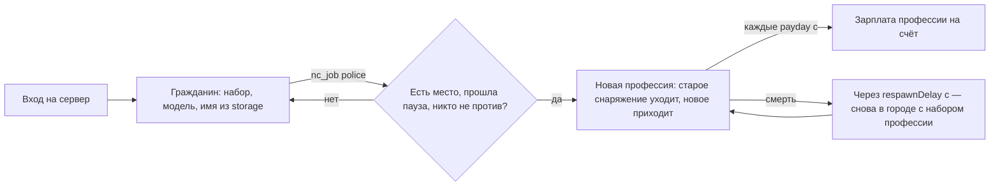

# Режим `city` — Город

Основной режим Next-City: бесконечный раунд ролевого города. Игрок заходит в любой момент, получает профессию «Гражданин», выбирает другую из свободных, получает зарплату на банковский счёт и ходит под выбранным ролевым именем. Победителей нет, раунд не кончается; умершие возвращаются через несколько секунд.

| | |
|---|---|
| Модуль | `mode_city` (официальный пакет, `lua/nextcity/modules/mode_city/`) |
| Режим | `city`, от 1 игрока |
| Зависимости | `rounds`, `roles`, `players`; необязательно `inventory`, `economy`, `notices`, `storage` |
| Правила | `respawn` (возрождение и вход во время раунда), `roles` (профессии — публичные роли) |
| Переводы | `lua/nextcity/lang/<код>/mode_city.lua` |

## Как идёт город



- **Профессия** — публичная роль модуля [`roles`](../../../../gamemodes/nextcity/gamemode/modules/roles/README.md): её видят все (строка над игроком, табло), в чат каждому — «Gordon теперь: Полицейский».
- **Смена профессии** проверяет: существует ли она, не та же ли это, есть ли место (лимит), прошла ли пауза `jobCooldown` после прошлой смены и не запрещает ли её другой модуль (вопрос `mode_city.canJob`). Причина отказа приходит уведомлением на языке игрока.
- **Снаряжение профессии** — набор `city_<профессия>`, выдаётся с меткой `issued` в состоянии каждой вещи: его нельзя выбросить, положить в чужой ящик или чужой инвентарь. При смене профессии оно исчезает, при смерти остаётся на теле, как всё остальное. Своё, купленное или найденное, — обычные вещи.
- **Модель** — из списка профессии по номеру игрока: у одного и того же игрока она не меняется от возрождения к возрождению.
- **Зарплата** — раз в `payday` секунд каждому участнику на банковский счёт модуля [`economy`](../../../../gamemodes/nextcity/gamemode/modules/economy/README.md); другой модуль может изменить её (свёртка `mode_city.salary`, например 0 в тюрьме).
- **Ролевое имя** — `nc_rpname Джон Фримен`: 2–32 байта, без управляющих символов и `<>"\`, уникальное без учёта регистра. Хранится в `storage` (пространство `city`) и видно всем вместо ника (ответ на вопрос `players.name`), в том числе в следующий заход.

## Профессии

| Профессия | Ключ | Зарплата | Мест | Снаряжение (набор `city_<ключ>`) | Модели |
|---|---|---|---|---|---|
| Гражданин | `citizen` | $45 | без лимита, по умолчанию | бинт | горожане (`group01`) |
| Полицейский | `police` | $85 | 4 | лёгкий бронежилет, дубинка, наручники, USP и 30 патронов 9×19, бинт | `police`, `police_fem` |
| Медик | `medic` | $70 | 3 | 5 бинтов, 3 гемостатические марли, 2 жгута, 2 шины, 2 шприц-тюбика морфина, автоинъектор адреналина | медики повстанцев (`group03m`) |
| Торговец оружием | `gundealer` | $55 | 2 | USP и 15 патронов 9×19 | Одесса |
| Мэр | `mayor` | $130 | 1 | лёгкий бронежилет, бинт | Брин |
| Бандит | `bandit` | $25 | 4 | монтировка, 2 стяжки | повстанцы (`group03`) |

Полицейский (`police = true`) и мэр (`mayor = true`) — флаги для законов города: `city:IsPolice(ply)`, `city:IsMayor(ply)`.

Свою профессию пакет регистрирует в `Init` на обоих сторонах в одном и том же порядке:

```lua
local city = ctx:Require("mode_city")
city:RegisterJob("taxi", {
	name = "mypack.job.taxi",           -- ключ перевода; по умолчанию mode_city.job.<ключ>
	description = "mypack.job.taxi.desc",
	color = Color(240, 200, 40),
	salary = 60,                         -- за каждый payday
	limit = 2,                           -- 0 или nil — без лимита
	kit = "mypack_taxi",                 -- по умолчанию city_<ключ>; нет набора — без снаряжения
	models = { "models/player/group02/male_02.mdl" },
})
```

## Параметры

| Параметр | По умолчанию | Что задаёт |
|---|---|---|
| `respawnDelay` | 10 | секунд до возвращения умершего (0–300) |
| `payday` | 300 | секунд между зарплатами (0 — без зарплат) |
| `jobCooldown` | 30 | секунд между сменами профессии (0 — без паузы) |
| `names` | `true` | ролевые имена (`nc_rpname`) вместо ников |

```lua
-- lua/nextcity/config/server.lua своего пакета
settings = {
	rounds = {
		mode = "city",
		params = { city = { payday = 600, jobCooldown = 60 } },
	},
},
```

## Команды

| Команда | Кто | Что делает |
|---|---|---|
| `nc_job` | все | список профессий: занято/мест, зарплата, своя отмечена |
| `nc_job <ключ>` | все | сменить профессию |
| `nc_rpname <имя>` | все | ролевое имя |
| `nc_setjob <игрок> <ключ>` | администратор | сменить профессию сразу, без лимита и паузы |

## API

```lua
local city = NC.Modules:Instance("mode_city")
city:SetJob(ply, "police")        -- true или false, причина[, секунд]: mode, unknown, same, limit, cooldown, denied
city:SetJob(ply, "mayor", true)   -- без лимита, паузы и вопроса
city:JobOf(ply)                   -- определение профессии (и на клиенте)
city:Members("police")            -- игроки профессии
city:SetName(ply, "Алиса Вэнс")   -- true или false, причина: short, long, chars, taken
city:CitizenName(ply)             -- ролевое имя или nil
```

| Событие или вопрос | Аргументы | Когда |
|---|---|---|
| `mode_city.job` | `ply, id, old` | профессия сменилась |
| `mode_city.canJob` (вопрос) | `ply, id` → `false` | можно ли сменить профессию |
| `mode_city.salary` (свёртка) | `salary, ply` → `salary` | сколько заплатить в этот раз |

## Проверить в реальном GMod

- Модели профессий и рук на них; смена модели без пересоздания игрока.
- Ощущение лимитов и паузы на заполненном сервере.
