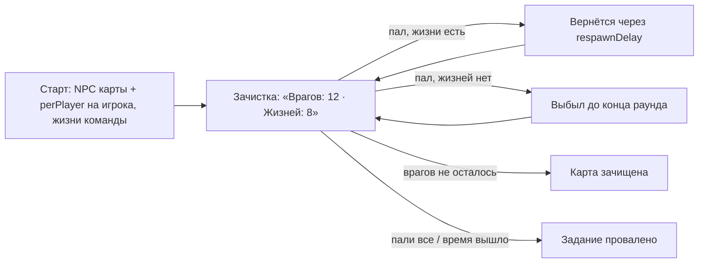

# Режим `coop` — Кооператив

Игроки вместе зачищают карту от существ: враждебных NPC самой карты и тех, кого режим расставил по её точкам. У команды общий запас жизней: пока он не кончился, павший возвращается через несколько секунд, потом — выбывает до конца раунда. Врагов не осталось — победа; пали все или вышло время — задание провалено.

| | |
|---|---|
| Модуль | `mode_coop` (официальный пакет, `lua/nextcity/modules/mode_coop/`) |
| Режим | `coop`, от 1 игрока |
| Зависимости | `rounds`, `players`, [`npcs`](../../../../gamemodes/nextcity/gamemode/modules/npcs/README.md); необязательно `inventory`, `loot`, `notices` |
| Существа | NPC карты и группа модуля [`hostiles`](../../README.md#существа) (по умолчанию `combine`) |
| Правила | `time_limit`; `loot`, если модуль лута работает |
| Переводы | `lua/nextcity/lang/<код>/mode_coop.lua` |

## Раунд



- **Враги.** При `map = true` враждебные NPC карты переходят под метку режима (`npcs:Adopt`): друзья, животные и неподвижные (`ignore` модуля `npcs`) — нет; хедкрабы убитых зомби тоже считаются. Кроме них режим расставляет `perPlayer` существ группы `group` на игрока по точкам `nc_npcs add` (без точек — по точкам появления стороны `b`), подальше от игроков. Существа ждут на местах, пока не увидят игроков; `hunt = true` — сами идут на них.
- **Жизни** — общие: `lives` или по 2 на игрока. Смерть тратит жизнь, павший возвращается через `respawnDelay` секунд; в чат — «Alyx пал(а), жизней осталось: 3». Без жизней павший выбывает, и переподключение его не вернёт.
- **Строка состояния** под таймером — сколько врагов осталось и сколько жизней.
- Подключившиеся во время раунда вступают сразу, жизней не тратят.
- Убийце — фраг; по своим огня нет (`friendlyFire = false`).
- Врагов нет с самого начала (нет NPC на карте, `perPlayer = 0` или неизвестная группа) — раунд заканчивается с подсказкой.

## Параметры

| Параметр | По умолчанию | Что задаёт |
|---|---|---|
| `roundTime` | 900 | длина раунда, с (0 — без предела); по истечении — провал |
| `lives` | 0 | жизней у команды (0 — по 2 на игрока) |
| `respawnDelay` | 10 | секунд до возвращения павшего |
| `map` | `true` | враждебные NPC карты — враги, которых надо зачистить |
| `perPlayer` | 4 | существ группы на игрока в начале раунда (0 — только NPC карты) |
| `group` | `combine` | группа существ (`nc_npcs kinds`) |
| `hunt` | `false` | существа сами идут на игроков |
| `kit` | `coop` | набор игрока |
| `friendlyFire` | `false` | игроки ранят друг друга |

```lua
-- lua/nextcity/config/server.lua своего пакета
settings = {
	rounds = {
		mode = "coop",
		params = { coop = { lives = 10, perPlayer = 6, group = "zombies", hunt = true, roundTime = 1200 } },
	},
},
```

## Набор

| Набор | Состав |
|---|---|
| `coop` | шлем, лёгкий бронежилет, MP7 и 160 патронов 4,6×30, USP и 30 патронов 9×19, монтировка, граната, 3 бинта, жгут |

В руках с начала — основное оружие набора. Без инвентаря или без набора — оружие движка (`weapon_smg1`, `weapon_pistol`, `weapon_crowbar`) с предупреждением в логе.

## Проверить в реальном GMod

- Карты кампании Half-Life 2: какие NPC карты переходят под метку, скрипты карты (`ai_script_conditions`, триггеры) с NPC под меткой.
- Существа на местах (`hunt = false`) реагируют на звук и вид игроков как обычно.
