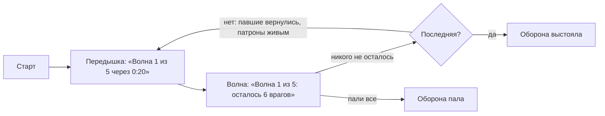

# Режим `defense` — Оборона

Игроки держат оборону против волн существ движка: перед каждой волной — передышка с обратным отсчётом, затем враги идут из самых дальних от игроков точек карты и бегут к ним. Волна отбита, когда от неё никого не осталось. После волны павшие возвращаются, живые получают патроны, а зашедшие во время волны вступают в бой. Последняя волна отбита — победа; пали все — поражение.

| | |
|---|---|
| Модуль | `mode_defense` (официальный пакет, `lua/nextcity/modules/mode_defense/`) |
| Режим | `defense`, от 1 игрока |
| Зависимости | `rounds`, `players`, [`npcs`](../../../../gamemodes/nextcity/gamemode/modules/npcs/README.md); необязательно `inventory`, `loot`, `notices` |
| Существа | группы модуля [`hostiles`](../../README.md#существа) (`zombies`, `metrocops`, `combine`, …) |
| Правила | `loot`, если модуль лута работает |
| Переводы | `lua/nextcity/lang/<код>/mode_defense.lua` |

## Раунд



- **Строка состояния** под таймером ([`round:SetStatus`](../../../../gamemodes/nextcity/gamemode/modules/rounds/README.md#объект-раунда)) у всех, опоздавших тоже: отсчёт передышки или сколько врагов осталось.
- **Размер волны** `n`: `ceil(perPlayer × живых × (1 + growth × (n − 1)))`. С настройками по умолчанию (3 на игрока, рост 0,5) один игрок встречает 3, 5, 6, 8, 9 врагов, четверо — 12, 18, 24, 30, 36.
- **Откуда.** Точки `nc_npcs add`, а без них — точки появления стороны `b` (Combine, контр-террористы), сначала самые далёкие от живых игроков. Игроки появляются на точках стороны `a`. Живых существ не больше `maxAlive` модуля `npcs` (40): остаток большой волны приходит по мере гибели первых.
- **Что считается.** Существа волны и всё враждебное, что появилось на карте во время неё: хедкрабы убитых зомби, NPC самой карты (кроме друзей и неподвижных — `ignore` модуля `npcs`).
- **Павшие** во время волны наблюдают до её конца; в передышку возвращаются с набором `defense`, живые получают `defense_resupply`. Подключившиеся во время волны вступают в следующую передышку, во время передышки — сразу.
- Убийце — фраг; по своим огня нет (`friendlyFire = false`).
- Негде появиться (нет ни точек, ни точек появления) — раунд заканчивается с подсказкой `nc_npcs add`.

## Параметры

| Параметр | По умолчанию | Что задаёт |
|---|---|---|
| `waves` | 5 | волн до победы (1–100) |
| `pause` | 20 | передышка перед каждой волной, с |
| `perPlayer` | 3 | врагов первой волны на живого игрока |
| `growth` | 0,5 | на какую долю первой волны больше каждая следующая |
| `groups` | `zombies`, `zombies_fast`, `metrocops`, `combine`, `combine_elite` | группы существ по волнам, последняя повторяется; неизвестная — первая известная из списка по умолчанию с предупреждением |
| `kit` | `defense` | набор защитника |
| `resupply` | `defense_resupply` | набор живым после каждой волны, `""` — без него |
| `friendlyFire` | `false` | защитники ранят друг друга |

```lua
-- lua/nextcity/config/server.lua своего пакета
settings = {
	rounds = {
		mode = "defense",
		params = { defense = { waves = 8, pause = 30, groups = { "zombies", "antlions", "combine" } } },
	},
	npcs = { maxAlive = 30 },
},
```

## Наборы

| Набор | Состав | Кому |
|---|---|---|
| `defense` | шлем, бронежилет, AR2 и 120 патронов 5,56×45, USP и 30 патронов 9×19, монтировка, 2 бинта, жгут | защитникам при появлении |
| `defense_resupply` | 60 патронов 5,56×45, 15 патронов 9×19, бинт | живым после каждой волны |

В руках с начала — основное оружие набора. Без инвентаря или без набора — оружие движка (`weapon_smg1`, `weapon_pistol`, `weapon_crowbar`) с предупреждением в логе.

## Проверить в реальном GMod

- Существа без `ai_nodes` на карте не ходят по приказу `SCHED_FORCED_GO_RUN` — нужны карты с узлами навигации (большинство карт HL2 и `gm_construct`).
- Хедкрабы убитых зомби входят в волну через полсекунды; NPC карты — с началом волны.
- Предел `maxAlive` и производительность при 30–40 существах.
