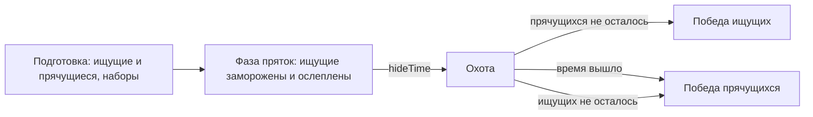

# Режим `hideseek` — Прятки

Прячущиеся разбегаются, пока ищущие стоят замороженными с завязанными глазами; потом начинается охота. Ищущие побеждают, когда прятаться больше некому; прячущиеся — когда время вышло или ищущих не осталось.

| | |
|---|---|
| Модуль | `mode_hideseek` (официальный пакет, `lua/nextcity/modules/mode_hideseek/`) |
| Режим | `hideseek`, от 2 игроков |
| Зависимости | `rounds`, `teams`, `players`; необязательно `inventory`, `loot`, `notices`, `hands` |
| Правила | `time_limit`, `teams` (две команды: «Прячущиеся» и «Ищущие»), `dead_mute`; `loot`, если модуль лута работает |
| Сеть | `phase` — время выхода ищущих (0 — никто не прячется) |
| Переводы | `lua/nextcity/lang/<код>/mode_hideseek.lua` |

## Раунд



| Фаза | Ищущие | Прячущиеся |
|---|---|---|
| Пряток (`hideTime`) | заморожены, экран чёрный с отсчётом до охоты; не наносят и не получают урона | прячутся; отсчёт под таймером раунда |
| Охота | ищут: убивают (`catch = kill`) или осаливают (`catch = tag`) | прячутся, бегут, могут отбиваться найденным лутом |

- **Ищущих** — четверть игроков (`seekers = 0`) или сколько задано, но хотя бы один и хотя бы один прячущийся остаётся.
- **Опоздавшие** входят прячущимися, пока идёт фаза пряток; во время охоты — наблюдают до следующего раунда.
- **Счёт команд** на экране — сколько в каждой живых.
- **Осаливание** (`catch = tag`): удар ищущего не ранит прячущегося, а переводит его к ищущим; в чат каждому — «Alyx поймал(а) Barney», ищущему — фраг.
- Мёртвые не говорят с живыми (`dead_mute`) и не выдают, кто где спрятался.

## Параметры

| Параметр | По умолчанию | Что задаёт |
|---|---|---|
| `roundTime` | 360 | длина раунда вместе с фазой пряток, с (60–3600); по истечении побеждают прячущиеся |
| `hideTime` | 60 | фаза пряток, с (5–600) |
| `seekers` | 0 | ищущих в раунде (0 — четверть игроков) |
| `catch` | `kill` | `kill` — ищущие убивают, `tag` — удар ищущего делает прячущегося ищущим |

`teams` (всегда 2) и `teamNames` правила `teams` режим задаёт сам.

```lua
-- lua/nextcity/config/server.lua своего пакета
settings = {
	rounds = {
		mode = "hideseek",
		params = { hideseek = { catch = "tag", hideTime = 45, roundTime = 300 } },
	},
},
```

## Наборы

| Набор | Состав | Кому |
|---|---|---|
| `hideseek_seeker` | USP, 45 патронов 9×19, монтировка | ищущим при `catch = kill` |

При `catch = tag` у ищущих только руки: осаливают ударом. Без инвентаря или без набора режим выдаёт оружие движка (`weapon_pistol`, `weapon_crowbar`) с предупреждением в логе. Наборы по режиму ловли и стороне — таблица `M.KITS` модуля.

## Проверить в реальном GMod

- Чёрный экран ищущего поверх мира, отсчёт, разморозка на выходе.
- Осаливание ударом рук и счёт живых в командах.
