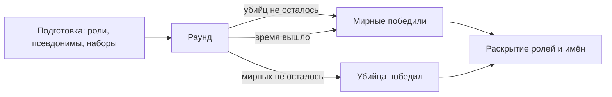

# Режим `homicide` — Хомисайд

Среди мирных прячется убийца. Роли скрыты, вместо имён — псевдонимы, смерти тихие, мёртвые не говорят с живыми. Убийца побеждает, когда мирных не осталось; мирные — когда убийца остановлен или время вышло.

| | |
|---|---|
| Модуль | `mode_homicide` (официальный пакет, `lua/nextcity/modules/mode_homicide/`) |
| Режим | `homicide`, от 3 игроков |
| Зависимости | `rounds`, `roles`, `players`; необязательно `inventory`, `loot`, `notices`, `hands` |
| Правила | `time_limit`, `roles`, `silent_deaths`, `dead_mute`; `loot`, если модуль лута работает |
| Компоненты | `alias` — номер псевдонима участника, виден всем |
| Отвечает | свёртка `players.name` — псевдоним вместо имени, пока идёт раунд |
| Переводы | `lua/nextcity/lang/<код>/mode_homicide.lua` |

## Роли

| Роль | Сторона | Кто знает | Снаряжение (стандарт) | Цель |
|---|---|---|---|---|
| Убийца (`murderer`) | `murderer` | сам и другие убийцы | нож | убить всех и не попасться |
| Шериф (`sheriff`) | `innocent` | только сам | револьвер «Кольт Питон» и 12 патронов .357 | найти и остановить убийцу |
| Мирный (`innocent`) | `innocent` | только сам | — | выжить и помочь найти убийцу |

Все появляются с пустыми руками: оружие в руках выдало бы роль. В конце раунда роли раскрываются, а в чат каждому приходит «Убийцей был Браво (Gordon)» и «Шерифом был …».

## Варианты

| `variant` | Что меняется |
|---|---|
| `standard` | у убийцы нож, у шерифа револьвер, лут карты как есть |
| `gunfree` | «Зона без оружия»: у шерифа дубинка вместо револьвера, огнестрела и патронов нет и в луте |
| `wildwest` | «Дикий Запад»: револьвер с 12 патронами у каждого, у убийцы ещё и нож |
| `random` | каждый раунд — один из трёх наугад |

Вариант объявляется всем в начале раунда (уведомление и строка в чате).



## Параметры

| Параметр | По умолчанию | Что задаёт |
|---|---|---|
| `roundTime` | 480 | длина раунда, с (60–3600); по истечении побеждают мирные |
| `variant` | `standard` | `standard`, `gunfree`, `wildwest` или `random` |
| `murderers` | 1 | убийц в раунде (1–8; хотя бы один мирный остаётся) |
| `sheriffs` | 1 | шерифов в раунде (0–8) |
| `penalty` | `drop` | что платит игрок стороны мирных, убивший мирного: `drop` — роняет огнестрел, `kill` — погибает, `none` — ничего |
| `aliases` | `true` | псевдонимы вместо имён |

```lua
-- lua/nextcity/config/server.lua своего пакета
settings = {
	rounds = {
		mode = "homicide",
		params = { homicide = { variant = "random", murderers = 2, roundTime = 600 } },
	},
},
```

## Псевдонимы

Каждый участник получает на раунд псевдоним из фонетического алфавита (`Alpha`, `Bravo`, … `Zulu`, дальше `Alpha 2`). Псевдоним показывают все места, где игроки видят имена ([`players:Name`](../../../../gamemodes/nextcity/gamemode/modules/players/README.md)): имя под прицелом, строки чата, итог раунда, наблюдение, медицина и тела. Килфида нет (`silent_deaths`), живые не слышат и не читают мёртвых и наблюдателей (`dead_mute`).

## Наборы

Наборы — в модуле `supplies` пакета; заменить снаряжение — зарегистрировать набор с тем же id в своём модуле.

| Набор | Состав | Кому |
|---|---|---|
| `homicide_murderer` | нож | убийце (`standard`, `gunfree`) |
| `homicide_murderer_wildwest` | нож, револьвер, 12 патронов .357 | убийце (`wildwest`) |
| `homicide_sheriff` | револьвер, 12 патронов .357 | шерифу (`standard`) |
| `homicide_sheriff_gunfree` | дубинка | шерифу (`gunfree`) |
| `homicide_wildwest` | револьвер, 12 патронов .357 | шерифу и мирным (`wildwest`) |

Без инвентаря или без набора режим выдаёт оружие движка (`weapon_crowbar`, `weapon_357`, `weapon_stunstick`) с предупреждением в логе.

## Проверить в реальном GMod

- Баннер роли и цель, псевдоним под прицелом, строки чата с псевдонимами, отсутствие килфида.
- Роняние револьвера шерифом после убийства мирного, подбор его другим игроком.
