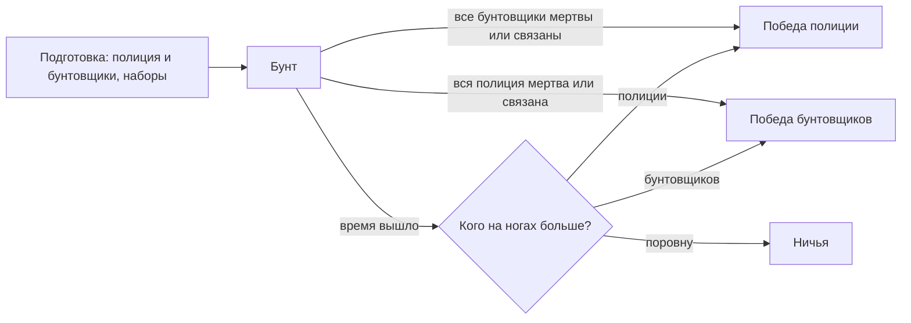

# Режим `riot` — Бунт

Полиция подавляет бунт: оглушает бунтовщиков дубинками и связывает стяжками. Бунтовщики отбиваются тем, что принесли и нашли, и развязывают своих. Мёртвый или связанный выбывает; побеждает сторона, у которой кто-то остался на ногах, а когда время вышло — та, у которой на ногах больше.

| | |
|---|---|
| Модуль | `mode_riot` (официальный пакет, `lua/nextcity/modules/mode_riot/`) |
| Режим | `riot`, от 2 игроков |
| Зависимости | `rounds`, `teams`, `players`; необязательно `inventory`, `loot`, `notices`, `restraints` |
| Правила | `time_limit`, `teams` (две команды: «Бунтовщики» и «Полиция»); `loot`, если модуль лута работает |
| Переводы | `lua/nextcity/lang/<код>/mode_riot.lua` |

## Раунд



| | Полиция | Бунтовщики |
|---|---|---|
| Сколько | треть игроков (`police = 0`) или сколько задано, но хотя бы один и хотя бы один бунтовщик остаётся | остальные |
| Снаряжение | шлем, бронежилет, дубинка, 6 стяжек; при `firearms` ещё USP | монтировка, 2 бутылки |
| Цель | связать или уложить всех бунтовщиков | одолеть полицию, не дать себя связать |

- **Связывание** — модуль [`restraints`](../../../../gamemodes/nextcity/gamemode/modules/restraints/README.md): клавиша `E` на игроке со стяжками в инвентаре, 3 с, пока он рядом. Удар дубинки может оглушить на 3–6 с — оглушённого (его тело) связать проще. Связывать можно только чужих, развязывать (4 с) — только своих: бунтовщики освобождают друг друга, полиция своих пленных не отпускает.
- За связанного противника — фраг; в чат каждому — «Alyx связал(а) Barney», «Gordon освободил(а) Barney».
- **Стоят на ногах** живые и несвязанные: это и счёт команд на экране, и условие победы.
- **Опоздавшие** во время подготовки идут в полицию, пока в ней меньше нужного для нового числа игроков, иначе — к бунтовщикам; во время бунта — наблюдают до следующего раунда.
- Без `firearms` в луте раунда нет стволов и патронов: бунт идёт врукопашную.

## Параметры

| Параметр | По умолчанию | Что задаёт |
|---|---|---|
| `roundTime` | 420 | длина раунда, с (60–3600); по истечении побеждают те, кого на ногах больше |
| `police` | 0 | полицейских в раунде (0 — треть игроков) |
| `firearms` | `false` | `true` — у полиции пистолеты, в луте есть стволы и патроны |

`teams` (всегда 2) и `teamNames` правила `teams` режим задаёт сам; огонь по своим — параметр `friendlyFire` правила.

```lua
-- lua/nextcity/config/server.lua своего пакета
settings = {
	rounds = {
		mode = "riot",
		params = { riot = { police = 3, firearms = true, roundTime = 600 } },
	},
},
```

## Наборы

| Набор | Состав | Кому |
|---|---|---|
| `riot_police` | шлем, бронежилет, дубинка, 6 стяжек | полиции |
| `riot_police_armed` | то же и USP с 30 патронами 9×19 | полиции при `firearms = true` |
| `riot_rioter` | монтировка, 2 бутылки | бунтовщикам |

В руках с начала раунда — холодное оружие набора (`select = { "melee", "secondary", "primary" }`). Без инвентаря или без набора режим выдаёт оружие движка (`weapon_stunstick`, `weapon_pistol`, `weapon_crowbar`) с предупреждением в логе; без модуля `restraints` бунт решают только убийства. Наборы по стороне — таблица `M.KITS` модуля.

## Проверить в реальном GMod

- Оглушение дубинкой и связывание тела оглушённого; разрыв связывания, когда бунтовщик отходит.
- Баланс: треть полиции в броне против монтировок и бутылок на картах разного размера.
